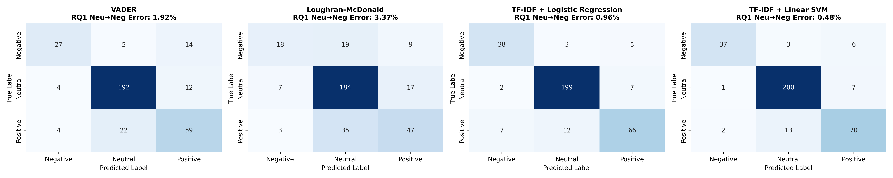
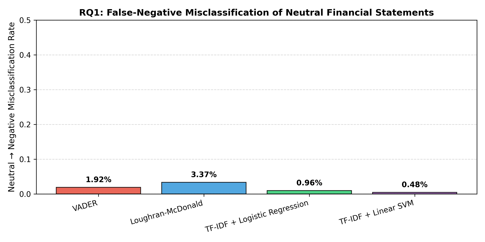
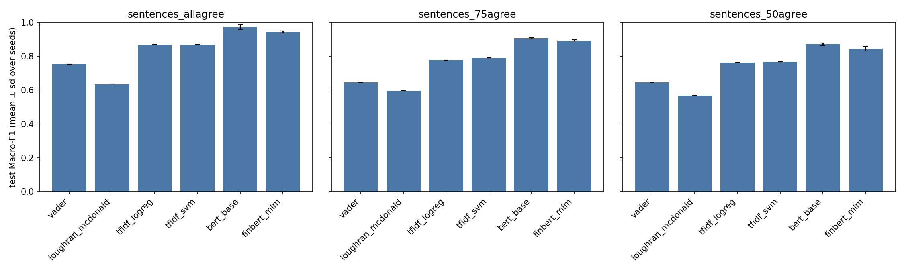
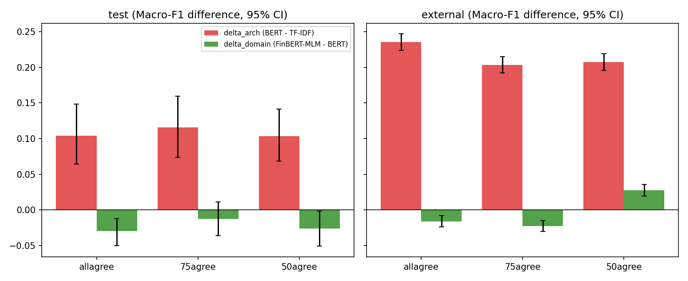
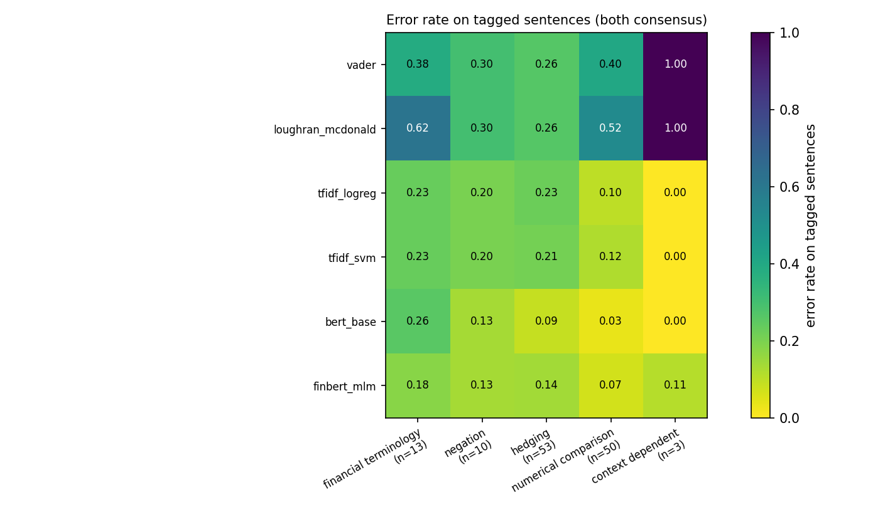
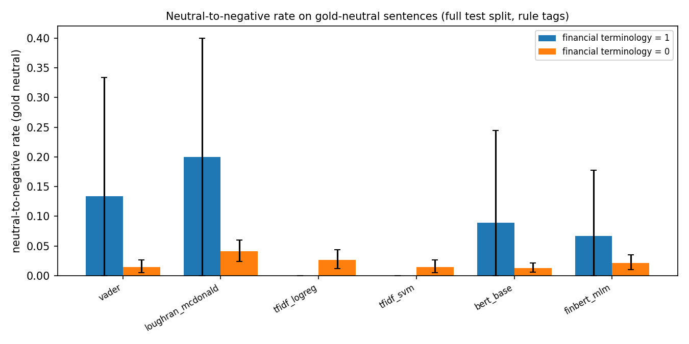

# Evaluating Domain Adaptation in Financial Sentiment Analysis

**FinBERT vs. Traditional NLP Baselines**  
*Authors: Qiyao Zheng, Benjamin Donick, Necati Furkan Colak*

[](https://colab.research.google.com/github/nfcolak/essential_text/blob/main/notebooks/step1_data_and_baselines_colab.ipynb)

## Overview

This repository contains the reproducible evaluation pipeline, leakage-free data splits, dataset provenance audit, and experiment code for our study on **domain adaptation in 3-class financial sentiment classification** (*positive*, *neutral*, *negative*).

### Research Questions
1. **RQ1 (Domain Polarity Mismatch):** To what extent do general-purpose sentiment methods misclassify financial language, particularly by falsely assigning *negative* polarity to *neutral* descriptive accounting statements (e.g., *cost*, *liability*, *debt*, *depreciation*)?
2. **RQ2 (Controlled Architecture vs. Domain Adaptation):** Under a strictly leakage-free evaluation protocol, how much classification improvement stems from domain-adaptive pretraining (`yiyanghkust/finbert-pretrain`) versus general-domain `bert-base-uncased` and traditional machine-learning baselines?
3. **RQ3 (Linguistic Phenomenon Attribution):** Which linguistic phenomena—financial terminology, negation, hedging, numerical comparisons, or context-dependent expressions—drive model divergence?

---

## Step 1 Experimental Results (Leakage-Free Splits & Tier 1/2 Baselines)

Full machine-readable artifacts are available in [`results/step1/`](results/step1/):
- **Detailed Report:** [`results/step1/STEP1_REPORT.md`](results/step1/STEP1_REPORT.md)
- **Summary Metrics & Calibration:** [`results/step1/summary_metrics.json`](results/step1/summary_metrics.json)
- **Statistical Significance Tests:** [`results/step1/statistical_comparisons.json`](results/step1/statistical_comparisons.json)
- **Dataset Provenance & Audit Verdict:** [`data/dataset_audit_verdict.json`](data/dataset_audit_verdict.json)

### 1. Dataset Partitioning & Leakage Audit (`seed=42`)

All datasets are downloaded from pinned upstream commits with SHA-256 verification (`FinancialPhraseBank-v1.0.zip` @ `8d3fe0c36d5feec6b3cc5e455b0fcb4820fb9964` and `SEntFiN.csv` @ `eba43610fe3cb57a3e5773cd6c037da1f8992ad5`). Near-duplicate sentences (token Jaccard $\ge 0.80$) are grouped via connected-component clustering and locked into identical partitions prior to splitting.

| Partition / Subset | Total Rows | Train (70%) | Val (15%) | Test (15%) | Cross-Split ID/Hash/Cluster Overlap | Max Cross-Split Token Jaccard |
|---|---:|---:|---:|---:|---:|---:|
| **Financial PhraseBank (`sentences_allagree`)** | 2,264 | 1,585 | 340 | 339 | `0` (**PASSED**) | `0.7857 < 0.80` (**PASSED**) |
| **Financial PhraseBank (`sentences_75agree`)** | 3,453 | 2,417 | 518 | 518 | `0` (**PASSED**) | `0.7895 < 0.80` (**PASSED**) |
| **Financial PhraseBank (`sentences_50agree`)** | 4,846 | 3,392 | 728 | 726 | `0` (**PASSED**) | `0.7917 < 0.80` (**PASSED**) |
| **External Holdout (`SEntFiN 1.0` unambiguous unique)** | 9,460 | — | — | 9,460 | `0` (**PASSED**) | `< 0.80` vs. PhraseBank (**PASSED**) |

### 2. Held-Out Test Set Performance (`Financial PhraseBank sentences_allagree`, $N = 339$)

| Model | Tier | Accuracy | Macro-F1 | Negative F1 | Neutral F1 | Positive F1 | ECE | RQ1 Neu→Neg Error Rate |
|---|---|---:|---:|---:|---:|---:|---:|---:|
| **VADER** | Tier 1 (Lexicon) | 0.8201 | **0.7534** | 0.6667 | 0.8993 | 0.6941 | 0.1410 | 1.92% (4 / 208) |
| **Loughran–McDonald** | Tier 1 (Lexicon) | 0.7345 | **0.6355** | 0.4865 | 0.8251 | 0.5949 | 0.2635 | 3.37% (7 / 208) |
| **TF-IDF + Logistic Regression** | Tier 2 (Linear ML) | 0.8938 | **0.8567** | 0.8172 | 0.9431 | 0.8098 | 0.0798 | 0.96% (2 / 208) |
| **TF-IDF + Linear SVM** | Tier 2 (Linear ML) | **0.9056** | **0.8791** | **0.8605** | **0.9434** | **0.8333** | **0.0366** | **0.48% (1 / 208)** |

### 3. 5-Fold Cross-Validation Performance (Training Partition, $N = 1,585$)

| Model | Mean Accuracy ($\pm$ Std) | Mean Macro-F1 ($\pm$ Std) | Mean Neu→Neg Rate ($\pm$ Std) |
|---|---:|---:|---:|
| **VADER** | $0.8000 \pm 0.0242$ | **$0.7165 \pm 0.0371$** | $0.0082 \pm 0.0025$ |
| **Loughran–McDonald** | $0.7319 \pm 0.0187$ | **$0.6181 \pm 0.0267$** | $0.0215 \pm 0.0104$ |
| **TF-IDF + Logistic Regression** | $0.8593 \pm 0.0240$ | **$0.8003 \pm 0.0419$** | $0.0123 \pm 0.0106$ |
| **TF-IDF + Linear SVM** | **$0.8732 \pm 0.0131$** | **$0.8181 \pm 0.0276$** | **$0.0041 \pm 0.0039$** |

### 4. Deduplicated External Holdout Generalization (`SEntFiN 1.0`, $N = 9,460$)

| Model | Accuracy | Macro-F1 | Negative F1 | Neutral F1 | Positive F1 | ECE | Neu→Neg Error Rate |
|---|---:|---:|---:|---:|---:|---:|---:|
| **VADER** | **0.6344** | **0.6242** | 0.5757 | **0.6589** | **0.6380** | 0.3335 | 3.64% |
| **Loughran–McDonald** | 0.5921 | 0.5850 | **0.5917** | 0.6205 | 0.5429 | 0.4049 | 6.37% |
| **TF-IDF + Logistic Regression** | 0.4921 | 0.4440 | 0.3304 | 0.5781 | 0.4235 | **0.2117** | 2.08% |
| **TF-IDF + Linear SVM** | 0.4895 | 0.4353 | 0.3235 | 0.5796 | 0.4029 | 0.4093 | **1.23%** |

> **Key Finding on Out-of-Distribution Generalization:** While TF-IDF + Linear SVM achieves strong in-domain performance on Financial PhraseBank (`Macro-F1 = 0.8791`), its performance drops sharply on the external `SEntFiN 1.0` entity-headline holdout (`Macro-F1 = 0.4353`) due to n-gram vocabulary shift between corporate earnings sentences and financial news headlines. Rule-based lexicons generalize more gracefully (`VADER Macro-F1 = 0.6242`), motivating our Step 2 contextual transformer investigation (`bert-base-uncased` vs. `yiyanghkust/finbert-pretrain`).

### 5. Statistical Significance Comparisons (Held-Out Test Set, $B = 10,000$ Paired Bootstrap)

| Comparison (Model A vs. Model B) | McNemar $\chi^2$ | McNemar $p$-value | $\Delta$Macro-F1 (95% CI) | Bootstrap $p$-value | Significant ($p < 0.05$) |
|---|---:|---:|---:|---:|---|
| **VADER vs. Loughran–McDonald** | 14.792 | 0.0001 | $+0.1178\ [+0.0609, +0.1776]$ | 0.0000 | **Yes ($p < 0.05$)** |
| **VADER vs. TF-IDF + Logistic Regression** | 7.890 | 0.0046 | $-0.1034\ [-0.1772, -0.0285]$ | 0.0070 | **Yes ($p < 0.05$)** |
| **VADER vs. TF-IDF + Linear SVM** | 10.453 | 0.0011 | $-0.1257\ [-0.1999, -0.0510]$ | 0.0007 | **Yes ($p < 0.05$)** |
| **Loughran–McDonald vs. TF-IDF + Logistic Regression** | 25.536 | 0.0000 | $-0.2212\ [-0.3098, -0.1345]$ | 0.0000 | **Yes ($p < 0.05$)** |
| **Loughran–McDonald vs. TF-IDF + Linear SVM** | 29.536 | 0.0000 | $-0.2436\ [-0.3310, -0.1573]$ | 0.0000 | **Yes ($p < 0.05$)** |
| **TF-IDF + Logistic Regression vs. TF-IDF + Linear SVM** | 0.900 | 0.3438 | $-0.0223\ [-0.0512, +0.0038]$ | 0.1064 | **No** |

### 6. Visualizations

#### Confusion Matrices Across Baselines


#### RQ1 Neutral-to-Negative Misclassification Comparison


---

## Step 2 Results: Controlled Transformer Fine-Tuning (RQ2)

Full artifacts: [`results/step2/`](results/step2/) ([`STEP2_REPORT.md`](results/step2/STEP2_REPORT.md),
`summary_metrics.json`, `statistical_comparisons.json`, `attribution.json`, figures) and one directory per run in
`results/step2/runs/<config>/<model>/<tag>/` with `result.json` and per-sentence probabilities (`predictions.npz`).

**Protocol.** `google-bert/bert-base-uncased` (general domain) and `yiyanghkust/finbert-pretrain` (financial MLM,
no sentiment supervision) are fine-tuned with one shared recipe (AdamW, lr 2e-5, batch 16, max length 128, 10%
warmup, weight decay 0.01, gradient clipping 1.0, at most 5 epochs, patience 2) on the identical locked Step 1
splits of each PhraseBank agreement level, 3 seeds each (42, 100, 2026). The epoch is chosen by validation Macro-F1
only; test and SEntFiN 1.0 are scored once. Off-the-shelf `ProsusAI/finbert` was trained on PhraseBank, so it is
scored **only** on SEntFiN 1.0 (zero-shot). All four Step 1 baselines were refit in the same environment so every
paired test compares predictions on identical sentences. Hugging Face revisions are pinned in
`src/transformer/finetune.py`. Runs: 61 (12 baseline, 18 fine-tune, 30 CV, 1 zero-shot) on Apple MPS.

### In-domain test Macro-F1 (mean ± sd over 3 seeds; baselines are deterministic)

| Model | allagree (N = 339) | 75agree (N = 518) | 50agree (N = 726) |
|---|---:|---:|---:|
| VADER | 0.753 | 0.646 | 0.645 |
| Loughran–McDonald | 0.636 | 0.597 | 0.567 |
| TF-IDF + Logistic Regression | 0.869 | 0.776 | 0.762 |
| TF-IDF + Linear SVM | 0.870 | 0.791 | 0.768 |
| `bert-base-uncased` | **0.974 ± 0.013** | **0.906 ± 0.004** | **0.872 ± 0.007** |
| FinBERT-MLM (`finbert-pretrain`) | 0.944 ± 0.005 | 0.894 ± 0.004 | 0.846 ± 0.014 |

### External SEntFiN 1.0 Macro-F1 (N = 9,460; models trained on each PhraseBank level)

| Model | trained on allagree | trained on 75agree | trained on 50agree |
|---|---:|---:|---:|
| VADER | 0.624 | 0.625 | 0.624 |
| Loughran–McDonald | 0.585 | 0.585 | 0.585 |
| TF-IDF + Logistic Regression | 0.451 | 0.475 | 0.475 |
| TF-IDF + Linear SVM | 0.450 | 0.472 | 0.469 |
| `bert-base-uncased` | 0.685 ± 0.021 | 0.676 ± 0.012 | 0.676 ± 0.018 |
| FinBERT-MLM | 0.669 ± 0.028 | 0.653 ± 0.047 | 0.704 ± 0.010 |
| `ProsusAI/finbert` (off-the-shelf, zero-shot) | **0.727** | | |

5-fold CV on the allagree training partition (scored on the fold used for epoch selection, so optimistic):
`bert-base-uncased` 0.950 ± 0.013, FinBERT-MLM 0.952 ± 0.013, TF-IDF + SVM 0.816 ± 0.028, VADER 0.716 ± 0.041.

### Architecture vs. domain-pretraining attribution (ΔMacro-F1, seed-averaged paired bootstrap, B = 10,000)

`Δarch` = BERT − best TF-IDF model (chosen by **validation** Macro-F1; SVM in every config).
`Δdomain` = FinBERT-MLM − BERT.

| Config | Split | Δarch [95% CI] | Δdomain [95% CI] |
|---|---|---:|---:|
| allagree | test | +0.104 [+0.064, +0.148] | −0.029 [−0.050, −0.012] |
| 75agree | test | +0.116 [+0.074, +0.159] | −0.012 [−0.036, +0.011] |
| 50agree | test | +0.104 [+0.069, +0.141] | −0.026 [−0.051, −0.002] |
| allagree | SEntFiN | +0.235 [+0.224, +0.247] | −0.016 [−0.024, −0.008] |
| 75agree | SEntFiN | +0.203 [+0.192, +0.215] | −0.023 [−0.030, −0.015] |
| 50agree | SEntFiN | +0.207 [+0.195, +0.219] | +0.028 [+0.019, +0.036] |

**Reading.** Almost all of the gain over traditional baselines comes from the contextual architecture (+0.10
in-domain, +0.20 to +0.24 on SEntFiN). Under one shared recipe, domain-adaptive MLM pretraining does not add to
it in-domain (−0.01 to −0.03) and helps out-of-distribution only when trained on the noisiest 50agree labels
(+0.028). The off-the-shelf `ProsusAI/finbert` is best on SEntFiN, but it also had more sentiment supervision
(all of PhraseBank), so it is a reference point rather than a controlled comparison. Pairwise McNemar tests with
Holm–Bonferroni correction and per-seed p-values are in `results/step2/statistical_comparisons.json` and the report.




---

## Step 3 Results: Linguistic Phenomenon Attribution (RQ1, RQ3)

Full artifacts: [`results/step3/`](results/step3/) ([`STEP3_REPORT.md`](results/step3/STEP3_REPORT.md),
`annotation_agreement.json`, `phenomenon_analysis.json`, figures) and the diagnostic set in
[`data/diagnostic/`](data/diagnostic/).

**Diagnostic set.** 300 sentences, label-stratified, drawn only from the `sentences_50agree` **test** split
(seed 42; 37 negative, 178 neutral, 85 positive). Each sentence is tagged for five phenomena: financial
terminology, negation, hedging, numerical comparison, context-dependent polarity
([`annotation/GUIDELINES.md`](annotation/GUIDELINES.md)).

**Annotators are LLMs, not humans.** Annotator A was Claude Sonnet 5.5 and annotator B was Gemini 3.8 Flash.
Each worked blind (text only: no gold label, no prediction, no rule tags, never the other annotator's file) and
tagged every sentence by reading it, not by keyword scripts. A third reference is the rule-based tagger
`src/analysis/phenomena.py`. Consensus tags require both annotators.

| Phenomenon | κ A–B | κ A–rules | κ B–rules | consensus n |
|---|---:|---:|---:|---:|
| financial terminology | 0.961 | 0.925 | 0.961 | 13 |
| negation | 1.000 | 1.000 | 1.000 | 10 |
| hedging | 0.893 | 0.778 | 0.827 | 53 |
| numerical comparison | 0.965 | 0.852 | 0.840 | 50 |
| context-dependent | 0.593 | 0.855 | 0.662 | 3 |

Agreement is high partly because the guideline defines each phenomenon with explicit cue words, so both LLMs
and the rule tagger look at the same cues. Subsets with n < 20 are flagged as unreliable in the report.

**Error rate on the diagnostic subset (seed mean).** Hedging (n = 53): VADER 0.264, TF-IDF + SVM 0.208,
BERT 0.088, FinBERT-MLM 0.138. Numerical comparison (n = 50): VADER 0.400, Loughran–McDonald 0.520,
TF-IDF + SVM 0.120, BERT 0.033, FinBERT-MLM 0.067. The architecture effect on hedging is +0.119 accuracy
[+0.019, +0.233]; the domain effect is not distinguishable from zero on any phenomenon in this subset.

**RQ1 (accounting terms → false negative).** On SEntFiN 1.0, gold-neutral headlines that contain a financial
term (rule tags, n = 150) are labelled negative far more often than other neutral headlines (n = 3,259):
VADER 0.367 vs 0.021, Loughran–McDonald 0.513 vs 0.043, BERT 0.358 vs 0.035, FinBERT-MLM 0.311 vs 0.048
(models trained on allagree), ProsusAI 0.393 vs 0.110. Inside PhraseBank test splits the same subsets hold only
7–15 sentences, too few for a conclusion.




### Caveats

- One shared fine-tuning recipe, no per-model hyperparameter search; FinBERT-MLM may need a different learning
  rate or more epochs, so `Δdomain` measures "domain pretraining under the BERT recipe".
- The Step 1 tables come from Google Colab. Rerun locally, the splits and lexicon baselines are identical, while
  TF-IDF Macro-F1 moves by up to 0.012 (different scikit-learn/scipy builds). Steps 2 and 3 use the local refit
  throughout, which is why their TF-IDF numbers differ slightly from Step 1.
- Six fine-tunes first hit Apple MPS "Insufficient Memory" command-buffer errors (four with NaN loss). They were
  quarantined and rerun in fresh processes with zero errors; the trainer now fails a run on a non-finite loss.

---

## Quick Start

### 1. Step 1 (data, splits, baselines)
```bash
python3 colab/run_step1_colab.py --mode full --execute --fpb-config all --out-dir results/step1 --splits-dir data/splits --bootstrap-samples 10000
```
`--fpb-config all` writes the locked manifests of all three agreement levels to `data/splits/` (git-ignored,
regenerated deterministically; Step 2 runs record their SHA-256).

### 2. Step 2 (fine-tuning matrix, resumable; prints the plan without `--execute`)
```bash
python3 scripts/run_step2.py --stage all --execute
python3 scripts/summarize_step2.py --runs-dir results/step2/runs --out-dir results/step2 --bootstrap-samples 10000
```

### 3. Step 3 (diagnostic set and phenomenon analysis)
```bash
python3 scripts/build_diagnostic_set.py --execute          # 300-sentence subset, key and rule tags
python3 scripts/run_step3_analysis.py                      # needs data/diagnostic/annotations_{a,b}.csv
```

### 4. Unit tests (offline, synthetic fixtures, tiny local models)
```bash
HF_HUB_OFFLINE=1 python3 -m unittest discover -s tests -v
```

---

## Repository Structure

```text
essential_text/
├── AGENTS.md                  # Shared project rules and leakage-free methodology constraints
├── README.md                  # Project overview, results, and usage instructions
├── requirements.txt           # Python dependencies (incl. torch, transformers)
├── annotation/
│   └── GUIDELINES.md          # Five-phenomenon annotation guideline
├── data/
│   ├── dataset_audit_verdict.json  # Pinned SHA-256 dataset provenance and row-level audit
│   └── diagnostic/            # 300-sentence diagnostic set: items, key, rule tags, LLM annotations A/B
├── proposal/                  # Revised proposal (LaTeX/PDF), rubric audit, verification script
├── results/
│   ├── step1/                 # Step 1 outputs from Google Colab
│   ├── step2/                 # Step 2 report, statistics, attribution, figures, runs/ with per-run predictions
│   └── step3/                 # Step 3 report, agreement, phenomenon analysis, figures
├── scripts/
│   ├── run_step2.py           # Resumable Step 2 run matrix (baselines, fine-tune, CV, zero-shot)
│   ├── summarize_step2.py     # Multi-seed statistics, McNemar + Holm, bootstrap, attribution, figures
│   ├── build_diagnostic_set.py
│   └── run_step3_analysis.py  # Cohen's kappa, per-phenomenon errors and attribution, RQ1 analysis
├── src/
│   ├── data/                  # Hashing, Jaccard >= 0.80 clustering, split locking, dedup, IO helpers
│   ├── baselines/             # Tier 1 (VADER, Loughran-McDonald) & Tier 2 (TF-IDF + LR/SVM)
│   ├── transformer/           # Tier 3 fine-tuning and zero-shot scoring (PyTorch + Hugging Face)
│   ├── evaluation/            # Metrics, ECE, McNemar, paired bootstrap, multi-seed statistics
│   └── analysis/              # Phenomenon tagger and per-phenomenon attribution
├── colab/
│   └── run_step1_colab.py     # End-to-end Step 1 pipeline runner (smoke & full mode)
├── notebooks/
│   ├── build_step1_notebook.py
│   └── step1_data_and_baselines_colab.ipynb
└── tests/                     # Offline unittest suite (114 tests)
```
