# Evaluating Domain Adaptation in Financial Sentiment Analysis

**FinBERT vs. Traditional NLP Baselines**  
*Authors: Qiyao Zheng, Benjamin Donick, Necati Furkan Colak*

[](https://colab.research.google.com/github/nfcolak/essential_text/blob/main/notebooks/step1_data_and_baselines_colab.ipynb)

## Overview

This repository contains the reproducible evaluation pipeline, leakage-free data splits, dataset provenance audit, and experiment code for our study on **domain adaptation in 3-class financial sentiment classification** (*positive*, *neutral*, *negative*).

### Research Questions

1. **RQ1 (Domain Polarity Mismatch):** To what extent do general-purpose sentiment methods misclassify financial language, particularly by falsely assigning *negative* polarity to *neutral* descriptive accounting statements (e.g., *cost*, *liability*, *debt*, *depreciation*)?
2. **RQ2 (Controlled Architecture vs. Domain Adaptation):** Under a strictly leakage-free evaluation protocol, how much classification improvement stems from domain-adaptive pretraining (`yiyanghkust/finbert-pretrain`) versus general-domain `bert-base-uncased` and traditional machine-learning baselines?
3. **RQ3 (Linguistic Phenomenon Attribution):** Which linguistic phenomena—financial terminology, negation, hedging, numerical comparisons, or context-dependent expressions—drive model divergence?

### Results at a Glance

Macro-F1; models trained on `sentences_allagree`, fine-tuned models averaged over 3 seeds. Details, intervals and tests are in the Step 2 and Step 3 sections below.

The following table reports the original Step 2 results under a shared fine-tuning configuration. Independently tuned transformer results are presented in **Step 4**.

| Model | PhraseBank test (N = 339) | SEntFiN 1.0 (N = 9,460) |
|---|---:|---:|
| `bert-base-uncased` | **0.974** | 0.685 |
| FinBERT-MLM (`yiyanghkust/finbert-pretrain`) | 0.944 | 0.669 |
| TF-IDF + Linear SVM | 0.870 | 0.450 |
| VADER (official lexicon) | 0.500 | 0.525 |
| Loughran–McDonald (official dictionary) | 0.498 | 0.466 |
| `ProsusAI/finbert` (off-the-shelf, zero-shot; SEntFiN only) | – | **0.727** |

- **The pretrained encoder drives the gain:** BERT beats TF-IDF by about +0.10 in-domain and +0.20 to +0.24 on SEntFiN (all intervals exclude zero).
- **Financial pretraining adds nothing measurable** under one shared recipe: FinBERT-MLM is 0.01–0.03 below BERT in-domain; the only positive cell is SEntFiN after 50agree training (+0.03).
- **RQ1:** the general-purpose VADER lexicon recovers 14–34 points fewer gold-neutral sentences than Loughran–McDonald; the fine-tuned encoders show no such gap.
- **Domain shift remains large:** the best controlled model reaches about 0.69 Macro-F1 on SEntFiN.
- **Main open question from Step 2:** FinBERT-MLM was not tuned separately, so its lag may reflect the shared recipe. It also
  uses its own vocabulary (only about 42% of BERT's word pieces are shared), so `Δdomain` measures corpus,
  vocabulary and pretraining budget together. A controlled arm (BERT further pretrained on 42M tokens of 10-K text,
  same vocabulary) moves BERT by at most about 0.03 with no consistent sign; where FinBERT-MLM wins (Twitter
  Financial News, +0.03 to +0.05), the gain comes from its own vocabulary and much larger corpus
  (see [Extensions](#extensions-post-hoc-robustness-checks)).

**Step 4 follow-up findings (independent tuning, same environment as Step 2):**

- **Same recipe chosen for both:** validation Macro-F1 selects learning rate 3e-5 and batch size 32 for BERT-base and
  FinBERT-MLM (for BERT by a noise-level margin of 0.002).
- **With five seeds the in-domain BERT lead is not demonstrated.** PhraseBank test, BERT − FinBERT:
  - fixed recipe: +0.023 [−0.002, +0.050];
  - tuned recipe: +0.012 [−0.010, +0.034].
  - With the three pre-specified seeds the fixed-recipe gap was +0.030 [+0.006, +0.057].
- **On SEntFiN the tuned FinBERT-MLM is ahead:** +0.023 [+0.002, +0.048] with five seeds, against +0.017 [−0.004, +0.044]
  with three. This is the only BERT-vs-FinBERT interval that excludes zero, and it just does.
- **Interpretation (post hoc, five seeds; the three pre-specified seeds show no difference after tuning on either
  test set):** part of FinBERT-MLM's Step 2 lag came from the shared recipe. Financial pretraining gives at most
  a small out-of-domain advantage after tuning, and no in-domain one (see
  [Step 4](#step-4-results-independent-hyperparameter-tuning-rq2)).

**Upgrade round (post hoc):**

- **A zero-shot local LLM generalises far better than any PhraseBank-trained model.** `qwen2.5:7b` (temperature 0)
  versus BERT-base trained on PhraseBank:
  - in-domain it is 0.04 below (0.934 on PhraseBank test);
  - out of domain it is far ahead: SEntFiN +0.14 (0.825), FiQA +0.22 (0.603), Twitter +0.11 (0.743), all intervals far
    from zero. It also beats off-the-shelf ProsusAI/finbert on SEntFiN (0.727).
  - The LLM may have seen these public datasets during pretraining
    ([Extensions §5](#5-zero-shot-llm-baseline-scriptsrun_llm_zeroshotpy)).
- **The whole 50agree test split (726 sentences) is now phenomenon-annotated,** with the same blind LLM annotators.
  Negation grows from about 10 to 25 sentences and financial terminology to 38; the domain effect stays
  indistinguishable from zero in every phenomenon ([Step 3](#full-50agree-test-split-726-sentences)).
---

## Step 1 Experimental Results (Leakage-Free Splits & Tier 1/2 Baselines)

Full machine-readable artifacts are available in [`results/step1/`](results/step1/):

- **Detailed Report:** [`results/step1/STEP1_REPORT.md`](results/step1/STEP1_REPORT.md)
- **Summary Metrics & Calibration:** [`results/step1/summary_metrics.json`](results/step1/summary_metrics.json)
- **Statistical Significance Tests:** [`results/step1/statistical_comparisons.json`](results/step1/statistical_comparisons.json)
- **Dataset Provenance & Audit Verdict:** [`data/dataset_audit_verdict.json`](data/dataset_audit_verdict.json)

> **Important: what "VADER" and "Loughran–McDonald" mean in this Step 1 section.** The Step 1 Tier 1 rows were produced by the project's own embedded word lists in [`src/baselines/lexicon.py`](src/baselines/lexicon.py), not by the published lexicons: a 200-entry VADER-style list and 462 positive / 710 negative LM-style lists, in which 23 accounting terms (for example *cost*, *debt*, *liability*, *depreciation*) are forced to neutral and whose decision thresholds are tuned on the validation split. These lists already encode the answer to RQ1, so they are reported as **finance-adjusted, custom** variants. Step 2 adds the **official** lexicons (vaderSentiment 3.3.2 with its 7,506-entry lexicon and the fixed ±0.05 compound rule; the Loughran–McDonald Master Dictionary 1993–2025 with 354 positive / 2,355 negative words and plain counting) as the headline Tier 1 baselines. The official lexicons score about 0.50 Macro-F1 in-domain, well below the custom lists (0.57–0.75).

### 1. Dataset Partitioning & Leakage Audit (`seed=42`)

All datasets are downloaded from pinned upstream commits with SHA-256 verification (`FinancialPhraseBank-v1.0.zip` @ `8d3fe0c36d5feec6b3cc5e455b0fcb4820fb9964` and `SEntFiN.csv` @ `eba43610fe3cb57a3e5773cd6c037da1f8992ad5`). Near-duplicate sentences (token Jaccard $\ge 0.80$) are grouped via connected-component clustering and locked into identical partitions prior to splitting.

| Partition / Subset | Total Rows | Train (70%) | Val (15%) | Test (15%) | Cross-Split ID/Hash/Cluster Overlap | Max Cross-Split Token Jaccard |
|---|---:|---:|---:|---:|---:|---:|
| **Financial PhraseBank (`sentences_allagree`)** | 2,264 | 1,585 | 340 | 339 | `0` (**PASSED**) | `0.7857 < 0.80` (**PASSED**) |
| **Financial PhraseBank (`sentences_75agree`)** | 3,453 | 2,417 | 518 | 518 | `0` (**PASSED**) | `0.7895 < 0.80` (**PASSED**) |
| **Financial PhraseBank (`sentences_50agree`)** | 4,846 | 3,392 | 728 | 726 | `0` (**PASSED**) | `0.7917 < 0.80` (**PASSED**) |
| **External Holdout (`SEntFiN 1.0` unambiguous unique)** | 9,460 | — | — | 9,460 | `0` (**PASSED**) | `< 0.80` vs. PhraseBank (**PASSED**) |

### 2. Held-Out Test Set Performance (`Financial PhraseBank sentences_allagree`, $N = 339$)

| Model | Tier | Accuracy | Macro-F1 | Negative F1 | Neutral F1 | Positive F1 | ECE | RQ1 Neu→Neg Error Rate |
|---|---|---:|---:|---:|---:|---:|---:|---:|
| **VADER-style (finance-adjusted, custom)** | Tier 1 (Lexicon) | 0.8201 | **0.7534** | 0.6667 | 0.8993 | 0.6941 | 0.1410 | 1.92% (4 / 208) |
| **LM-style (finance-adjusted, custom)** | Tier 1 (Lexicon) | 0.7345 | **0.6355** | 0.4865 | 0.8251 | 0.5949 | 0.2635 | 3.37% (7 / 208) |
| **TF-IDF + Logistic Regression** | Tier 2 (Linear ML) | 0.8938 | **0.8567** | 0.8172 | 0.9431 | 0.8098 | 0.0798 | 0.96% (2 / 208) |
| **TF-IDF + Linear SVM** | Tier 2 (Linear ML) | **0.9056** | **0.8791** | **0.8605** | **0.9434** | **0.8333** | **0.0366** | **0.48% (1 / 208)** |

### 3. 5-Fold Cross-Validation Performance (Training Partition, $N = 1,585$)

| Model | Mean Accuracy ($\pm$ Std) | Mean Macro-F1 ($\pm$ Std) | Mean Neu→Neg Rate ($\pm$ Std) |
|---|---:|---:|---:|
| **VADER-style (custom)** | $0.8000 \pm 0.0242$ | **$0.7165 \pm 0.0371$** | $0.0082 \pm 0.0025$ |
| **LM-style (custom)** | $0.7319 \pm 0.0187$ | **$0.6181 \pm 0.0267$** | $0.0215 \pm 0.0104$ |
| **TF-IDF + Logistic Regression** | $0.8593 \pm 0.0240$ | **$0.8003 \pm 0.0419$** | $0.0123 \pm 0.0106$ |
| **TF-IDF + Linear SVM** | **$0.8732 \pm 0.0131$** | **$0.8181 \pm 0.0276$** | **$0.0041 \pm 0.0039$** |

### 4. Deduplicated External Holdout Generalization (`SEntFiN 1.0`, $N = 9,460$)

| Model | Accuracy | Macro-F1 | Negative F1 | Neutral F1 | Positive F1 | ECE | Neu→Neg Error Rate |
|---|---:|---:|---:|---:|---:|---:|---:|
| **VADER-style (custom)** | **0.6344** | **0.6242** | 0.5757 | **0.6589** | **0.6380** | 0.3335 | 3.64% |
| **LM-style (custom)** | 0.5921 | 0.5850 | **0.5917** | 0.6205 | 0.5429 | 0.4049 | 6.37% |
| **TF-IDF + Logistic Regression** | 0.4921 | 0.4440 | 0.3304 | 0.5781 | 0.4235 | **0.2117** | 2.08% |
| **TF-IDF + Linear SVM** | 0.4895 | 0.4353 | 0.3235 | 0.5796 | 0.4029 | 0.4093 | **1.23%** |

> **Key finding on out-of-distribution generalization.** TF-IDF + Linear SVM is strong in-domain on Financial PhraseBank (Macro-F1 0.8791) but drops sharply on the external `SEntFiN 1.0` headline holdout (Macro-F1 0.4353), a vocabulary shift from company-report sentences to news headlines. The lexicon baselines drop less. This also holds for the official lexicons added in Step 2 (VADER 0.525, Loughran–McDonald 0.466 on SEntFiN vs 0.450 for TF-IDF + SVM), but less clearly than the custom VADER-style list (0.624) suggests.

### 5. Statistical Significance Comparisons (Held-Out Test Set, $B = 10,000$ Paired Bootstrap)

| Comparison (Model A vs. Model B) | McNemar $\chi^2$ | McNemar $p$-value | $\Delta$Macro-F1 (95% CI) | Bootstrap $p$-value | Significant ($p < 0.05$) |
|---|---:|---:|---:|---:|---|
| **VADER-style vs. LM-style (custom)** | 14.792 | 0.0001 | $+0.1178\ [+0.0609, +0.1776]$ | 0.0000 | **Yes ($p < 0.05$)** |
| **VADER-style (custom) vs. TF-IDF + Logistic Regression** | 7.890 | 0.0046 | $-0.1034\ [-0.1772, -0.0285]$ | 0.0070 | **Yes ($p < 0.05$)** |
| **VADER-style (custom) vs. TF-IDF + Linear SVM** | 10.453 | 0.0011 | $-0.1257\ [-0.1999, -0.0510]$ | 0.0007 | **Yes ($p < 0.05$)** |
| **LM-style (custom) vs. TF-IDF + Logistic Regression** | 25.536 | 0.0000 | $-0.2212\ [-0.3098, -0.1345]$ | 0.0000 | **Yes ($p < 0.05$)** |
| **LM-style (custom) vs. TF-IDF + Linear SVM** | 29.536 | 0.0000 | $-0.2436\ [-0.3310, -0.1573]$ | 0.0000 | **Yes ($p < 0.05$)** |
| **TF-IDF + Logistic Regression vs. TF-IDF + Linear SVM** | 0.900 | 0.3438 | $-0.0223\ [-0.0512, +0.0038]$ | 0.1064 | **No** |

### 6. Visualizations

#### Confusion Matrices Across Baselines

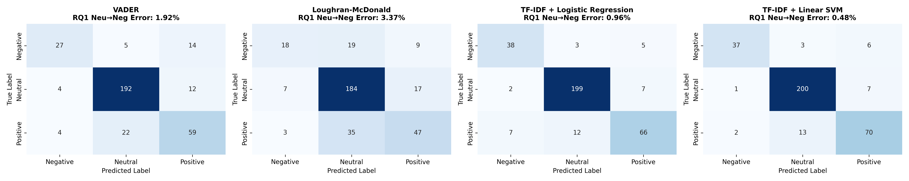

#### RQ1 Neutral-to-Negative Misclassification Comparison

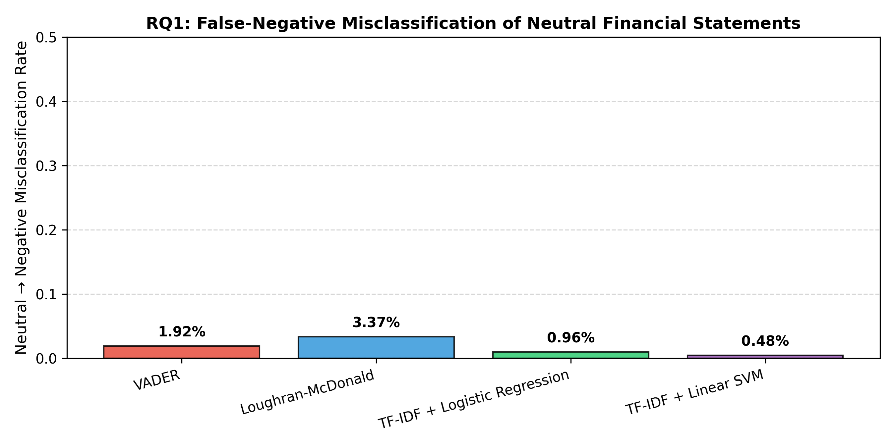

---

## Step 2 Results: Controlled Transformer Fine-Tuning (RQ2)

Full artifacts: [`results/step2/`](results/step2/) ([`STEP2_REPORT.md`](results/step2/STEP2_REPORT.md),
`summary_metrics.json`, `statistical_comparisons.json`, `attribution.json`, `rq1_boundary.json`, figures) and one
directory per run in
`results/step2/runs/<config>/<model>/<tag>/` with `result.json` and per-sentence probabilities (`predictions.npz`).

**Protocol.** `google-bert/bert-base-uncased` (general domain) and `yiyanghkust/finbert-pretrain` (financial MLM,
no sentiment supervision) are fine-tuned with one shared recipe (AdamW, lr 2e-5, batch 16, max length 128, 10%
warmup, weight decay 0.01, gradient clipping 1.0, at most 5 epochs, patience 2) on the identical locked splits of
each PhraseBank agreement level (allagree from Step 1; 75agree and 50agree produced locally with the same Step 1 code
and seed, `--fpb-config all`, all three pinned in `data/splits/SHA256SUMS`), 3 seeds each (42, 100, 2026). The epoch is chosen by validation Macro-F1
only; test and SEntFiN 1.0 are scored once. Off-the-shelf `ProsusAI/finbert` was trained on PhraseBank, so it is
scored **only** on SEntFiN 1.0 (zero-shot). All baselines were refit in the same environment, so every paired test
compares predictions on identical sentences. Tier 1 has three variants: the plain official lexicons with their
fixed published rules; the proposal's specification, i.e. the official lexicons with decision thresholds tuned on the
validation split (and 3-token negation handling for Loughran–McDonald); and the custom finance-adjusted lists from
Step 1. TF-IDF models tune C ∈ {0.01, 0.1, 1, 10} and the class weight on validation (C = 1 or 10 was chosen in every
run). Hugging Face revisions are pinned in `src/transformer/finetune.py`; split files are checked against
`data/splits/SHA256SUMS` before every run. Runs: 93 (24 baseline, 18 fine-tune, 50 CV, 1 zero-shot); the 28
transformer runs on Apple MPS, the 65 lexicon and TF-IDF runs on CPU (Python 3.9.6, torch 2.8.0, transformers 4.57.6, scikit-learn 1.6.1; exact versions in `requirements-lock.txt`).

### Transformer Setup: Independent Hyperparameter Tuning

To further investigate RQ2, we extended the controlled transformer experiments with an independent hyperparameter tuning study for BERT-base and FinBERT-MLM. The original Step 2 experiments used an identical fine-tuning configuration for both models, ensuring comparability but leaving open the possibility that the observed performance gap was partially attributable to hyperparameter sensitivity.

**Model Selection.** We retained the two pretrained checkpoints used in Step 2:

- **BERT-base:** `google-bert/bert-base-uncased`, pretrained on general-domain text.
- **FinBERT-MLM:** `yiyanghkust/finbert-pretrain`, a financial-domain BERT checkpoint trained with masked language modeling.

Unlike the off-the-shelf `ProsusAI/finbert` model, FinBERT-MLM had not undergone supervised financial sentiment classification training. This allows us to examine financial-domain pretraining without introducing additional sentiment-label supervision.

Both models were fine-tuned for three-class sentiment classification using the existing training pipeline. The pretrained encoder weights were preserved, while the task-specific classification heads were newly initialized. For FinBERT-MLM, tokenizer compatibility was explicitly verified against the pretrained vocabulary of 30,873 tokens to ensure correct tokenization across Transformers versions.

**Dataset and Training Protocol.** The tuning study reused the locked Financial PhraseBank `sentences_allagree` split established in Step 1, consisting of 1,585 training, 340 validation, and 339 test sentences. The external SEntFiN 1.0 dataset contained 9,460 unambiguous, deduplicated financial headlines and was reserved exclusively for final evaluation.

The original preprocessing and training procedures were preserved.

| Parameter | Configuration |
|---|---|
| Models | BERT-base, FinBERT-MLM |
| Training dataset | Financial PhraseBank (`sentences_allagree`) |
| Maximum sequence length | 128 |
| Optimizer | AdamW |
| Weight decay | 0.01 |
| Warmup ratio | 0.10 |
| Gradient clipping | 1.0 |
| Maximum epochs | 5 |
| Early stopping patience | 2 |
| Hyperparameter selection metric | Validation Macro-F1 |
| Hyperparameter selection seed | 42 |
| Final evaluation seeds | 42, 100, 2026 |
| Final evaluation datasets | PhraseBank test, SEntFiN 1.0 |

**Hyperparameter Search.** To examine whether model-specific fine-tuning settings could explain the original performance difference, learning rate and batch size were selected independently for each model.

The search space consisted of:

- Learning rates: {2e-5, 3e-5}
- Batch sizes: {16, 32}

This resulted in four configurations per model and eight configurations overall.

**Stage 1 — Validation-Only Hyperparameter Selection.** Each configuration was trained using seed 42. For each model, the optimal configuration was selected exclusively according to validation Macro-F1. The locked PhraseBank test set and external SEntFiN holdout were not accessed during hyperparameter selection.

**Stage 2 — Three-Seed Final Evaluation.** After selecting the optimal configuration independently for each model, the models were retrained using seeds 42, 100, and 2026. Final performance was evaluated on the locked PhraseBank test set and external SEntFiN holdout. Results were aggregated using the mean and sample standard deviation of Macro-F1 across the three seeds.

The reported tuning runs were executed on the same Mac (Apple MPS, Python 3.9.6, torch 2.8.0, transformers 4.57.6) as the Step 2 runs, so fixed and tuned results come from one environment; a first run on a Google Colab T4 GPU (Python 3.13, Transformers 5) selected the same recipes and is reported for reference in Step 4.

All tuning outputs were stored separately from the original Step 2 experiments to preserve the fixed-recipe results.

The three agreement levels are nested (a 100%-agreement sentence is also in 75agree and 50agree), so columns are
compared within a config; across configs the comparison is descriptive.

### In-domain test Macro-F1 (mean ± sd over 3 seeds; baselines are single runs with seed 42)

| Model | allagree (N = 339) | 75agree (N = 518) | 50agree (N = 726) |
|---|---:|---:|---:|
| VADER (official lexicon) | 0.500 | 0.515 | 0.491 |
| VADER (official lexicon, val-tuned thresholds) | 0.507 | 0.542 | 0.506 |
| Loughran–McDonald (official dictionary) | 0.498 | 0.518 | 0.502 |
| Loughran–McDonald (official, negation + val-tuned thresholds) | 0.505 | 0.520 | 0.503 |
| VADER-style (finance-adjusted, custom) | 0.753 | 0.646 | 0.645 |
| LM-style (finance-adjusted, custom) | 0.636 | 0.597 | 0.567 |
| TF-IDF + Logistic Regression | 0.869 | 0.776 | 0.762 |
| TF-IDF + Linear SVM | 0.870 | 0.791 | 0.768 |
| `bert-base-uncased` | **0.974 ± 0.013** | **0.906 ± 0.004** | **0.872 ± 0.007** |
| FinBERT-MLM (`finbert-pretrain`) | 0.944 ± 0.005 | 0.894 ± 0.004 | 0.846 ± 0.014 |

### External SEntFiN 1.0 Macro-F1 (N = 9,460; models trained on each PhraseBank level)

| Model | trained on allagree | trained on 75agree | trained on 50agree |
|---|---:|---:|---:|
| VADER (official lexicon) | 0.525 | 0.525 | 0.525 |
| VADER (official lexicon, val-tuned thresholds) | 0.481 | 0.528 | 0.525 |
| Loughran–McDonald (official dictionary) | 0.466 | 0.466 | 0.466 |
| Loughran–McDonald (official, negation + val-tuned thresholds) | 0.469 | 0.469 | 0.469 |
| VADER-style (finance-adjusted, custom) | 0.624 | 0.625 | 0.624 |
| LM-style (finance-adjusted, custom) | 0.585 | 0.585 | 0.585 |
| TF-IDF + Logistic Regression | 0.451 | 0.475 | 0.475 |
| TF-IDF + Linear SVM | 0.450 | 0.472 | 0.469 |
| `bert-base-uncased` | 0.685 ± 0.021 | 0.676 ± 0.012 | 0.676 ± 0.018 |
| FinBERT-MLM | 0.669 ± 0.028 | 0.653 ± 0.047 | 0.704 ± 0.010 |
| `ProsusAI/finbert` (off-the-shelf, zero-shot) | **0.727** | | |

5-fold CV on the allagree training partition (scored on the fold used for epoch selection, so optimistic):
FinBERT-MLM 0.952 ± 0.013, `bert-base-uncased` 0.950 ± 0.013, TF-IDF + SVM 0.816 ± 0.028, VADER-style (custom)
0.716 ± 0.041, VADER (official, val-tuned) 0.529 ± 0.039, VADER (official) 0.492 ± 0.038, Loughran–McDonald
(official, val-tuned) 0.483 ± 0.026, Loughran–McDonald (official) 0.480 ± 0.026.

Tuning the thresholds of the official lexicons on validation, as the proposal specified, changes Macro-F1 by
−0.04 to +0.04 (at most +0.027 on a test split, +0.036 in CV, −0.044 on SEntFiN for the allagree-tuned VADER); the
large gap to the custom lists (0.57–0.75) comes from their edited word lists, not from tuning. For Loughran–McDonald
the discrete score (P − N) / (P + N + 1) leaves the sweep at the default ±0.05 in every config and fold, so the
"val-tuned" LM variant differs from the plain one by its negation handling only.

### RQ1: the neutral/negative boundary (neutral recall R_neu, negative precision P_neg)

As planned in the proposal's RQ1 traceability matrix: R_neu and P_neg per model, Δ with the seed + sentence
bootstrap (B = 10,000) and McNemar on gold-neutral sentences only (correct = predicted neutral), Holm within each
seed family. Full tables for every config: `STEP2_REPORT.md`, section "RQ1: neutral/negative boundary", and
`results/step2/rq1_boundary.json`.

| Pair (A vs B), allagree-trained | Split | R_neu A / B | ΔR_neu [95% CI] | P_neg A / B | ΔP_neg [95% CI] |
|---|---|---|---:|---|---:|
| VADER (official) vs LM (official) | test | 0.591 / 0.899 | −0.308 [−0.390, −0.225] | 0.345 / 0.475 | −0.130 [−0.321, +0.056] |
| VADER vs LM (official, val-tuned) | test | 0.731 / 0.899 | −0.168 [−0.244, −0.093] | 0.421 / 0.576 | −0.155 [−0.386, +0.071] |
| BERT vs FinBERT-MLM | test | 0.992 / 0.978 | +0.014 [−0.008, +0.040] | 1.000 / 0.955 | +0.045 [+0.000, +0.116] |
| VADER (official) vs LM (official) | SEntFiN | 0.590 / 0.871 | −0.281 [−0.298, −0.263] | 0.656 / 0.687 | −0.031 [−0.055, −0.009] |
| VADER vs LM (official, val-tuned) | SEntFiN | 0.729 / 0.871 | −0.142 [−0.158, −0.126] | 0.704 / 0.696 | +0.008 [−0.017, +0.033] |
| BERT vs FinBERT-MLM | SEntFiN | 0.858 / 0.879 | −0.021 [−0.071, +0.031] | 0.855 / 0.848 | +0.006 [−0.012, +0.025] |
| ProsusAI vs BERT | SEntFiN | 0.752 / 0.858 | −0.106 [−0.136, −0.068] | 0.757 / 0.855 | −0.097 [−0.114, −0.081] |

**Reading.** The general-purpose lexicon loses many more neutral sentences than the financial one: VADER's neutral
recall is 0.14–0.34 below Loughran–McDonald's in every config and on SEntFiN (all intervals exclude zero; neutral-only
McNemar p < 1e-4 on each single deterministic lexicon run). This is the RQ1 effect at the lexicon level, and
validation tuning removes only a third to a half of it (VADER; the LM thresholds did not move). Negative precision differs much less between the two lexicons (in-domain intervals include zero). Between
the controlled encoders there is no domain-pretraining advantage at this boundary: ΔR_neu (BERT − FinBERT-MLM) includes
zero in all six config × split cells, and ΔP_neg is significant only on SEntFiN after 50agree training (+0.048, BERT
better; the allagree test interval touches zero, p = 0.17). The off-the-shelf ProsusAI/finbert has lower neutral recall and negative precision on SEntFiN than both
controlled encoders.

### Architecture vs. domain-pretraining attribution (ΔMacro-F1, seed + sentence bootstrap, B = 10,000)

`Δarch` = BERT − best TF-IDF model (chosen by **validation** Macro-F1; SVM in every config). It compares a
pretrained contextual encoder with a bag-of-n-grams model, so it includes general-domain pretraining, not only the
architecture. `Δdomain` = FinBERT-MLM − BERT. The interval resamples sentences **and** the three trained seeds, so it
includes seed-to-seed variation.

| Config | Split | Δarch [95% CI] | Δdomain [95% CI] | Δdomain per seed (42, 100, 2026) |
|---|---|---:|---:|---|
| allagree | test | +0.104 [+0.062, +0.150] | −0.029 [−0.057, −0.006] | −0.030, −0.015, −0.044 |
| 75agree | test | +0.116 [+0.073, +0.160] | −0.012 [−0.039, +0.014] | −0.011, −0.018, −0.008 |
| 50agree | test | +0.104 [+0.067, +0.143] | −0.026 [−0.056, +0.005] | −0.018, −0.025, −0.035 |
| allagree | SEntFiN | +0.235 [+0.215, +0.259] | −0.016 [−0.048, +0.016] | +0.023, −0.066, −0.004 |
| 75agree | SEntFiN | +0.203 [+0.187, +0.219] | −0.023 [−0.068, +0.022] | −0.024, +0.013, −0.057 |
| 50agree | SEntFiN | +0.207 [+0.186, +0.227] | +0.028 [+0.007, +0.050] | +0.033, +0.013, +0.037 |

**Reading.** Most of the gain over the traditional baselines comes from the pretrained contextual encoder (about
+0.10 in-domain, +0.20 to +0.24 on SEntFiN; all six intervals exclude zero). Under one shared recipe, domain-adaptive
MLM pretraining adds nothing measurable: in-domain it is slightly negative (−0.01 to −0.03; only the allagree interval
excludes zero), and on SEntFiN two of three cells have intervals around zero and change sign across seeds. The one
positive cell is FinBERT-MLM trained on 50agree (+0.028, all three seeds positive); 50agree is both the largest and
the noisiest training set, and this design cannot separate the two. The off-the-shelf `ProsusAI/finbert` is best on
SEntFiN, but it had more sentiment supervision (all of PhraseBank), so it is a reference point, not a controlled
comparison. McNemar tests are reported per seed (no single "primary" seed), with Holm–Bonferroni within each seed
family; the BERT vs FinBERT-MLM difference on allagree test is significant in one of three seed families.

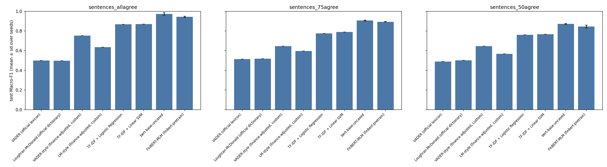

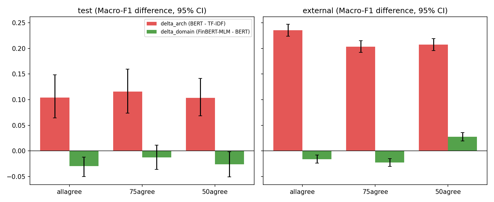

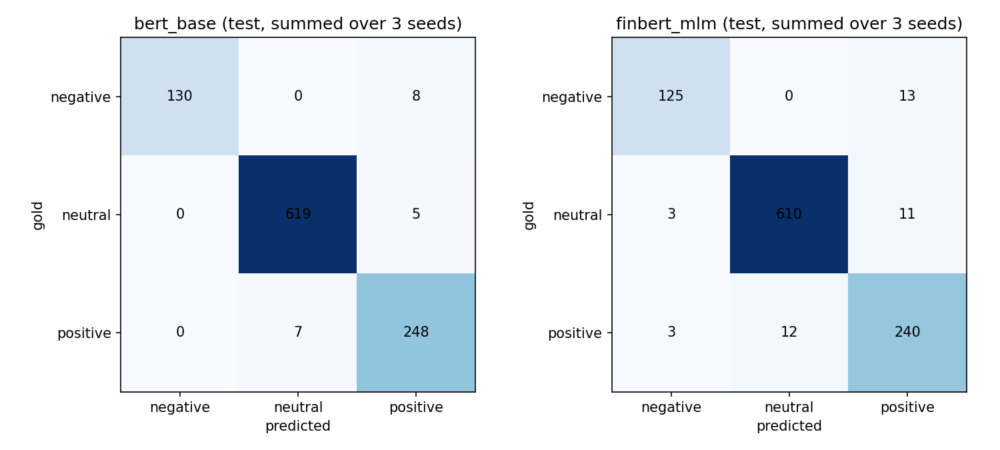

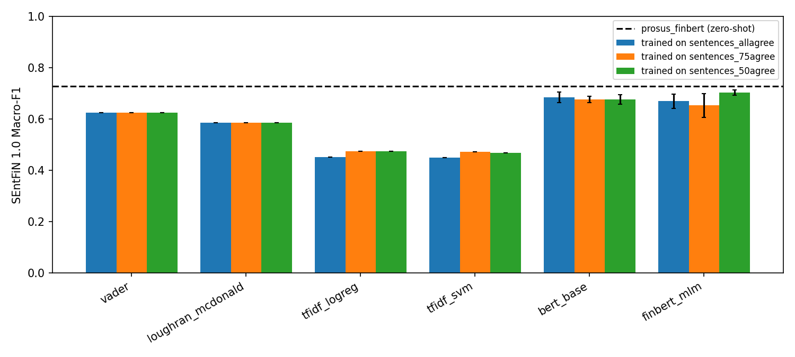

---

## Step 3 Results: Linguistic Phenomenon Attribution (RQ1, RQ3)

Full artifacts: [`results/step3/`](results/step3/) ([`STEP3_REPORT.md`](results/step3/STEP3_REPORT.md),
`annotation_agreement.json`, `phenomenon_analysis.json`, figures) and the diagnostic set in
[`data/diagnostic/`](data/diagnostic/) (see its [`README.md`](data/diagnostic/README.md) for provenance and licence).

**Diagnostic set.** 300 sentences, label-stratified, drawn only from the `sentences_50agree` **test** split
(seed 42; 37 negative, 178 neutral, 85 positive). The 50agree level was chosen before any annotation because its
test split is the largest and has the most Step 1 baseline errors. Because the levels are nested, some of these
sentences are training sentences of the stricter levels, so only models trained on 50agree are scored on this set. Each sentence is tagged for five phenomena: financial
terminology, negation, hedging, numerical comparison, context-dependent polarity
([`annotation/GUIDELINES.md`](annotation/GUIDELINES.md)).

**Annotators are LLMs, not humans.** Annotator A was Claude Sonnet 5.5 and annotator B was Gemini 3.8 Flash.
Each worked blind (text and guideline only: no gold label, no prediction, no rule tags, never the other annotator's
file) and tagged by reading, not by keyword scripts; this was verified by the supervising agent from the session
transcripts, which are not part of the repository. Both models may have seen Financial PhraseBank sentences during
pretraining. A third reference is the rule-based tagger `src/analysis/phenomena.py`. Consensus tags require both
annotators. The first round used guideline v1; its context-dependent definition covered only 3 of 300 sentences
and missed cases such as "operating profit decreased", so the definition was widened (v2: a direction word applied
to a positive- or negative-valence financial target, plus job cuts) and that one tag was re-annotated blind by the
same two models. The v1 files are kept as `annotations_{a,b}_v1.csv`.

**Human check.** Team member Qiyao Zheng tagged all 300 sentences by hand with the same guideline
(`data/diagnostic/annotations_qiyao.csv`); the analysis above still uses the A-B consensus.
`scripts/analyze_human_annotation.py` measures how well the LLM tags match this human pass
([`results/step3/human_annotation_agreement.json`](results/step3/human_annotation_agreement.json)):

| Phenomenon | κ human-A | κ human-B | κ human-consensus | κ A-B |
|---|---:|---:|---:|---:|
| financial terminology | 0.891 | 0.925 | 0.925 | 0.961 |
| negation | 0.946 | 0.946 | 0.946 | 1.000 |
| hedging | 0.837 | 0.817 | 0.880 | 0.893 |
| numerical comparison | 0.911 | 0.899 | 0.887 | 0.965 |
| context-dependent | 0.936 | 0.937 | 0.936 | 0.975 |
| mean | 0.904 | 0.905 | 0.915 | 0.959 |

Human-LLM agreement is high (κ 0.82 to 0.95) but below the agreement between the two LLMs. Most disagreements
are in hedging and numerical comparison (10 sentences each against the consensus). The human prevalence of
context-dependent sentences (15%) matches the widened v2 definition. Which guideline version was used is not
recorded. A second human pass can be added without code changes: instructions in
[`annotation/HUMAN_ANNOTATOR_2.md`](annotation/HUMAN_ANNOTATOR_2.md), template
`data/diagnostic/annotations_human2_template.csv`. `analyze_human_annotation.py` then also reports human-human κ.

Using the human tags instead of the LLM consensus changes the per-phenomenon error rates of the five headline models
by at most 9.6 points and none of the conclusions (`scripts/analyze_human_tag_errors.py`,
[`results/step3/human_tag_error_rates.json`](results/step3/human_tag_error_rates.json)).

#### Full 50agree test split (726 sentences)

The 300-item set has too few negation and financial-terminology sentences for any conclusion. The other 426
sentences of the 50agree test split were therefore annotated as well (`data/diagnostic/extension/`, blind file
`items.csv`, seeded order). The annotators were the same two blind LLMs (Claude Sonnet 5.5 and Gemini 3.8 Flash) under
guideline v2. Agreement A-B on the extension: κ 0.88 to 1.00. `scripts/analyze_diagnostic_extension.py` analyses
the whole split with the Step 3 method
([`results/step3/full_split/REPORT.md`](results/step3/full_split/REPORT.md)).

The union is not a selected subset, so prevalences are natural.

| Phenomenon | n (neg / neu / pos) | Error BERT | Error FinBERT-MLM | Error TF-IDF SVM | Error zero-shot LLM | Δarch [95% CI] | Δdomain [95% CI] |
|---|---|---:|---:|---:|---:|---|---|
| financial terminology | 38 (10 / 11 / 17) | 0.175 | 0.175 | 0.211 | 0.132 | +0.035 [−0.123, +0.193] | +0.000 [−0.123, +0.132] |
| negation | 25 (5 / 18 / 2) | 0.147 | 0.213 | 0.280 | 0.360 | +0.133 [−0.040, +0.320] | −0.067 [−0.227, +0.080] |
| hedging | 117 (15 / 71 / 31) | 0.120 | 0.137 | 0.248 | 0.154 | +0.128 [+0.040, +0.214] | −0.017 [−0.077, +0.048] |
| numerical comparison | 139 (54 / 7 / 78) | 0.043 | 0.096 | 0.151 | 0.094 | +0.108 [+0.043, +0.175] | −0.053 [−0.103, −0.007] |
| context-dependent | 114 (43 / 2 / 69) | 0.038 | 0.035 | 0.088 | 0.053 | +0.050 [+0.000, +0.102] | +0.003 [−0.038, +0.044] |

Errors are on the tagged sentences, three-seed means for the fine-tuned models (50agree training); Δ = accuracy
differences (Δarch = BERT − TF-IDF SVM, Δdomain = FinBERT-MLM − BERT), seed + sentence bootstrap.

- **Architecture effect:** survives Holm correction (10 tests) only for numerical comparison (Holm p = 0.016).
- **Domain effect:** indistinguishable from zero everywhere after Holm. Its raw interval for numerical comparison
  favours BERT (Holm p = 0.18).
- **Negation:** with 25 sentences it still allows only ±0.15-0.20 intervals.

| Phenomenon | κ A–B | κ A–rules | κ B–rules | consensus n |
|---|---:|---:|---:|---:|
| financial terminology | 0.961 | 0.925 | 0.961 | 13 |
| negation | 1.000 | 1.000 | 1.000 | 10 |
| hedging | 0.893 | 0.778 | 0.827 | 53 |
| numerical comparison | 0.965 | 0.895 | 0.882 | 50 |
| context-dependent (v2) | 0.975 | 0.645 | 0.654 | 47 |

Agreement is high partly because the guideline defines each phenomenon with explicit cue words, so both LLMs
and the rule tagger look at similar cues; for financial terminology and negation the LLM consensus differs from the
rule tags on at most 1 sentence. Subsets with n < 20 get confidence intervals only, no p-values.

**Error rate on the diagnostic subset (seed mean; models trained on 50agree).** Hedging (n = 53): VADER (official)
0.340, VADER-style 0.264, TF-IDF + SVM 0.208, BERT 0.088, FinBERT-MLM 0.138. Numerical comparison (n = 50): VADER
(official) 0.600, Loughran–McDonald (official) 0.820, TF-IDF + SVM 0.120, BERT 0.033, FinBERT-MLM 0.067. Error
rates depend on the gold-label mix of each subset (numerical-comparison sentences are almost never neutral), so the
report also gives label-balanced rates and the label mix. On this subset the architecture effect on hedging is
+0.119 accuracy [+0.019, +0.233] (p = 0.030), which does **not** survive Holm correction over the ten tests of the
table (Holm p = 0.18). All domain-effect intervals contain zero, but the subset is too small to see a modest
effect: it cannot tell a domain effect of about ±0.05–0.08 (hedging, numerical comparison, context-dependent) or
±0.13–0.22 (negation n = 10, financial terminology n = 13) from zero. The annotated set therefore supports
phenomenon-level conclusions for three of the five phenomena; for negation and financial terminology use the
full-split rule-tag analysis below.

**Full test splits and SEntFiN with rule tags** (report section 5; larger n, cruder tags). On allagree test, Δarch
is significant after Holm for financial terminology (+0.185), hedging (+0.175) and numerical comparison (+0.071); on
SEntFiN it is significant for all five phenomena in every config. Δdomain is significant after Holm in only two of
the 30 phenomenon × config cells, with opposite signs (75agree, SEntFiN, numerical comparison −0.101; 50agree,
SEntFiN, context-dependent +0.091), so there is no stable phenomenon-level domain-pretraining effect.

**RQ1 (accounting terms → false negative).** On SEntFiN 1.0, gold-neutral headlines with a financial term (rule
tags, n = 142) are labelled negative far more often than other neutral headlines (n = 3,267): VADER (official) 0.570
vs 0.078, Loughran–McDonald (official) 0.479 vs 0.073, BERT 0.322–0.378 vs 0.029–0.043 and FinBERT-MLM 0.146–0.385
vs 0.031–0.081 (range over the three training levels), ProsusAI 0.415 vs 0.109. **Most of this effect is one cue
word:** 47 of the 142 headlines contain *loss/losses*, and most models tag them negative (lexicons 94–100%, BERT
79–94%, ProsusAI 94%, FinBERT-MLM 79–82% except 32% when trained on 75agree; TF-IDF 11–40%). SEntFiN often labels a reported loss as neutral for the named entity, whereas PhraseBank
labels most reported losses negative, so this part reflects a label-convention difference between the datasets as
much as model error. Without the loss-only headlines (n = 96) the gap shrinks to VADER (official) 0.375 vs 0.078,
Loughran–McDonald (official) 0.229 vs 0.073, BERT 0.083–0.108 vs 0.029–0.043, FinBERT-MLM 0.069–0.191 vs
0.031–0.081, ProsusAI 0.167 vs 0.109 (interval includes zero). So the RQ1 mechanism is clear for the
general-purpose lexicons, small for the fine-tuned encoders. Inside the PhraseBank test splits the term subsets hold
only 6–15 gold-neutral sentences, too few for a conclusion.

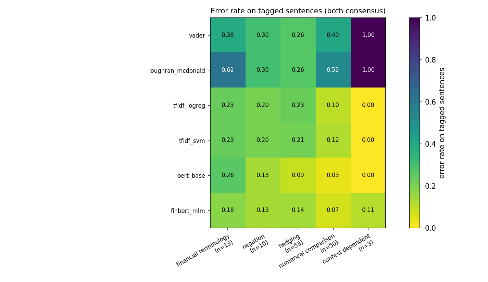

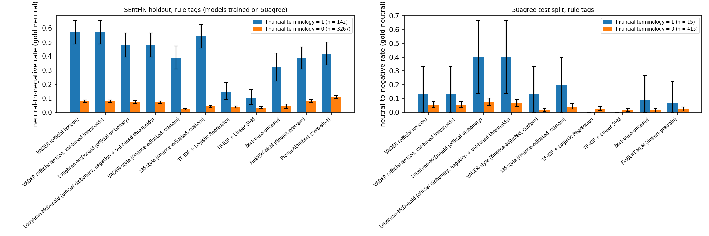

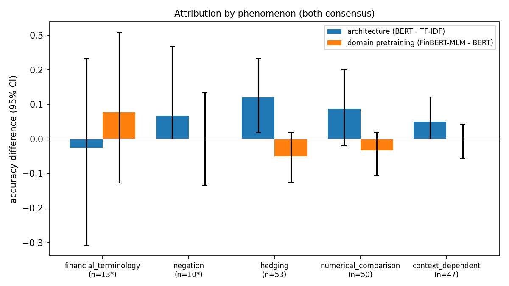

### Caveats

- One shared fine-tuning recipe, no per-model hyperparameter search; FinBERT-MLM may need a different learning
  rate or more epochs, so `Δdomain` measures "domain pretraining under the BERT recipe".
- `Δdomain` is not a pure corpus effect. FinBERT-MLM has its own uncased vocabulary (30,868 entries without special
  tokens vs 29,523 for BERT; 12,493 shared) and a different pretraining corpus and budget (4.9B tokens of 10-K/10-Q
  reports, earnings calls and analyst reports vs BooksCorpus + Wikipedia), so the contrast mixes all three. The
  vocabulary-controlled DAPT arm in [Extensions](#extensions-post-hoc-robustness-checks) separates the text part, but
  only at about 1% of FinBERT's corpus size, and vocabulary and corpus size stay mixed in the remainder.
- The Step 1 tables come from Google Colab. Rerun locally, the splits and lexicon baselines are identical, while
  TF-IDF Macro-F1 moves by up to 0.012 (different scikit-learn/scipy builds). Steps 2 and 3 use the local refit
  throughout, which is why their TF-IDF numbers differ slightly from Step 1.
- Six fine-tunes first hit Apple MPS "Insufficient Memory" command-buffer errors (four with NaN loss). They were
  quarantined and rerun in fresh processes with zero errors; the runner now rejects non-finite losses and
  probabilities and a transformer that predicts a single class.
- The context-dependent definition was widened after the first-round κ (0.593) was known; the v2 κ (0.975) is
  therefore not an independent test of the original guideline.
- TF-IDF + Linear SVM is `LinearSVC` with Platt (sigmoid) calibration fitted on the training features; its
  predictions are the argmax of the calibrated probabilities and its ECE is train-calibrated, so it is not directly
  comparable with the ECE of the other models.
- Near-duplicates are grouped at token Jaccard ≥ 0.80. Just below that threshold a few templated earnings sentences
  (same template, different numbers, same label) still have a train neighbour: 4 of 339 / 6 of 518 / 7 of 726 test
  sentences at Jaccard ≥ 0.75 (allagree / 75agree / 50agree).
- McNemar p-values are the exact binomial test on the discordant pairs (the continuity-corrected χ² is stored
  alongside). For a pair of two single-run models (lexicons, TF-IDF) the per-seed "families" repeat one test.
- `results/step2/runs/journal.jsonl` is an append-only event log; it also records the six MPS reruns, one
  deliberately stopped run and the later baseline refits (TF-IDF C grid, LM tokenisation fix; predictions
  unchanged). The `result.json` files are authoritative.

### Deviations from the proposal

- **Annotation.** The proposal planned double annotation by two team members; it was done by two blind LLM
  annotators (above), and one team member tagged all 300 sentences as a human check (κ against the LLM tags
  0.82 to 0.95, above); a second human pass is prepared (instructions and template) but not yet done.
- **Tier 1 lexicons.** Step 1 used custom finance-adjusted word lists under the names VADER and Loughran–McDonald;
  the official lexicons (plain, and with the proposal's validation-tuned thresholds and LM negation handling) were
  added in Step 2 and are now the headline Tier 1 rows.
- **Split manifests.** The full manifests (with sentence text, about 11 MB) stay git-ignored and are regenerated by
  one command (`--fpb-config all`), pinned by `data/splits/SHA256SUMS`, which `run_step2.py` checks before running.
  The committed deliverable is [`data/splits/assignments/`](data/splits/assignments/): text-free per-config split
  and 5-fold CV assignments plus the SEntFiN holdout ids, keyed by sentence id and SHA-256
  (`scripts/export_split_assignments.py --check` verifies them against the manifests).
- **Pre-tagger.** The proposal planned lexical/dependency pre-tagging; negation scope is detected with token windows
  and regular expressions (`src/analysis/phenomena.py`), not a dependency parser.
- **FiQA.** The proposal mentioned FiQA headlines next to SEntFiN 1.0 as external data; Steps 2 and 3 use only
  SEntFiN 1.0. FiQA 2018 (and Twitter Financial News) are scored in [Extensions](#extensions-post-hoc-robustness-checks)
  with rerun models.
- **Cross-validation.** 5-fold stratified CV is run on the allagree training partition only (all baselines and both
  encoders); the 75agree and 50agree levels use the single locked 70/15/15 split with three seeds.
- **SEntFiN size.** The proposal planned a 2,000-sentence holdout; all 9,460 unambiguous, deduplicated headlines
  are used.
- **SEntFiN single-entity filter.** The proposal filters SEntFiN to "unambiguous single-entity" headlines; the
  pipeline keeps every headline whose entities share one label, so 1,607 of the 9,460 name two or more entities.
  The single-entity subset (7,853) is reported in [Extensions](#extensions-post-hoc-robustness-checks); on it every
  model's SEntFiN Macro-F1 moves by at most 0.012.
- **κ criterion.** The proposal's acceptance criterion κ ≥ 0.75 failed for context-dependent in round 1 (0.593); it
  holds after the v2 re-annotation, with the caveat above.
- **Phenomenon deltas.** Defined on F1 in the proposal; Step 3 reports them on accuracy because several subsets
  have very few sentences of one class, where per-class F1 is undefined or unstable.
- **Work plan and effort.** The 55-hour, five-work-package plan was removed from the 2-page `proposal.pdf` for the
  page limit (commit `0d55c01`). Planned hours: WP1 data, hash-locked splits and deduplication 8; WP2 lexicon and
  TF-IDF baselines 10; WP3 controlled transformer fine-tuning and external holdout 14; WP4 phenomenon annotation and
  statistics 13; WP5 reproducible codebase and final report 10 (total 55). Actual per-member hours are not recorded
  in this repository.
- **Fine-tuning recipe.** The proposal promises identical AdamW settings and validation early stopping (met). The
  team's methodology notes (not part of the submitted proposal) sketched lr ∈ {2e-5, 3e-5}, batch 32 and 4 epochs; the runs
  use one fixed recipe, lr 2e-5, batch 16, up to 5 epochs with patience 2, without a learning-rate search.
- **Diagnostic split.** The proposal says "from the locked test split"; the set comes from the 50agree test split
  (reason above), so it is scored with 50agree-trained models only.
- **McNemar variant.** The proposal names McNemar with continuity correction; the reported p-values are the exact
  binomial version (the corrected χ² is stored).
- **Corpus size.** The proposal gives 4,845 sentences for the full corpus; the pinned release has 4,846
  (`data/dataset_audit_verdict.json`).
- **Not delivered.** The audit's lexicon-domain effect Δlex-domain and a `pyproject.toml` (requirements files are
  provided instead); the manifest file name in the audit (`splits/fpb_splits_sha256.json`) is replaced by
  `data/splits/SHA256SUMS` and `data/splits/assignments/`.

**Step 4 follow-up.** The original fixed-recipe Step 2 experiment remains unchanged. Independent learning-rate and batch-size selection was subsequently performed in Step 4 to address the hyperparameter sensitivity question identified above.

---

## Step 4 Results: Independent Hyperparameter Tuning (RQ2)

Step 2 trained both encoders with one shared recipe (learning rate 2e-5, batch size 16), which left open whether
FinBERT-MLM's lag comes from that recipe. Step 4 tunes learning rate and batch size separately for each model.

The study uses the locked `sentences_allagree` split (1,585 train / 340 validation / 339 test) and the SEntFiN 1.0
holdout (9,460 headlines).

- **Stage 1, selection:** eight runs (2 models × learning rates {2e-5, 3e-5} × batch sizes {16, 32}), seed 42,
  validation only. Test and SEntFiN are not loaded.
- **Stage 2, final:** six runs. The selected recipe is retrained with seeds 42, 100 and 2026 and scored on test and
  SEntFiN.

**Environment.** The reported numbers come from a rerun on the same Mac (Apple MPS) and the same library versions
as Step 2: Python 3.9.6, torch 2.8.0, transformers 4.57.6. `scripts/summarize_step4.py` checks this from each run's
`result.json`, so the fixed-recipe Step 2 runs and the tuned runs can be compared directly. The first Colab run
(T4 GPU, Transformers 5) chose the same recipes; its numbers are kept below for reference.

All run files (per-sentence predictions included) are in [`results/tuning/`](results/tuning/), and the statistics in
[`results/step4/`](results/step4/) ([`STEP4_REPORT.md`](results/step4/STEP4_REPORT.md),
`step4_statistics.json`).

### 4.1 Selection (validation Macro-F1, seed 42)

| Model | lr 2e-5, bs 16 (Step 2 recipe) | lr 2e-5, bs 32 | lr 3e-5, bs 16 | lr 3e-5, bs 32 | Selected |
|---|---:|---:|---:|---:|---|
| BERT-base | 0.9560 | 0.9559 | 0.9469 | **0.9576** | 3e-5, 32 |
| FinBERT-MLM | 0.9486 | 0.9513 | 0.9461 | **0.9568** | 3e-5, 32 |

Both models select learning rate 3e-5 with batch size 32, as in the Colab run.

- **BERT:** the margin over the Step 2 recipe is 0.0016 Macro-F1 at identical validation accuracy (0.9676). That is
  smaller than the run-to-run noise: retraining the same BERT recipe with the same seed gave 0.9576 in Stage 1 and
  0.9607 in Stage 2.
- **FinBERT:** the margin is 0.0082.

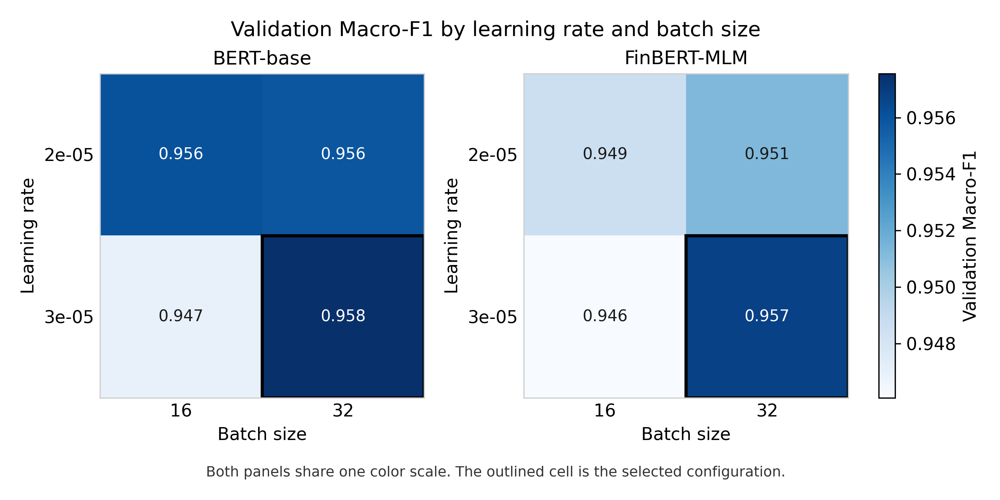

*Figure 1. Validation Macro-F1 for the four configurations per model (seed 42). Outlined cells are the selected
configurations.*

### 4.2 Final evaluation (three seeds)

| Split | Model | Recipe | Seed 42 | Seed 100 | Seed 2026 | Mean ± sd |
|---|---|---|---:|---:|---:|---:|
| PhraseBank test | BERT-base | fixed (Step 2) | 0.9691 | 0.9639 | 0.9888 | 0.9739 ± 0.0132 |
| PhraseBank test | BERT-base | tuned | 0.9695 | 0.9672 | 0.9752 | 0.9706 ± 0.0041 |
| PhraseBank test | FinBERT-MLM | fixed (Step 2) | 0.9389 | 0.9493 | 0.9452 | 0.9445 ± 0.0052 |
| PhraseBank test | FinBERT-MLM | tuned | 0.9628 | 0.9454 | 0.9539 | 0.9540 ± 0.0087 |
| SEntFiN | BERT-base | fixed (Step 2) | 0.6747 | 0.7087 | 0.6716 | 0.6850 ± 0.0205 |
| SEntFiN | BERT-base | tuned | 0.6743 | 0.6785 | 0.6806 | 0.6778 ± 0.0032 |
| SEntFiN | FinBERT-MLM | fixed (Step 2) | 0.6979 | 0.6422 | 0.6672 | 0.6691 ± 0.0279 |
| SEntFiN | FinBERT-MLM | tuned | 0.7235 | 0.6751 | 0.6863 | 0.6949 ± 0.0254 |

Macro-F1; the sd is the sample standard deviation over the three seeds.

For reference, the Colab run of the same protocol (different hardware and library versions) gave:

| Split | BERT-base | FinBERT-MLM |
|---|---:|---:|
| PhraseBank test | 0.9764 ± 0.0023 | 0.9578 ± 0.0034 |
| SEntFiN | 0.6899 ± 0.0117 | 0.6915 ± 0.0060 |

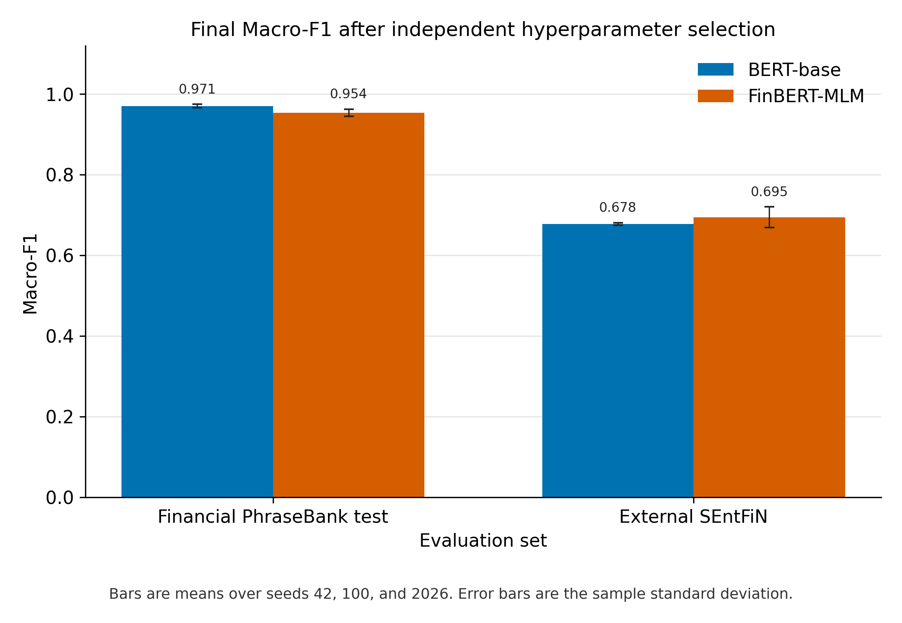

*Figure 2. Mean Macro-F1 after independent selection; error bars are the sample sd over three seeds.*

### 4.3 Paired comparisons

The table compares Macro-F1 differences (A − B, seed means).

- **95% interval:** seed + sentence bootstrap, B = 10,000. Sentences are resampled, and each run set's seeds are
  resampled independently.
- **McNemar:** exact test per seed pairing, Holm-corrected within each seed family (8 tests).

| Split | Comparison | Δ Macro-F1 | 95% interval | McNemar significant (Holm) |
|---|---|---:|---|---:|
| PhraseBank test | fixed BERT − fixed FinBERT | +0.0295 | [+0.0061, +0.0572] | 1 of 3 seeds |
| PhraseBank test | tuned BERT − tuned FinBERT | +0.0166 | [−0.0050, +0.0425] | 0 of 3 |
| PhraseBank test | tuned − fixed, BERT | −0.0033 | [−0.0227, +0.0180] | 0 of 3 |
| PhraseBank test | tuned − fixed, FinBERT | +0.0096 | [−0.0095, +0.0312] | 0 of 3 |
| SEntFiN | fixed BERT − fixed FinBERT | +0.0159 | [−0.0164, +0.0497] | 2 of 3 |
| SEntFiN | tuned BERT − tuned FinBERT | −0.0171 | [−0.0444, +0.0048] | 1 of 3 |
| SEntFiN | tuned − fixed, BERT | −0.0072 | [−0.0297, +0.0083] | 2 of 3 |
| SEntFiN | tuned − fixed, FinBERT | +0.0258 | [−0.0077, +0.0614] | 3 of 3 |

The change of the BERT − FinBERT gap through tuning is computed from one bootstrap with the seeds of all four run
sets drawn independently:

| Split | Gap change | 95% interval |
|---|---:|---|
| PhraseBank test | −0.0129 | [−0.0387, +0.0130] |
| SEntFiN | −0.0330 | [−0.0734, +0.0066] |

In plain words:

- **Tuning helps FinBERT more than BERT,** on both test sets: +0.010 and +0.026 for FinBERT against −0.003 and −0.007
  for BERT. None of the four tuned-vs-fixed intervals excludes zero, so no single gain is demonstrated.
- **PhraseBank:** BERT stays ahead after tuning (+0.017). The gap shrinks from +0.030, whose interval excludes zero,
  to +0.017, whose interval contains zero. The change in the gap itself (−0.013) is not demonstrated.
- **SEntFiN:** the order flips (FinBERT +0.017 after tuning). The gap change (−0.033) is the largest effect, but
  its interval still just contains zero.
- **Per-seed McNemar results:** on SEntFiN they are significant for several seeds (n = 9,460, so even small
  per-sentence differences are detected). They disagree in sign across seeds, which is why the seed-aware
  intervals are the headline.

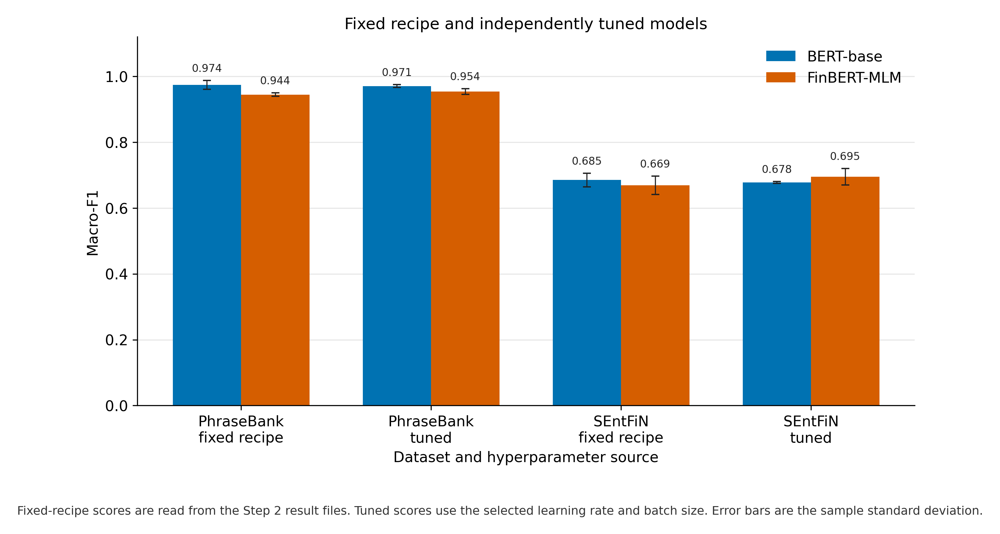

*Figure 3. Fixed recipe (Step 2 runs) and independently tuned recipe; three-seed means with sample sd. Both from
the same environment.*

#### Five seeds (post hoc)

Two more seeds (7 and 123) were added to all four run sets after the three-seed results were known, to shrink the
seed term ([`results/step4/STEP4_REPORT_5seeds.md`](results/step4/STEP4_REPORT_5seeds.md)). The three-seed report above
stays the pre-specified analysis.

| Split | Comparison | Δ Macro-F1 (5 seeds) | 95% interval | Δ (3 seeds) |
|---|---|---:|---|---:|
| PhraseBank test | fixed BERT − fixed FinBERT | +0.0232 | [−0.0017, +0.0495] | +0.0295 |
| PhraseBank test | tuned BERT − tuned FinBERT | +0.0115 | [−0.0101, +0.0335] | +0.0166 |
| PhraseBank test | tuned − fixed, FinBERT | +0.0084 | [−0.0114, +0.0310] | +0.0096 |
| SEntFiN | fixed BERT − fixed FinBERT | +0.0023 | [−0.0218, +0.0293] | +0.0159 |
| SEntFiN | tuned BERT − tuned FinBERT | −0.0234 | [−0.0479, −0.0015] | −0.0171 |
| SEntFiN | tuned − fixed, FinBERT | +0.0156 | [−0.0081, +0.0423] | +0.0258 |
| PhraseBank test | gap change (tuned − fixed) | −0.0118 | [−0.0395, +0.0132] | −0.0129 |
| SEntFiN | gap change (tuned − fixed) | −0.0257 | [−0.0598, +0.0051] | −0.0330 |

What the two extra seeds change:

- **PhraseBank, fixed recipe:** BERT's in-domain lead was significant with three seeds. With five it is +0.023 and its
  interval reaches zero: seed 7 is FinBERT's best run so far (0.971).
- **SEntFiN, tuned recipe:** tuned FinBERT-MLM is ahead by 0.023, and the interval now just excludes zero.
- **Gap change:** both gap changes keep intervals that contain zero.

### 4.4 RQ2 discussion

- **Effect of the shared recipe.** The Step 2 recipe was close to optimal for BERT and slightly unfavourable for
  FinBERT-MLM. Tuning narrows FinBERT's in-domain lag but does not close it: BERT-base remains ahead on PhraseBank
  in every one of the three pre-specified seeds (seed-level deltas +0.007, +0.022, +0.021), but with five seeds the
  in-domain lead is no longer distinguishable from zero (+0.012 tuned, +0.023 fixed).
- **Generalisation.** On SEntFiN the tuned FinBERT-MLM is ahead. With three seeds the interval contained zero; with
  five it just excludes it (+0.023 [+0.002, +0.048]). This is post hoc and marginal, so it is a small out-of-domain
  advantage at most.
- **Answer to RQ2 after Step 4.** Within this small grid, financial-domain pretraining gives no demonstrated
  advantage over general-domain BERT for three-class sentence sentiment. Part of FinBERT-MLM's Step 2 lag was
  recipe-related.
- **Caveat: checkpoints, not a controlled ablation.** The comparison is between two checkpoints, not a controlled
  domain ablation; vocabulary, corpus and pretraining budget differ (see Extensions §1 and §4).

**Limitations.**

- The grid is small: 2 learning rates × 2 batch sizes.
- Selection uses one seed, and selection differences of about 0.003 are within run-to-run noise.
- Fine-tuning on MPS is not bit-reproducible for BERT. Rerunning the Step 2 recipe with seed 42 matched FinBERT's
  validation predictions exactly (largest probability difference 2e-5) but changed BERT's label on 1.2% of
  validation sentences.

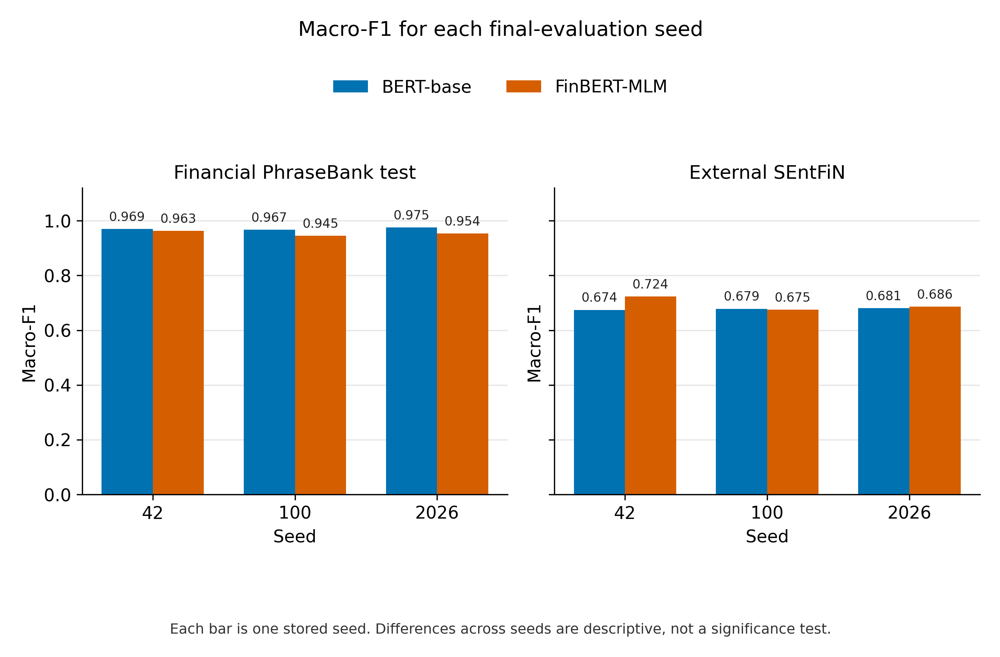

*Figure 4. Per-seed Macro-F1 on PhraseBank test and SEntFiN (tuned recipes).*

### 4.5 Reproducibility

- [`scripts/run_tuning.py`](scripts/run_tuning.py): selection and final runs. The local rerun called the same
  `scripts/run_step2.py` arguments once per run, because one long process ran out of GPU memory on a 24 GB Mac.
  Then `run_tuning.py --phase all --write-tables` wrote `results/tuning/tuning_results.csv`, `final_results.csv`
  and `selection.json`.
- [`scripts/summarize_step4.py`](scripts/summarize_step4.py): paired statistics and
  [`results/step4/STEP4_REPORT.md`](results/step4/STEP4_REPORT.md). `--check` recomputes them without writing.
- [`src/analysis/tuning_figures.py`](src/analysis/tuning_figures.py): the four figures and
  [`results/step4/RESULTS_SUMMARY.md`](results/step4/RESULTS_SUMMARY.md).
- [`notebooks/tuning_hyperparameters_colab.ipynb`](notebooks/tuning_hyperparameters_colab.ipynb): the same study on
  Colab with Google Drive backups.

Selection never reads the test split or SEntFiN; the selection runs contain validation predictions only.

---

## Extensions: Post-hoc Robustness Checks

Four analyses added after the Step 2 and Step 3 results were known, so they are robustness checks, not
pre-registered tests. Sections 1 and 2 refit nothing and re-read the stored per-sentence predictions in
`results/step2/runs/`; sections 3 and 4 retrain the encoders (same recipe) into `results/extensions/runs/`.
Outputs: [`results/extensions/`](results/extensions/).

### 1. Vocabulary: what `Δdomain` actually compares (`scripts/analyze_tokenizers.py`)

| | `bert-base-uncased` | FinBERT-MLM |
|---|---:|---:|
| Vocabulary (without special / `[unused]` tokens) | 29,523 | 30,868 |
| Shared entries | 12,493 (42.3%) | 12,493 (40.5%) |
| Pieces per word, PhraseBank (4,846 sentences) | 1.133 | 1.122 |
| Pieces per word, SEntFiN (9,460 headlines) | 1.230 | 1.225 |
| Pretraining corpus | BooksCorpus + Wikipedia | 4.9B tokens: 10-K/10-Q, earnings calls, analyst reports |

FinBERT-MLM keeps many finance terms whole that BERT splits (*depreciation* → `de ##pre ##ciation`, *EBITDA* →
`e ##bit ##da`, *dividend* → `divide ##nd`, *bearish* → `bear ##ish`, *mln* → `ml ##n`), but on whole sentences the
two tokenizers need almost the same number of pieces. So the two models share an architecture but differ in
vocabulary, corpus and pretraining budget, and `Δdomain` cannot separate these. Grouping sentences by which
tokenizer needs fewer pieces gives one consistent pattern: on SEntFiN, FinBERT-MLM does relatively best on headlines
its tokenizer splits into fewer pieces (Δdomain accuracy +0.012 / +0.008 / +0.043 for allagree / 75agree / 50agree
training, vs −0.034 / −0.035 / +0.018 where it needs more pieces). The group intervals overlap, so this is a
direction, not an established effect; on the PhraseBank test splits there is no pattern.

### 2. SEntFiN: single-entity headlines (`scripts/analyze_sentfin_entities.py`)

The proposal's single-entity filter keeps 7,853 of the 9,460 headlines. Macro-F1 on SEntFiN (all / single-entity /
multi-entity, models trained on allagree):

| Model | All (9,460) | Single (7,853) | Multi (1,607) |
|---|---:|---:|---:|
| `bert-base-uncased` | 0.685 | 0.689 | 0.651 |
| FinBERT-MLM | 0.669 | 0.669 | 0.657 |
| TF-IDF + Linear SVM | 0.450 | 0.455 | 0.402 |
| VADER (official lexicon) | 0.525 | 0.517 | 0.558 |
| Loughran–McDonald (official dictionary) | 0.466 | 0.456 | 0.509 |
| `ProsusAI/finbert` (zero-shot) | 0.727 | 0.734 | 0.684 |

The conclusions do not change on the single-entity subset: Δarch stays large (+0.21 to +0.23, all intervals exclude
zero) and Δdomain stays small (−0.020 [−0.053, +0.013], −0.030 [−0.076, +0.015], +0.024 [+0.002, +0.046] for
allagree / 75agree / 50agree training). The RQ1 loss effect is not a multi-entity artefact: 43 of the 47 gold-neutral
*loss* headlines name a single entity, and on single-entity headlines with a financial term (n = 124) the
neutral-to-negative rates are VADER (official) 0.597, Loughran–McDonald (official) 0.508, BERT 0.341–0.406,
FinBERT-MLM 0.151–0.401 and ProsusAI 0.435, against 0.031–0.112 on other neutral headlines (n = 2,535).

### 3. Two more external test sets: FiQA 2018 and Twitter Financial News (`scripts/run_extra_external.py`)

The Step 2 checkpoints were not saved, so the whole Step 2 matrix (24 baseline, 18 fine-tune and 1 zero-shot run;
no CV) was rerun with the same code, splits, seeds and recipe, and two evaluation-only sets were scored after
training (`scripts/prepare_extra_external.py`, pinned Hugging Face revisions, SHA-256 checked). The resulting
`data/splits/extra_external.json` is git-ignored; its SHA-256 is recorded in `data/splits/SHA256SUMS.extra`
(separate from the locked Step 1 splits in `data/splits/SHA256SUMS`, so that the Colab notebooks, which check
every file listed in `SHA256SUMS`, do not need it), and `run_extra_external.py` checks it before running:

- **FiQA 2018 Task 1** (`pauri32/fiqa-2018`): 1,110 sentences (435 headlines, 675 microblog posts) after dropping
  1 duplicate; 682 positive / 84 neutral / 344 negative (release thresholds: score > 0.1 positive, < −0.1 negative).
  Only 84 neutral sentences, so its Macro-F1 is noisy.
- **Twitter Financial News** (`zeroshot/twitter-financial-news-sentiment`, MIT): 11,737 tweets after URL removal and
  dropping 179 duplicates and 12 conflicting copies; bearish → negative, bullish → positive (a market-outlook label,
  close to but not identical with PhraseBank sentiment).
- Neither set has an exact or near duplicate (token Jaccard ≥ 0.80) in Financial PhraseBank.

Macro-F1 (seed mean of 3 for the encoders; models trained on allagree / 75agree / 50agree):

| Model | FiQA | FiQA headlines | Twitter |
|---|---:|---:|---:|
| VADER (official lexicon) | 0.386 | 0.458 | 0.439 |
| Loughran–McDonald (official dictionary) | 0.311 | 0.375 | 0.464 |
| TF-IDF + Linear SVM | 0.212 / 0.252 / 0.259 | 0.260 / 0.292 / 0.324 | 0.435 / 0.454 / 0.480 |
| `bert-base-uncased` | 0.381 / 0.344 / 0.403 | 0.477 / 0.443 / 0.529 | 0.634 / 0.613 / 0.625 |
| FinBERT-MLM | 0.348 / 0.314 / 0.395 | 0.407 / 0.406 / 0.502 | 0.663 / 0.657 / 0.673 |
| `ProsusAI/finbert` (zero-shot) | 0.478 | 0.584 | 0.656 |

Δarch stays large on both sets (FiQA +0.09 to +0.17, Twitter +0.14 to +0.20, all intervals exclude zero). Δdomain
differs by set: on Twitter FinBERT-MLM is better under all three training levels (+0.029 [+0.007, +0.051], +0.045
[+0.020, +0.070], +0.049 [+0.038, +0.059]); on FiQA it is not (−0.033 to −0.008, all intervals contain zero).

**Reproducibility of the rerun.** Lexicon and TF-IDF runs reproduce the stored Step 2 predictions exactly, and so
does ProsusAI. Fine-tuning on Apple MPS is not bit-deterministic: the rerun FinBERT-MLM models agree with the stored
ones on 99.98% of test and 99.93% of SEntFiN labels, the rerun BERT models on 97.7% and 93.6% (lowest single run
88.9% on SEntFiN). The headline tables above keep the stored Step 2 runs; this section compares only rerun models
with each other (e.g. BERT on SEntFiN, allagree: 0.676 rerun vs 0.685 stored).

### 4. Controlled DAPT arm: is the FinBERT effect the financial text or the vocabulary? (`scripts/dapt_mlm.py`)

`bert_dapt` is `bert-base-uncased` with its own vocabulary, further pretrained with masked language modelling on
financial text and then fine-tuned with the unchanged Step 2 recipe (3 levels × 3 seeds, Apple MPS, same runner):

- Corpus (`scripts/build_dapt_corpus.py`): EDGAR-CORPUS (`eloukas/edgar-corpus`, Apache-2.0), 10-K Items 1 and 7 of
  the 2017–2020 `validate` files, 5,007 sections, 41.7M word pieces; 218 sentences that matched an evaluation
  sentence or shared an 8-token window with one (PhraseBank, SEntFiN, FiQA, Twitter) were removed.
- Pretraining: one pass, 5,128 steps, batch 32 × 256 tokens, lr 5e-5, 15% masking, Kaggle T4 (fp16, 44 min); MLM
  loss 2.33 (first 50 steps) → 1.38 (last steps). Vocabulary, token ids and the pooler (not trained) are unchanged
  (checked). This is about 1% of FinBERT-MLM's 4.9B pretraining tokens. Logs: `results/extensions/dapt_train_log.json`,
  `results/extensions/dapt_corpus_stats.json`. The checkpoint is on the Hugging Face Hub:
  [`necatifcolak/essential-text-bert-dapt`](https://huggingface.co/necatifcolak/essential-text-bert-dapt)
  (`model.safetensors` SHA-256 `300399b9…6b`, the value recorded in every `bert_dapt` run), so
  `run_extra_external.py --dapt-model` can use it without the Kaggle pretraining step.

This splits `Δdomain` into `Δcorpus = bert_dapt − BERT` (financial text, vocabulary fixed) and
`Δrest = FinBERT-MLM − bert_dapt` (FinBERT's own vocabulary plus its much larger corpus). Macro-F1 deltas
(allagree / 75agree / 50agree training; * = 95% interval excludes zero):

| Test set | Δdomain | Δcorpus | Δrest |
|---|---|---|---|
| PhraseBank test | −0.027* / −0.019 / −0.028 | +0.007 / −0.001 / +0.000 | −0.035* / −0.018 / −0.029 |
| SEntFiN | −0.007 / −0.005 / +0.022* | −0.001 / +0.019* / −0.026* | −0.006 / −0.024 / +0.048* |
| FiQA | −0.033 / −0.030 / −0.008 | +0.015 / +0.032* / −0.008 | −0.049 / −0.062* / +0.000 |
| Twitter | +0.029* / +0.045* / +0.049* | +0.009 / +0.018* / −0.004 | +0.021* / +0.026 / +0.053* |

Continued pretraining on 42M tokens of 10-K text moves BERT by at most about 0.03 in either direction, with no consistent
sign across sets or training levels. Where FinBERT-MLM does beat BERT (Twitter, and SEntFiN after 50agree training),
the gain sits in `Δrest`, i.e. in FinBERT's own vocabulary and its 100× larger financial corpus, not in a modest
amount of financial text alone. The two parts of `Δrest` cannot be separated here.

### 5. Zero-shot LLM baseline (`scripts/run_llm_zeroshot.py`)

**Setup.**

- Model: a local open-weight LLM, `qwen2.5:7b` via Ollama (digest `845dbda0…697e`), temperature 0, seed 42, JSON
  output restricted to the three labels.
- Prompt: one fixed instruction, no examples, no training. It is recorded in every `result.json`.
- Reproducibility: raw answers are cached in `results/llm_zeroshot/<set>/raw.jsonl`; there were 0 invalid answers in
  23,372 sentences.
- Comparison: `scripts/summarize_llm_zeroshot.py` compares against the fixed-recipe fine-tuned models trained on
  PhraseBank with seed + sentence bootstrap and per-seed McNemar
  ([`results/llm_zeroshot/REPORT.md`](results/llm_zeroshot/REPORT.md)).

| Test set | n | Zero-shot LLM | Δ vs BERT-base [95% CI] | Δ vs FinBERT-MLM [95% CI] |
|---|---:|---:|---|---|
| PhraseBank allagree test | 339 | 0.934 | −0.040 [−0.076, −0.004] | −0.010 [−0.050, +0.030] |
| PhraseBank 50agree test | 726 | 0.819 | −0.053 [−0.088, −0.018] | −0.027 [−0.063, +0.010] |
| SEntFiN | 9,460 | 0.825 | +0.140 [+0.117, +0.159] | +0.156 [+0.128, +0.183] |
| FiQA | 1,110 | 0.603 | +0.222 [+0.192, +0.253] | +0.255 [+0.193, +0.312] |
| Twitter Financial News | 11,737 | 0.743 | +0.109 [+0.092, +0.127] | +0.080 [+0.061, +0.099] |

Macro-F1. The reference models were trained on allagree, except on the 50agree test set (50agree training). On FiQA
and Twitter the references are the models trained on allagree.

**Findings.**

- **In domain** the fine-tuned encoders keep a small lead.
- **Out of domain** the zero-shot LLM wins by 0.08 to 0.26 Macro-F1. That is far more than anything domain
  pretraining achieved (Δdomain at most about ±0.05), and more than off-the-shelf ProsusAI/finbert on SEntFiN (0.727).
  The PhraseBank-trained models learn PhraseBank's own label convention, which does not carry over to headlines or
  tweets.
- **Caveats:**
  - Qwen2.5 may have seen PhraseBank, SEntFiN, FiQA or the Twitter set during pretraining; there is no way to rule
    this out for public datasets.
  - FiQA neutral F1 is low for every model (0.26 here), because its labels come from thresholded continuous scores.
  - This is one model and one prompt, not a tuned LLM baseline.

---

## Quick Start

### 1. Step 1 (data, splits, baselines)

```bash
python3 colab/run_step1_colab.py --mode full --execute --fpb-config all --out-dir results/step1 --splits-dir data/splits --bootstrap-samples 10000
```

`--fpb-config all` writes the locked manifests of all three agreement levels to `data/splits/` (git-ignored,
regenerated deterministically; Step 2 runs record their SHA-256).

### 2. Step 2 (fine-tuning matrix, resumable; prints the plan without `--execute`)

```bash
# official Loughran-McDonald dictionary (git-ignored; SHA-256 checked by src/baselines/lexicon_official.py)
curl -L -o data/raw/LM_MasterDictionary_1993-2025.csv "https://drive.usercontent.google.com/download?id=1iq2RUf8qGFEAk1g8wQntP3habOnR3fXF&export=download&confirm=t"
python3 scripts/run_step2.py --stage all --execute
python3 scripts/export_split_assignments.py --check            # verify committed split assignments
python3 scripts/summarize_step2.py --runs-dir results/step2/runs --out-dir results/step2 --bootstrap-samples 10000
```

### 3. Step 3 (diagnostic set and phenomenon analysis)

```bash
python3 scripts/build_diagnostic_set.py --execute          # 300-sentence subset, key and rule tags
python3 scripts/build_diagnostic_set.py --execute --rule-tags-only   # recompute rule tags only
python3 scripts/run_step3_analysis.py                      # needs data/diagnostic/annotations_{a,b}.csv
python3 scripts/analyze_human_annotation.py                # human vs LLM agreement (--check: recompute only)
python3 scripts/analyze_human_tag_errors.py                # error rates with the human tags (--check: recompute only)
python3 scripts/build_diagnostic_extension.py --execute    # the other 426 test sentences -> data/diagnostic/extension/
python3 scripts/analyze_diagnostic_extension.py            # full 726-sentence split (needs extension/annotations_{a,b}.csv)
```

### 4. Step 4 (independent hyperparameter tuning)

The tuning study independently selects hyperparameters for BERT-base and FinBERT-MLM using validation Macro-F1.

```bash
python3 scripts/run_tuning.py
python3 scripts/run_tuning.py --phase all --execute
```

The first command displays the experiment plan without launching training. The second command executes validation-based hyperparameter selection followed by three-seed final evaluation.

```bash
python3 scripts/summarize_step4.py          # paired statistics -> results/step4/STEP4_REPORT.md (--check: recompute only)
python3 scripts/summarize_step4.py --seeds 42,100,2026,7,123 --suffix _5seeds   # five-seed report (post hoc)
```

For GPU execution with Google Drive result backups, use the [Step 4 Colab Notebook](notebooks/tuning_hyperparameters_colab.ipynb).

The experimental summaries and figures are available in [`results/step4/`](results/step4/).

### 5. Extensions (post-hoc robustness checks)
```bash
HF_HUB_OFFLINE=1 python3 scripts/analyze_tokenizers.py      # vocabulary overlap, tokenization, Δdomain by tokenization
python3 scripts/analyze_sentfin_entities.py                 # SEntFiN single- vs multi-entity headlines
python3 scripts/prepare_extra_external.py --execute         # FiQA 2018 + Twitter Financial News -> data/splits/extra_external.json
python3 scripts/build_dapt_corpus.py --execute              # 10-K corpus for the DAPT arm (data/raw/dapt/, git-ignored)
python3 scripts/dapt_mlm.py --corpus data/raw/dapt/corpus.txt --out-dir models/dapt   # continued MLM (run on a CUDA GPU)
python3 scripts/run_extra_external.py --dapt-model models/dapt/model   # plan; add --execute --only N per run
python3 scripts/analyze_extra_external.py                   # tables, attribution, reproduction check
python3 scripts/run_llm_zeroshot.py --execute               # zero-shot LLM (local Ollama, qwen2.5:7b), resumable
python3 scripts/summarize_llm_zeroshot.py                   # zero-shot vs fine-tuned comparison
```

### 6. Unit tests (offline, synthetic fixtures, tiny local models)
```bash
HF_HUB_OFFLINE=1 python3 -m unittest discover -s tests -v
```

---

## Repository Structure

```text
essential_text/
├── AGENTS.md                  # Shared project rules and leakage-free methodology constraints
├── README.md                  # Project overview, results, and usage instructions
├── requirements.txt           # Python dependencies (imports only)
├── requirements-lock.txt      # Exact versions of the original Step 2 environment
├── annotation/
│   └── GUIDELINES.md          # Five-phenomenon annotation guideline
├── data/
│   ├── dataset_audit_verdict.json  # Pinned SHA-256 dataset provenance and row-level audit
│   ├── splits/SHA256SUMS      # SHA-256 of the locked split files (the files themselves are regenerated)
│   ├── splits/SHA256SUMS.extra  # SHA-256 of extra_external.json (extensions only)
│   ├── splits/assignments/    # Text-free split / CV-fold / SEntFiN-holdout assignments
│   └── diagnostic/            # 300-sentence diagnostic set (items, key, rule tags, LLM annotations A/B, human pass);
│                              # extension/ = the other 426 test sentences with their LLM annotations
├── proposal/                  # Submitted proposals: original (v1 PDF) and revised (LaTeX/PDF)
├── results/
│   ├── step1/                 # Step 1 outputs from Google Colab
│   ├── step2/                 # Step 2 report, statistics, attribution, figures, runs/ with per-run predictions
│   ├── step3/                 # Step 3 report, agreement, phenomenon analysis, figures; full_split/ (726 sentences)
│   ├── tuning/                # Step 4 runs (selection/, final/ with per-run predictions), CSVs, selection.json
│   ├── step4/                 # Step 4 statistics (STEP4_REPORT.md, step4_statistics.json), summary, figures
│   │   ├── README.md
│   │   ├── STEP4_REPORT.md
│   │   ├── RESULTS_SUMMARY.md
│   │   ├── step4_statistics.json
│   │   ├── hyperparameter_heatmaps.png
│   │   ├── final_model_comparison.png
│   │   ├── original_vs_tuned.png
│   │   └── per_seed_performance.png
│   ├── llm_zeroshot/          # Zero-shot LLM runs (raw answers, predictions), summary.json, REPORT.md
│   └── extensions/            # Post-hoc robustness checks: tokenizer comparison, SEntFiN entity subsets
├── scripts/
│   ├── run_step2.py           # Resumable Step 2 run matrix (baselines, fine-tune, CV, zero-shot)
│   ├── summarize_step2.py     # Multi-seed statistics, McNemar + Holm, bootstrap, attribution, figures
│   ├── run_tuning.py          # Independent hyperparameter tuning and three-seed evaluation
│   ├── summarize_step4.py     # Step 4 paired statistics (seed + sentence bootstrap, McNemar + Holm)
│   ├── fig_rq1.py             # RQ1 figure for the report (Latin Modern font, serif fallback)
│   ├── build_diagnostic_set.py
│   ├── run_step3_analysis.py  # Cohen's kappa, per-phenomenon errors and attribution, RQ1 analysis
│   ├── analyze_human_annotation.py  # Human vs LLM annotation agreement (Cohen's kappa)
│   ├── analyze_human_tag_errors.py  # Step 3 error rates with the human tags instead of the LLM consensus
│   ├── build_diagnostic_extension.py    # Blind item file for the other 426 50agree test sentences
│   ├── analyze_diagnostic_extension.py  # Phenomenon analysis on the full 726-sentence test split
│   ├── run_llm_zeroshot.py          # Extension: zero-shot LLM baseline (local Ollama)
│   ├── summarize_llm_zeroshot.py    # Extension: zero-shot vs fine-tuned statistics
│   ├── export_split_assignments.py  # Text-free split / CV-fold assignments with a --check mode
│   ├── analyze_tokenizers.py  # Extension: BERT vs FinBERT-MLM vocabulary and tokenization
│   ├── analyze_sentfin_entities.py  # Extension: SEntFiN single- vs multi-entity headlines
│   ├── prepare_extra_external.py    # Extension: FiQA 2018 + Twitter Financial News (pinned, deduplicated)
│   ├── run_extra_external.py        # Extension: Step 2 rerun scoring the extra sets; bert_dapt arm
│   ├── build_dapt_corpus.py         # Extension: leakage-filtered 10-K corpus for continued pretraining
│   ├── dapt_mlm.py                  # Extension: continued MLM pretraining of bert-base-uncased
│   └── analyze_extra_external.py    # Extension: extra-set tables, Δcorpus / Δrest attribution
├── src/
│   ├── data/                  # Hashing, Jaccard >= 0.80 clustering, split locking, dedup, IO, assignments.py
│   ├── baselines/             # Tier 1 official + custom lexicons, Tier 2 TF-IDF + LR/SVM, registry
│   ├── transformer/           # Tier 3 fine-tuning and zero-shot scoring (PyTorch + Hugging Face)
│   ├── evaluation/            # Metrics, ECE, McNemar, paired bootstrap, multi-seed statistics
│   └── analysis/              # Phenomenon attribution and tuning_figures.py
├── colab/
│   └── run_step1_colab.py     # End-to-end Step 1 pipeline runner (smoke & full mode)
├── notebooks/
│   ├── build_step1_notebook.py
│   ├── step1_data_and_baselines_colab.ipynb
│   ├── build_tuning_notebook.py
│   └── tuning_hyperparameters_colab.ipynb
└── tests/                     # Offline unittest suite (298 tests)
```

### Code Structure: Three Independent Parts

The pipeline is split into three parts. Each part owns its own folders and output files and is changed only by
its owner; the parts talk to each other only through the hand-off files listed below.

| Part | What it does | Code | Outputs |
| :--- | :--- | :--- | :--- |
| **A. Data & Evaluation** | Dataset download, dedup, locked splits; metrics, McNemar, bootstrap, multi-seed statistics, attribution, reports and figures | `src/data/`, `src/evaluation/`, `src/analysis/attribution.py`, `scripts/export_split_assignments.py`, `scripts/summarize_step2.py`, `scripts/run_step3_analysis.py`, `scripts/analyze_tokenizers.py`, `scripts/analyze_sentfin_entities.py`, `scripts/prepare_extra_external.py`, `scripts/run_extra_external.py`, `scripts/build_dapt_corpus.py`, `scripts/dapt_mlm.py`, `scripts/analyze_extra_external.py` | `data/splits/`, `results/step2/*.json` and figures, `results/step3/`, `results/extensions/` |
| **B. Baselines & Phenomena** | Tier 1 lexicons, Tier 2 TF-IDF + LR/SVM; five-phenomenon tagger and the 300-sentence diagnostic set | `src/baselines/`, `src/analysis/phenomena.py`, `scripts/build_diagnostic_set.py`, `annotation/`, Step 1 runners (`colab/`, `notebooks/`) | `results/step1/`, baseline runs in `results/step2/runs/`, `data/diagnostic/` |
| **C. Transformers** | Tier 3 fine-tuning (`bert-base-uncased`, FinBERT-MLM), 5-fold CV, zero-shot SEntFiN scoring; the run matrix | `src/transformer/`, `scripts/run_step2.py` | transformer runs in `results/step2/runs/` |

**Step 4 extension.** Independent hyperparameter selection extends Part C (Transformers) without introducing a new independent pipeline component. It reuses the locked data splits from Part A and the transformer fine-tuning implementation from Part C, producing separate tuning results and visualizations.

Hand-off files (read-only for the other parts):

1. **A → B, C:** locked splits in `data/splits/` (checked against `data/splits/SHA256SUMS`).
2. **B → C:** baselines are exposed through `src/baselines/registry.py` (`make_baseline(key, seed)`), which the run matrix calls.
3. **B, C → A:** one folder per run, `results/step2/runs/<config>/<model>/seed<N>/` with `result.json` and `predictions.npz`.
4. **B → A:** diagnostic items and the two independent annotation files in `data/diagnostic/`.

Each part keeps its own tests in `tests/`; the full suite must pass before a change is merged.

---

## License

The code is released under the [MIT License](LICENSE). Data files derived from public datasets keep the licence of
their source:

| Source | Licence | Files in this repository |
|---|---|---|
| Financial PhraseBank v1.0 (`takala/financial_phrasebank`) | CC BY-NC-SA 3.0 (non-commercial, share-alike) | `data/diagnostic/` sentences; per-run predictions keyed by sentence id |
| SEntFiN 1.0 (`pyRis/SEntFiN`) | MIT | none (downloaded and checksummed at run time) |
| Twitter Financial News (`zeroshot/twitter-financial-news-sentiment`) | MIT | none (downloaded at run time) |
| FiQA 2018 Task 1 (`pauri32/fiqa-2018`) | no licence stated on the dataset page; check the original FiQA 2018 terms | none (downloaded at run time) |
| Loughran–McDonald Master Dictionary | free for academic use (SRAF terms) | none (git-ignored, SHA-256 checked) |
| EDGAR-CORPUS (`eloukas/edgar-corpus`) | Apache-2.0 | none (DAPT corpus is git-ignored) |
