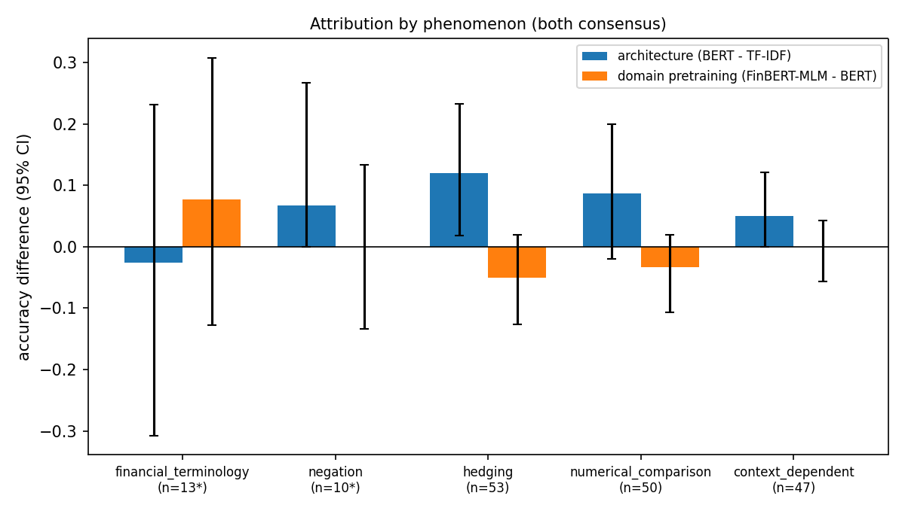

# Step 3 Report: Phenomenon-Level Error and Attribution Analysis

## 1. Annotation and agreement

Annotators A and B are two independent LLM annotators, not human annotators. Annotator A was `Claude Sonnet 5.5 (claude-sonnet-5-5, Anthropic) - LLM agent, not a human annotator` and annotator B was `Gemini 3.8 Flash (gemini-3.8-flash-medium, Google, via Antigravity CLI) - LLM agent, not a human annotator`. Both labelled the same 300 sentences blind (no gold label, no model prediction) using the same guidelines. Both models may have seen Financial PhraseBank during pretraining; blindness refers to the labels and predictions withheld in this run. All agreement numbers below therefore describe agreement between two language models and must not be read as inter-human agreement.

The sentences were drawn from the `sentences_50agree` test split (seed 42). This level was chosen before any annotation because its test split is the largest and has the most Step 1 baseline errors. Its sentences overlap the training splits of the stricter levels (the levels are nested), so only models trained on this level are scored on the diagnostic subset. Mean Cohen's kappa between A and B over the five phenomena is 0.959.

| Phenomenon | kappa A-B | kappa A-rule | kappa B-rule | raw agreement A-B | prevalence A / B / rule | consensus differs from rule (n) |
|---|---|---|---|---|---|---|
| financial_terminology | 0.961 | 0.925 | 0.961 | 0.997 | 0.047 / 0.043 / 0.047 | 1 of 300 |
| negation | 1.000 | 1.000 | 1.000 | 1.000 | 0.033 / 0.033 / 0.033 | 0 of 300 |
| hedging | 0.893 | 0.778 | 0.827 | 0.967 | 0.190 / 0.197 / 0.153 | 15 of 300 |
| numerical_comparison | 0.965 | 0.895 | 0.882 | 0.990 | 0.173 / 0.170 / 0.170 | 9 of 300 |
| context_dependent | 0.975 | 0.645 | 0.654 | 0.993 | 0.157 / 0.163 / 0.087 | 23 of 300 |

The last column counts the sentences where the both-annotators consensus differs from the rule tag. Where it is close to 0 the LLM pass confirmed the rule tagger, so the kappa against the rules measures cue-word matching rather than construct validity.

Consensus tags use the `both` rule (a sentence carries a phenomenon only when both annotators marked it).

## Protocol

- Bootstrap: B = 10000; every resample draws sentences with replacement and, independently per model, draws its trained seeds with replacement (a baseline has one run), so every interval includes seed variation.
- p = min(1, 2 * min(P(d <= 0), P(d >= 0))) over the bootstrap draws of the difference d; a zero is printed as p<0.0002 (= 2/B).
- Holm-Bonferroni is applied within each attribution table (one split block, 5 phenomena x 2 deltas, over the rows that are tested). `Holm p` is the adjusted value.
- Rows marked `*` have fewer than 20 tagged sentences: only the CI is shown, no p-value. RQ1 cells with fewer than 5 sentences print n/a.
- Error rates are shown raw and label-balanced (mean over the gold classes present of the class error rate), because the gold-label mix of a tagged subset changes the raw rate. The gold-label mix of every subset is listed.

## 2. Per-phenomenon error rates on the diagnostic subset

Error on the sentences tagged with the phenomenon (annotator consensus). Rows and columns marked `*` have fewer than 20 tagged sentences and are unreliable.

Diagnostic subset: raw error rate (1 - accuracy), seed mean [95% CI]:

| Model | financial_terminology (n=13*) | negation (n=10*) | hedging (n=53) | numerical_comparison (n=50) | context_dependent (n=47) |
|---|---|---|---|---|---|
| VADER (official lexicon) | 0.538 [0.308, 0.769] | 0.200 [0.000, 0.500] | 0.340 [0.208, 0.472] | 0.600 [0.460, 0.740] | 0.553 [0.404, 0.702] |
| VADER (official lexicon, val-tuned thresholds) | 0.692 [0.462, 0.923] | 0.100 [0.000, 0.300] | 0.358 [0.226, 0.491] | 0.660 [0.520, 0.780] | 0.596 [0.447, 0.745] |
| Loughran-McDonald (official dictionary) | 0.615 [0.308, 0.846] | 0.400 [0.100, 0.700] | 0.340 [0.208, 0.472] | 0.820 [0.700, 0.920] | 0.830 [0.723, 0.936] |
| Loughran-McDonald (official dictionary, negation + val-tuned thresholds) | 0.615 [0.308, 0.846] | 0.400 [0.100, 0.700] | 0.340 [0.208, 0.472] | 0.820 [0.700, 0.920] | 0.830 [0.723, 0.936] |
| VADER-style (finance-adjusted, custom) | 0.385 [0.154, 0.615] | 0.300 [0.000, 0.600] | 0.264 [0.151, 0.377] | 0.400 [0.260, 0.540] | 0.362 [0.234, 0.511] |
| LM-style (finance-adjusted, custom) | 0.615 [0.385, 0.846] | 0.300 [0.000, 0.600] | 0.264 [0.151, 0.377] | 0.520 [0.380, 0.660] | 0.489 [0.340, 0.638] |
| TF-IDF + Logistic Regression | 0.231 [0.000, 0.462] | 0.200 [0.000, 0.500] | 0.226 [0.113, 0.340] | 0.100 [0.020, 0.180] | 0.064 [0.000, 0.149] |
| TF-IDF + Linear SVM | 0.231 [0.000, 0.462] | 0.200 [0.000, 0.500] | 0.208 [0.113, 0.321] | 0.120 [0.040, 0.220] | 0.064 [0.000, 0.149] |
| bert-base-uncased | 0.256 [0.051, 0.513] | 0.133 [0.000, 0.367] | 0.088 [0.025, 0.170] | 0.033 [0.000, 0.093] | 0.014 [0.000, 0.057] |
| FinBERT-MLM (finbert-pretrain) | 0.179 [0.000, 0.385] | 0.133 [0.000, 0.367] | 0.138 [0.057, 0.233] | 0.067 [0.013, 0.140] | 0.014 [0.000, 0.057] |

Diagnostic subset: label-balanced error (mean over the gold classes present of the class error rate) [95% CI]:

| Model | financial_terminology (n=13*) | negation (n=10*) | hedging (n=53) | numerical_comparison (n=50) | context_dependent (n=47) |
|---|---|---|---|---|---|
| VADER (official lexicon) | 0.583 [0.278, 0.833] | 0.083 [0.000, 0.333] | 0.398 [0.230, 0.559] | 0.413 [0.354, 0.692] | 0.617 [0.518, 0.716] |
| VADER (official lexicon, val-tuned thresholds) | 0.694 [0.389, 0.944] | 0.042 [0.000, 0.200] | 0.421 [0.252, 0.586] | 0.453 [0.389, 0.760] | 0.652 [0.548, 0.758] |
| Loughran-McDonald (official dictionary) | 0.556 [0.333, 0.667] | 0.750 [0.100, 0.833] | 0.481 [0.321, 0.624] | 0.557 [0.489, 0.910] | 0.832 [0.715, 0.936] |
| Loughran-McDonald (official dictionary, negation + val-tuned thresholds) | 0.556 [0.333, 0.667] | 0.750 [0.100, 0.833] | 0.481 [0.321, 0.624] | 0.557 [0.489, 0.910] | 0.832 [0.715, 0.936] |
| VADER-style (finance-adjusted, custom) | 0.278 [0.167, 0.409] | 0.708 [0.000, 0.778] | 0.404 [0.246, 0.543] | 0.594 [0.291, 0.675] | 0.397 [0.258, 0.535] |
| LM-style (finance-adjusted, custom) | 0.556 [0.278, 0.852] | 0.708 [0.000, 0.778] | 0.378 [0.214, 0.534] | 0.676 [0.417, 0.758] | 0.521 [0.378, 0.656] |
| TF-IDF + Logistic Regression | 0.250 [0.000, 0.556] | 0.667 [0.000, 0.667] | 0.308 [0.149, 0.471] | 0.068 [0.016, 0.167] | 0.070 [0.000, 0.158] |
| TF-IDF + Linear SVM | 0.250 [0.000, 0.556] | 0.667 [0.000, 0.667] | 0.261 [0.121, 0.420] | 0.082 [0.027, 0.199] | 0.070 [0.000, 0.157] |
| bert-base-uncased | 0.269 [0.048, 0.540] | 0.444 [0.000, 0.556] | 0.110 [0.021, 0.233] | 0.023 [0.000, 0.079] | 0.012 [0.000, 0.045] |
| FinBERT-MLM (finbert-pretrain) | 0.213 [0.000, 0.480] | 0.444 [0.000, 0.556] | 0.166 [0.060, 0.302] | 0.259 [0.013, 0.391] | 0.012 [0.000, 0.050] |

Diagnostic subset: gold-label mix of each subset (negative / neutral / positive):

| Phenomenon | tag = 1 | tag = 0 |
|---|---|---|
| financial_terminology (n=13*) | 4 / 3 / 6 | 33 / 175 / 79 |
| negation (n=10*) | 1 / 8 / 1 | 36 / 170 / 84 |
| hedging (n=53) | 7 / 31 / 15 | 30 / 147 / 70 |
| numerical_comparison (n=50) | 24 / 1 / 25 | 13 / 177 / 60 |
| context_dependent (n=47) | 19 / 0 / 28 | 18 / 178 / 57 |

The heatmap shows the label-balanced error. When a gold class has only a few sentences in a subset (see the gold-label mix), resamples that drop or keep that class change the average a lot, so the balanced interval can be wide and need not be centred on the point value; read those cells with the raw rate.

## 3. Architecture versus domain-pretraining attribution

`delta_arch` = accuracy(bert_base) - accuracy(tfidf_svm) and `delta_domain` = accuracy(finbert_mlm) - accuracy(bert_base) on the tagged sentences. `tfidf_svm` was chosen by validation Macro-F1 (logreg 0.7295, svm 0.7368).

Coverage: the subset is label-stratified, not phenomenon-stratified, so phenomena with fewer than 20 tagged sentences (marked `*`) get an interval only and support no conclusion here; for them use the full-split rule-tag analysis in section 5. Intervals that contain zero mean the subset cannot distinguish an effect of about their half-width from zero, not that the effect is absent.

| Phenomenon | n | delta_arch [95% CI] (p, Holm p) | delta_domain [95% CI] (p, Holm p) |
|---|---|---|---|
| financial_terminology * | 13 | -0.026 [-0.308, +0.231] (CI only) | +0.077 [-0.128, +0.308] (CI only) |
| negation * | 10 | +0.067 [-0.000, +0.267] (CI only) | +0.000 [-0.133, +0.133] (CI only) |
| hedging | 53 | +0.119 [+0.019, +0.233] (p=0.030, Holm p=0.178) | -0.050 [-0.126, +0.019] (p=0.190, Holm p=0.615) |
| numerical_comparison | 50 | +0.087 [-0.020, +0.200] (p=0.123, Holm p=0.615) | -0.033 [-0.107, +0.020] (p=0.313, Holm p=0.626) |
| context_dependent | 47 | +0.050 [+0.000, +0.121] (p=0.139, Holm p=0.615) | +0.000 [-0.057, +0.043] (p=1.000, Holm p=1.000) |

## 4. RQ1: financial terminology and neutral-to-negative errors

Neutral-to-negative rate on gold-neutral sentences, with and without a financial-terminology tag. Annotator consensus on the diagnostic subset, then rule tags on the full splits.

| Model | RQ1 term=1 | RQ1 term=0 |
|---|---|---|
| VADER (official lexicon) | n/a (n=3) | 0.029 [0.006, 0.057] (n=175) |
| VADER (official lexicon, val-tuned thresholds) | n/a (n=3) | 0.029 [0.006, 0.057] (n=175) |
| Loughran-McDonald (official dictionary) | n/a (n=3) | 0.063 [0.029, 0.103] (n=175) |
| Loughran-McDonald (official dictionary, negation + val-tuned thresholds) | n/a (n=3) | 0.051 [0.023, 0.086] (n=175) |
| VADER-style (finance-adjusted, custom) | n/a (n=3) | 0.011 [0.000, 0.029] (n=175) |
| LM-style (finance-adjusted, custom) | n/a (n=3) | 0.040 [0.011, 0.069] (n=175) |
| TF-IDF + Logistic Regression | n/a (n=3) | 0.011 [0.000, 0.029] (n=175) |
| TF-IDF + Linear SVM | n/a (n=3) | 0.006 [0.000, 0.017] (n=175) |
| bert-base-uncased | n/a (n=3) | 0.017 [0.000, 0.042] (n=175) |
| FinBERT-MLM (finbert-pretrain) | n/a (n=3) | 0.027 [0.006, 0.051] (n=175) |

## 5. Full-split analysis with rule tags only

No annotators are involved here: tags come from the rule-based pre-tagger (`src/analysis/phenomena.py`), which is cruder than the annotators but covers every test sentence.

### sentences_allagree: test split (N = 339, tfidf_best = tfidf_svm)

Rule tags: raw error rate (1 - accuracy), seed mean [95% CI]:

| Model | financial_terminology (n=27) | negation (n=18*) | hedging (n=42) | numerical_comparison (n=89) | context_dependent (n=47) |
|---|---|---|---|---|---|
| VADER (official lexicon) | 0.519 [0.333, 0.704] | 0.500 [0.278, 0.722] | 0.310 [0.167, 0.452] | 0.461 [0.360, 0.562] | 0.447 [0.298, 0.596] |
| VADER (official lexicon, val-tuned thresholds) | 0.556 [0.370, 0.741] | 0.222 [0.056, 0.444] | 0.310 [0.167, 0.452] | 0.584 [0.483, 0.685] | 0.532 [0.383, 0.681] |
| Loughran-McDonald (official dictionary) | 0.370 [0.185, 0.556] | 0.444 [0.222, 0.667] | 0.214 [0.095, 0.333] | 0.787 [0.697, 0.865] | 0.830 [0.702, 0.936] |
| Loughran-McDonald (official dictionary, negation + val-tuned thresholds) | 0.370 [0.185, 0.556] | 0.444 [0.222, 0.667] | 0.214 [0.095, 0.333] | 0.787 [0.697, 0.865] | 0.830 [0.702, 0.936] |
| VADER-style (finance-adjusted, custom) | 0.259 [0.111, 0.444] | 0.000 [0.000, 0.000] | 0.119 [0.024, 0.214] | 0.303 [0.213, 0.404] | 0.298 [0.170, 0.426] |
| LM-style (finance-adjusted, custom) | 0.556 [0.370, 0.741] | 0.056 [0.000, 0.167] | 0.214 [0.095, 0.333] | 0.517 [0.416, 0.618] | 0.468 [0.319, 0.617] |
| TF-IDF + Logistic Regression | 0.185 [0.037, 0.333] | 0.000 [0.000, 0.000] | 0.214 [0.095, 0.333] | 0.112 [0.056, 0.180] | 0.043 [0.000, 0.106] |
| TF-IDF + Linear SVM | 0.222 [0.074, 0.370] | 0.000 [0.000, 0.000] | 0.190 [0.071, 0.310] | 0.112 [0.056, 0.180] | 0.021 [0.000, 0.064] |
| bert-base-uncased | 0.037 [0.000, 0.123] | 0.000 [0.000, 0.000] | 0.016 [0.000, 0.056] | 0.041 [0.007, 0.086] | 0.007 [0.000, 0.043] |
| FinBERT-MLM (finbert-pretrain) | 0.086 [0.000, 0.198] | 0.000 [0.000, 0.000] | 0.016 [0.000, 0.056] | 0.071 [0.022, 0.127] | 0.007 [0.000, 0.043] |

Rule tags: label-balanced error (mean over the gold classes present of the class error rate) [95% CI]:

| Model | financial_terminology (n=27) | negation (n=18*) | hedging (n=42) | numerical_comparison (n=89) | context_dependent (n=47) |
|---|---|---|---|---|---|
| VADER (official lexicon) | 0.496 [0.311, 0.694] | 0.500 [0.278, 0.722] | 0.353 [0.145, 0.564] | 0.445 [0.312, 0.612] | 0.606 [0.542, 0.682] |
| VADER (official lexicon, val-tuned thresholds) | 0.533 [0.342, 0.733] | 0.222 [0.056, 0.444] | 0.382 [0.170, 0.597] | 0.481 [0.384, 0.623] | 0.667 [0.588, 0.750] |
| Loughran-McDonald (official dictionary) | 0.374 [0.250, 0.516] | 0.444 [0.222, 0.667] | 0.361 [0.154, 0.567] | 0.555 [0.500, 0.606] | 0.838 [0.709, 0.941] |
| Loughran-McDonald (official dictionary, negation + val-tuned thresholds) | 0.374 [0.250, 0.516] | 0.444 [0.222, 0.667] | 0.361 [0.154, 0.567] | 0.555 [0.500, 0.606] | 0.838 [0.709, 0.941] |
| VADER-style (finance-adjusted, custom) | 0.274 [0.107, 0.456] | 0.000 [0.000, 0.000] | 0.179 [0.037, 0.410] | 0.271 [0.166, 0.417] | 0.397 [0.250, 0.535] |
| LM-style (finance-adjusted, custom) | 0.533 [0.343, 0.732] | 0.056 [0.000, 0.167] | 0.291 [0.133, 0.517] | 0.424 [0.316, 0.569] | 0.518 [0.362, 0.666] |
| TF-IDF + Logistic Regression | 0.176 [0.042, 0.337] | 0.000 [0.000, 0.000] | 0.301 [0.095, 0.509] | 0.126 [0.039, 0.265] | 0.030 [0.000, 0.078] |
| TF-IDF + Linear SVM | 0.189 [0.067, 0.318] | 0.000 [0.000, 0.000] | 0.288 [0.084, 0.495] | 0.129 [0.041, 0.268] | 0.015 [0.000, 0.050] |
| bert-base-uncased | 0.030 [0.000, 0.099] | 0.000 [0.000, 0.000] | 0.032 [0.000, 0.137] | 0.031 [0.006, 0.063] | 0.012 [0.000, 0.062] |
| FinBERT-MLM (finbert-pretrain) | 0.071 [0.000, 0.152] | 0.000 [0.000, 0.000] | 0.014 [0.000, 0.050] | 0.053 [0.018, 0.093] | 0.012 [0.000, 0.062] |

Rule tags: gold-label mix of each subset (negative / neutral / positive):

| Phenomenon | tag = 1 | tag = 0 |
|---|---|---|
| financial_terminology (n=27) | 11 / 7 / 9 | 35 / 201 / 76 |
| negation (n=18*) | 0 / 18 / 0 | 46 / 190 / 85 |
| hedging (n=42) | 4 / 26 / 12 | 42 / 182 / 73 |
| numerical_comparison (n=89) | 38 / 6 / 45 | 8 / 202 / 40 |
| context_dependent (n=47) | 14 / 0 / 33 | 32 / 208 / 52 |

| Phenomenon | n | delta_arch [95% CI] (p, Holm p) | delta_domain [95% CI] (p, Holm p) |
|---|---|---|---|
| financial_terminology | 27 | +0.185 [+0.049, +0.333] (p=0.005, Holm p=0.038) | -0.049 [-0.136, +0.000] (p=0.210, Holm p=0.841) |
| negation * | 18 | +0.000 [+0.000, +0.000] (CI only) | +0.000 [+0.000, +0.000] (CI only) |
| hedging | 42 | +0.175 [+0.056, +0.302] (p=0.002, Holm p=0.018) | +0.000 [-0.040, +0.040] (p=1.000, Holm p=1.000) |
| numerical_comparison | 89 | +0.071 [+0.019, +0.135] (p=0.008, Holm p=0.048) | -0.030 [-0.071, +0.007] (p=0.141, Holm p=0.705) |
| context_dependent | 47 | +0.014 [-0.028, +0.064] (p=0.832, Holm p=1.000) | +0.000 [-0.028, +0.028] (p=1.000, Holm p=1.000) |

RQ1, all financial-terminology sentences:

| Model | RQ1 term=1 | RQ1 term=0 | difference |
|---|---|---|---|
| VADER (official lexicon) | 0.143 [0.000, 0.429] (n=7, small) | 0.075 [0.040, 0.114] (n=201) | +0.068 [-0.104, +0.369] |
| VADER (official lexicon, val-tuned thresholds) | 0.143 [0.000, 0.429] (n=7, small) | 0.035 [0.010, 0.065] (n=201) | +0.108 [-0.055, +0.404] |
| Loughran-McDonald (official dictionary) | 0.143 [0.000, 0.429] (n=7, small) | 0.070 [0.035, 0.109] (n=201) | +0.073 [-0.095, +0.369] |
| Loughran-McDonald (official dictionary, negation + val-tuned thresholds) | 0.143 [0.000, 0.429] (n=7, small) | 0.035 [0.010, 0.060] (n=201) | +0.108 [-0.055, +0.404] |
| VADER-style (finance-adjusted, custom) | 0.000 [0.000, 0.000] (n=7, small) | 0.020 [0.005, 0.040] (n=201) | -0.020 [-0.040, -0.005] |
| LM-style (finance-adjusted, custom) | 0.143 [0.000, 0.429] (n=7, small) | 0.030 [0.010, 0.055] (n=201) | +0.113 [-0.050, +0.409] |
| TF-IDF + Logistic Regression | 0.143 [0.000, 0.429] (n=7, small) | 0.005 [0.000, 0.015] (n=201) | +0.138 [-0.015, +0.429] |
| TF-IDF + Linear SVM | 0.000 [0.000, 0.000] (n=7, small) | 0.005 [0.000, 0.015] (n=201) | -0.005 [-0.015, +0.000] |
| bert-base-uncased | 0.000 [0.000, 0.000] (n=7, small) | 0.000 [0.000, 0.000] (n=201) | +0.000 [+0.000, +0.000] |
| FinBERT-MLM (finbert-pretrain) | 0.000 [0.000, 0.000] (n=7, small) | 0.005 [0.000, 0.017] (n=201) | -0.005 [-0.017, +0.000] |

RQ1, excluding sentences whose only cue is loss/losses (0 gold-neutral sentences dropped from the term=1 group):

| Model | RQ1 term=1 | RQ1 term=0 | difference |
|---|---|---|---|
| VADER (official lexicon) | 0.143 [0.000, 0.429] (n=7, small) | 0.075 [0.040, 0.114] (n=201) | +0.068 [-0.104, +0.369] |
| VADER (official lexicon, val-tuned thresholds) | 0.143 [0.000, 0.429] (n=7, small) | 0.035 [0.010, 0.065] (n=201) | +0.108 [-0.055, +0.404] |
| Loughran-McDonald (official dictionary) | 0.143 [0.000, 0.429] (n=7, small) | 0.070 [0.035, 0.109] (n=201) | +0.073 [-0.095, +0.369] |
| Loughran-McDonald (official dictionary, negation + val-tuned thresholds) | 0.143 [0.000, 0.429] (n=7, small) | 0.035 [0.010, 0.060] (n=201) | +0.108 [-0.055, +0.404] |
| VADER-style (finance-adjusted, custom) | 0.000 [0.000, 0.000] (n=7, small) | 0.020 [0.005, 0.040] (n=201) | -0.020 [-0.040, -0.005] |
| LM-style (finance-adjusted, custom) | 0.143 [0.000, 0.429] (n=7, small) | 0.030 [0.010, 0.055] (n=201) | +0.113 [-0.050, +0.409] |
| TF-IDF + Logistic Regression | 0.143 [0.000, 0.429] (n=7, small) | 0.005 [0.000, 0.015] (n=201) | +0.138 [-0.015, +0.429] |
| TF-IDF + Linear SVM | 0.000 [0.000, 0.000] (n=7, small) | 0.005 [0.000, 0.015] (n=201) | -0.005 [-0.015, +0.000] |
| bert-base-uncased | 0.000 [0.000, 0.000] (n=7, small) | 0.000 [0.000, 0.000] (n=201) | +0.000 [+0.000, +0.000] |
| FinBERT-MLM (finbert-pretrain) | 0.000 [0.000, 0.000] (n=7, small) | 0.005 [0.000, 0.017] (n=201) | -0.005 [-0.017, +0.000] |

RQ1 by cue word (neutral-to-negative rate on gold-neutral sentences, n = sentences carrying the cue; a sentence counts once per cue; n/a below 5): the effect can be carried by a single cue, and label conventions differ between datasets (for example, reported losses are mostly negative or positive in Financial PhraseBank but often neutral in SEntFiN).

| Cue | n | VADER (official lexicon) | VADER (official lexicon, val-tuned thresholds) | Loughran-McDonald (official dictionary) | Loughran-McDonald (official dictionary, negation + val-tuned thresholds) | VADER-style (finance-adjusted, custom) | LM-style (finance-adjusted, custom) | TF-IDF + Logistic Regression | TF-IDF + Linear SVM | bert-base-uncased | FinBERT-MLM (finbert-pretrain) |
|---|---|---|---|---|---|---|---|---|---|---|---|
| cost * | 2 | n/a | n/a | n/a | n/a | n/a | n/a | n/a | n/a | n/a | n/a |
| tax * | 2 | n/a | n/a | n/a | n/a | n/a | n/a | n/a | n/a | n/a | n/a |
| debt * | 1 | n/a | n/a | n/a | n/a | n/a | n/a | n/a | n/a | n/a | n/a |
| expense * | 1 | n/a | n/a | n/a | n/a | n/a | n/a | n/a | n/a | n/a | n/a |
| restructuring * | 1 | n/a | n/a | n/a | n/a | n/a | n/a | n/a | n/a | n/a | n/a |

### sentences_allagree: SEntFiN holdout (N = 9460, tfidf_best = tfidf_svm)

Rule tags: raw error rate (1 - accuracy), seed mean [95% CI]:

| Model | financial_terminology (n=560) | negation (n=277) | hedging (n=1063) | numerical_comparison (n=1433) | context_dependent (n=395) |
|---|---|---|---|---|---|
| VADER (official lexicon) | 0.500 [0.459, 0.543] | 0.538 [0.480, 0.596] | 0.504 [0.474, 0.534] | 0.588 [0.562, 0.613] | 0.418 [0.370, 0.466] |
| VADER (official lexicon, val-tuned thresholds) | 0.516 [0.475, 0.557] | 0.480 [0.422, 0.538] | 0.519 [0.489, 0.549] | 0.653 [0.629, 0.678] | 0.524 [0.476, 0.575] |
| Loughran-McDonald (official dictionary) | 0.464 [0.423, 0.507] | 0.545 [0.487, 0.603] | 0.499 [0.468, 0.529] | 0.789 [0.767, 0.810] | 0.653 [0.605, 0.701] |
| Loughran-McDonald (official dictionary, negation + val-tuned thresholds) | 0.464 [0.423, 0.507] | 0.480 [0.419, 0.538] | 0.496 [0.466, 0.526] | 0.789 [0.767, 0.810] | 0.651 [0.603, 0.699] |
| VADER-style (finance-adjusted, custom) | 0.434 [0.395, 0.475] | 0.444 [0.386, 0.502] | 0.420 [0.389, 0.450] | 0.211 [0.191, 0.232] | 0.284 [0.241, 0.327] |
| LM-style (finance-adjusted, custom) | 0.450 [0.409, 0.491] | 0.480 [0.422, 0.538] | 0.442 [0.412, 0.471] | 0.469 [0.442, 0.495] | 0.304 [0.258, 0.349] |
| TF-IDF + Logistic Regression | 0.698 [0.661, 0.736] | 0.534 [0.473, 0.592] | 0.549 [0.519, 0.579] | 0.356 [0.331, 0.380] | 0.532 [0.481, 0.580] |
| TF-IDF + Linear SVM | 0.680 [0.641, 0.718] | 0.542 [0.480, 0.599] | 0.543 [0.513, 0.573] | 0.389 [0.364, 0.414] | 0.570 [0.522, 0.618] |
| bert-base-uncased | 0.435 [0.396, 0.474] | 0.434 [0.379, 0.489] | 0.379 [0.348, 0.410] | 0.124 [0.089, 0.159] | 0.194 [0.152, 0.237] |
| FinBERT-MLM (finbert-pretrain) | 0.476 [0.428, 0.523] | 0.468 [0.409, 0.526] | 0.371 [0.334, 0.406] | 0.140 [0.110, 0.172] | 0.184 [0.139, 0.232] |
| ProsusAI/finbert (zero-shot) | 0.393 [0.352, 0.434] | 0.433 [0.375, 0.491] | 0.388 [0.358, 0.417] | 0.064 [0.052, 0.077] | 0.124 [0.094, 0.157] |

Rule tags: label-balanced error (mean over the gold classes present of the class error rate) [95% CI]:

| Model | financial_terminology (n=560) | negation (n=277) | hedging (n=1063) | numerical_comparison (n=1433) | context_dependent (n=395) |
|---|---|---|---|---|---|
| VADER (official lexicon) | 0.584 [0.544, 0.623] | 0.570 [0.494, 0.644] | 0.514 [0.484, 0.544] | 0.539 [0.495, 0.582] | 0.562 [0.469, 0.625] |
| VADER (official lexicon, val-tuned thresholds) | 0.576 [0.534, 0.617] | 0.543 [0.471, 0.611] | 0.540 [0.513, 0.568] | 0.540 [0.502, 0.579] | 0.525 [0.405, 0.642] |
| Loughran-McDonald (official dictionary) | 0.550 [0.510, 0.589] | 0.641 [0.588, 0.689] | 0.523 [0.498, 0.548] | 0.549 [0.528, 0.573] | 0.529 [0.442, 0.641] |
| Loughran-McDonald (official dictionary, negation + val-tuned thresholds) | 0.550 [0.510, 0.589] | 0.553 [0.483, 0.619] | 0.519 [0.494, 0.545] | 0.549 [0.528, 0.573] | 0.527 [0.441, 0.639] |
| VADER-style (finance-adjusted, custom) | 0.480 [0.436, 0.524] | 0.474 [0.401, 0.547] | 0.446 [0.420, 0.472] | 0.401 [0.365, 0.435] | 0.469 [0.378, 0.527] |
| LM-style (finance-adjusted, custom) | 0.541 [0.500, 0.582] | 0.553 [0.483, 0.618] | 0.465 [0.438, 0.493] | 0.403 [0.363, 0.445] | 0.448 [0.338, 0.536] |
| TF-IDF + Logistic Regression | 0.646 [0.605, 0.686] | 0.588 [0.527, 0.643] | 0.584 [0.563, 0.606] | 0.458 [0.414, 0.500] | 0.570 [0.447, 0.681] |
| TF-IDF + Linear SVM | 0.628 [0.589, 0.667] | 0.594 [0.531, 0.648] | 0.580 [0.559, 0.600] | 0.444 [0.399, 0.488] | 0.598 [0.475, 0.709] |
| bert-base-uncased | 0.451 [0.409, 0.494] | 0.512 [0.443, 0.573] | 0.394 [0.363, 0.426] | 0.217 [0.172, 0.260] | 0.387 [0.285, 0.461] |
| FinBERT-MLM (finbert-pretrain) | 0.479 [0.430, 0.528] | 0.515 [0.441, 0.584] | 0.387 [0.348, 0.423] | 0.173 [0.135, 0.213] | 0.417 [0.335, 0.468] |
| ProsusAI/finbert (zero-shot) | 0.432 [0.389, 0.476] | 0.507 [0.437, 0.570] | 0.395 [0.365, 0.424] | 0.217 [0.175, 0.259] | 0.404 [0.384, 0.426] |

Rule tags: gold-label mix of each subset (negative / neutral / positive):

| Phenomenon | tag = 1 | tag = 0 |
|---|---|---|
| financial_terminology (n=560) | 301 / 142 / 117 | 2399 / 3267 / 3234 |
| negation (n=277) | 129 / 122 / 26 | 2571 / 3287 / 3325 |
| hedging (n=1063) | 308 / 401 / 354 | 2392 / 3008 / 2997 |
| numerical_comparison (n=1433) | 567 / 63 / 803 | 2133 / 3346 / 2548 |
| context_dependent (n=395) | 210 / 9 / 176 | 2490 / 3400 / 3175 |

| Phenomenon | n | delta_arch [95% CI] (p, Holm p) | delta_domain [95% CI] (p, Holm p) |
|---|---|---|---|
| financial_terminology | 560 | +0.246 [+0.193, +0.299] (p<0.0002, Holm p=0.002) | -0.042 [-0.089, +0.007] (p=0.096, Holm p=0.482) |
| negation | 277 | +0.107 [+0.052, +0.162] (p<0.001, Holm p=0.002) | -0.034 [-0.084, +0.013] (p=0.176, Holm p=0.702) |
| hedging | 1063 | +0.164 [+0.132, +0.199] (p<0.0002, Holm p=0.002) | +0.008 [-0.026, +0.044] (p=0.674, Holm p=1.000) |
| numerical_comparison | 1433 | +0.264 [+0.223, +0.307] (p<0.0002, Holm p=0.002) | -0.015 [-0.060, +0.029] (p=0.530, Holm p=1.000) |
| context_dependent | 395 | +0.376 [+0.316, +0.434] (p<0.0002, Holm p=0.002) | +0.010 [-0.038, +0.058] (p=0.676, Holm p=1.000) |

RQ1, all financial-terminology sentences:

| Model | RQ1 term=1 | RQ1 term=0 | difference |
|---|---|---|---|
| VADER (official lexicon) | 0.570 [0.486, 0.655] (n=142) | 0.078 [0.069, 0.087] (n=3267) | +0.493 [+0.409, +0.577] |
| VADER (official lexicon, val-tuned thresholds) | 0.451 [0.373, 0.535] (n=142) | 0.039 [0.032, 0.046] (n=3267) | +0.412 [+0.331, +0.495] |
| Loughran-McDonald (official dictionary) | 0.479 [0.394, 0.563] (n=142) | 0.073 [0.065, 0.083] (n=3267) | +0.405 [+0.323, +0.488] |
| Loughran-McDonald (official dictionary, negation + val-tuned thresholds) | 0.479 [0.394, 0.563] (n=142) | 0.070 [0.062, 0.079] (n=3267) | +0.408 [+0.326, +0.492] |
| VADER-style (finance-adjusted, custom) | 0.387 [0.310, 0.472] (n=142) | 0.021 [0.016, 0.026] (n=3267) | +0.366 [+0.287, +0.449] |
| LM-style (finance-adjusted, custom) | 0.542 [0.458, 0.627] (n=142) | 0.043 [0.036, 0.050] (n=3267) | +0.499 [+0.415, +0.581] |
| TF-IDF + Logistic Regression | 0.070 [0.035, 0.113] (n=142) | 0.018 [0.013, 0.023] (n=3267) | +0.053 [+0.014, +0.098] |
| TF-IDF + Linear SVM | 0.049 [0.021, 0.092] (n=142) | 0.010 [0.006, 0.013] (n=3267) | +0.040 [+0.007, +0.080] |
| bert-base-uncased | 0.378 [0.300, 0.460] (n=142) | 0.035 [0.026, 0.046] (n=3267) | +0.343 [+0.263, +0.425] |
| FinBERT-MLM (finbert-pretrain) | 0.329 [0.242, 0.420] (n=142) | 0.048 [0.037, 0.061] (n=3267) | +0.281 [+0.194, +0.373] |
| ProsusAI/finbert (zero-shot) | 0.415 [0.338, 0.500] (n=142) | 0.109 [0.099, 0.120] (n=3267) | +0.306 [+0.225, +0.390] |

RQ1, excluding sentences whose only cue is loss/losses (46 gold-neutral sentences dropped from the term=1 group):

| Model | RQ1 term=1 | RQ1 term=0 | difference |
|---|---|---|---|
| VADER (official lexicon) | 0.375 [0.281, 0.469] (n=96) | 0.078 [0.069, 0.087] (n=3267) | +0.297 [+0.200, +0.395] |
| VADER (official lexicon, val-tuned thresholds) | 0.208 [0.135, 0.292] (n=96) | 0.039 [0.032, 0.046] (n=3267) | +0.169 [+0.092, +0.254] |
| Loughran-McDonald (official dictionary) | 0.229 [0.146, 0.312] (n=96) | 0.073 [0.065, 0.083] (n=3267) | +0.156 [+0.071, +0.244] |
| Loughran-McDonald (official dictionary, negation + val-tuned thresholds) | 0.229 [0.146, 0.312] (n=96) | 0.070 [0.062, 0.079] (n=3267) | +0.159 [+0.074, +0.247] |
| VADER-style (finance-adjusted, custom) | 0.094 [0.042, 0.156] (n=96) | 0.021 [0.016, 0.026] (n=3267) | +0.073 [+0.019, +0.135] |
| LM-style (finance-adjusted, custom) | 0.323 [0.229, 0.417] (n=96) | 0.043 [0.036, 0.050] (n=3267) | +0.280 [+0.188, +0.375] |
| TF-IDF + Logistic Regression | 0.021 [0.000, 0.052] (n=96) | 0.018 [0.013, 0.023] (n=3267) | +0.003 [-0.020, +0.036] |
| TF-IDF + Linear SVM | 0.021 [0.000, 0.052] (n=96) | 0.010 [0.006, 0.013] (n=3267) | +0.011 [-0.011, +0.044] |
| bert-base-uncased | 0.108 [0.052, 0.170] (n=96) | 0.035 [0.026, 0.046] (n=3267) | +0.072 [+0.016, +0.136] |
| FinBERT-MLM (finbert-pretrain) | 0.097 [0.045, 0.156] (n=96) | 0.048 [0.037, 0.061] (n=3267) | +0.049 [-0.003, +0.111] |
| ProsusAI/finbert (zero-shot) | 0.167 [0.094, 0.240] (n=96) | 0.109 [0.099, 0.120] (n=3267) | +0.057 [-0.013, +0.136] |

RQ1 by cue word (neutral-to-negative rate on gold-neutral sentences, n = sentences carrying the cue; a sentence counts once per cue; n/a below 5): the effect can be carried by a single cue, and label conventions differ between datasets (for example, reported losses are mostly negative or positive in Financial PhraseBank but often neutral in SEntFiN).

| Cue | n | VADER (official lexicon) | VADER (official lexicon, val-tuned thresholds) | Loughran-McDonald (official dictionary) | Loughran-McDonald (official dictionary, negation + val-tuned thresholds) | VADER-style (finance-adjusted, custom) | LM-style (finance-adjusted, custom) | TF-IDF + Logistic Regression | TF-IDF + Linear SVM | bert-base-uncased | FinBERT-MLM (finbert-pretrain) | ProsusAI/finbert (zero-shot) |
|---|---|---|---|---|---|---|---|---|---|---|---|---|
| loss | 47 | 0.979 | 0.936 | 1.000 | 1.000 | 1.000 | 1.000 | 0.170 | 0.106 | 0.943 | 0.816 | 0.936 |
| tax | 26 | 0.000 | 0.000 | 0.038 | 0.038 | 0.000 | 0.000 | 0.000 | 0.000 | 0.000 | 0.000 | 0.038 |
| risk * | 16 | 0.688 | 0.188 | 0.062 | 0.062 | 0.125 | 0.875 | 0.062 | 0.062 | 0.167 | 0.125 | 0.250 |
| debt * | 15 | 0.667 | 0.600 | 0.133 | 0.133 | 0.067 | 0.067 | 0.000 | 0.000 | 0.000 | 0.044 | 0.067 |
| charge * | 10 | 0.500 | 0.100 | 0.100 | 0.100 | 0.100 | 0.100 | 0.100 | 0.100 | 0.100 | 0.100 | 0.200 |
| volatility * | 10 | 0.200 | 0.200 | 0.900 | 0.900 | 0.000 | 0.800 | 0.000 | 0.000 | 0.100 | 0.133 | 0.100 |
| cost * | 6 | 0.500 | 0.167 | 0.333 | 0.333 | 0.167 | 0.167 | 0.000 | 0.000 | 0.278 | 0.389 | 0.333 |
| deficit * | 5 | 0.800 | 0.600 | 0.800 | 0.800 | 0.800 | 0.800 | 0.000 | 0.000 | 0.600 | 0.400 | 0.400 |
| exposure * | 4 | n/a | n/a | n/a | n/a | n/a | n/a | n/a | n/a | n/a | n/a | n/a |
| restructuring * | 2 | n/a | n/a | n/a | n/a | n/a | n/a | n/a | n/a | n/a | n/a | n/a |
| bear * | 1 | n/a | n/a | n/a | n/a | n/a | n/a | n/a | n/a | n/a | n/a | n/a |
| bearish * | 1 | n/a | n/a | n/a | n/a | n/a | n/a | n/a | n/a | n/a | n/a | n/a |
| claim * | 1 | n/a | n/a | n/a | n/a | n/a | n/a | n/a | n/a | n/a | n/a | n/a |

### sentences_75agree: test split (N = 518, tfidf_best = tfidf_svm)

Rule tags: raw error rate (1 - accuracy), seed mean [95% CI]:

| Model | financial_terminology (n=33) | negation (n=21) | hedging (n=76) | numerical_comparison (n=103) | context_dependent (n=48) |
|---|---|---|---|---|---|
| VADER (official lexicon) | 0.455 [0.273, 0.636] | 0.286 [0.095, 0.476] | 0.408 [0.303, 0.526] | 0.524 [0.427, 0.621] | 0.479 [0.333, 0.625] |
| VADER (official lexicon, val-tuned thresholds) | 0.636 [0.455, 0.788] | 0.286 [0.095, 0.476] | 0.382 [0.276, 0.500] | 0.592 [0.495, 0.689] | 0.521 [0.375, 0.667] |
| Loughran-McDonald (official dictionary) | 0.515 [0.333, 0.697] | 0.333 [0.143, 0.524] | 0.303 [0.197, 0.408] | 0.757 [0.670, 0.835] | 0.792 [0.667, 0.896] |
| Loughran-McDonald (official dictionary, negation + val-tuned thresholds) | 0.515 [0.333, 0.697] | 0.333 [0.143, 0.524] | 0.303 [0.197, 0.408] | 0.757 [0.670, 0.835] | 0.792 [0.667, 0.896] |
| VADER-style (finance-adjusted, custom) | 0.455 [0.273, 0.636] | 0.143 [0.000, 0.286] | 0.211 [0.118, 0.303] | 0.398 [0.301, 0.495] | 0.438 [0.292, 0.583] |
| LM-style (finance-adjusted, custom) | 0.606 [0.424, 0.758] | 0.143 [0.000, 0.286] | 0.263 [0.171, 0.368] | 0.602 [0.505, 0.699] | 0.500 [0.354, 0.646] |
| TF-IDF + Logistic Regression | 0.394 [0.242, 0.545] | 0.095 [0.000, 0.238] | 0.158 [0.079, 0.237] | 0.146 [0.078, 0.214] | 0.167 [0.062, 0.271] |
| TF-IDF + Linear SVM | 0.364 [0.212, 0.545] | 0.095 [0.000, 0.238] | 0.132 [0.066, 0.211] | 0.155 [0.087, 0.233] | 0.167 [0.062, 0.271] |
| bert-base-uncased | 0.242 [0.101, 0.394] | 0.048 [0.000, 0.143] | 0.083 [0.026, 0.149] | 0.068 [0.026, 0.117] | 0.090 [0.021, 0.181] |
| FinBERT-MLM (finbert-pretrain) | 0.222 [0.091, 0.364] | 0.048 [0.000, 0.143] | 0.101 [0.039, 0.171] | 0.081 [0.039, 0.133] | 0.097 [0.021, 0.188] |

Rule tags: label-balanced error (mean over the gold classes present of the class error rate) [95% CI]:

| Model | financial_terminology (n=33) | negation (n=21) | hedging (n=76) | numerical_comparison (n=103) | context_dependent (n=48) |
|---|---|---|---|---|---|
| VADER (official lexicon) | 0.493 [0.296, 0.670] | 0.105 [0.044, 0.381] | 0.419 [0.281, 0.563] | 0.510 [0.408, 0.614] | 0.660 [0.490, 0.750] |
| VADER (official lexicon, val-tuned thresholds) | 0.649 [0.471, 0.810] | 0.105 [0.044, 0.381] | 0.464 [0.317, 0.607] | 0.505 [0.424, 0.596] | 0.586 [0.339, 0.766] |
| Loughran-McDonald (official dictionary) | 0.524 [0.361, 0.688] | 0.439 [0.100, 0.725] | 0.483 [0.347, 0.613] | 0.588 [0.524, 0.661] | 0.549 [0.467, 0.822] |
| Loughran-McDonald (official dictionary, negation + val-tuned thresholds) | 0.524 [0.361, 0.688] | 0.439 [0.100, 0.725] | 0.483 [0.347, 0.613] | 0.588 [0.524, 0.661] | 0.549 [0.467, 0.822] |
| VADER-style (finance-adjusted, custom) | 0.381 [0.333, 0.452] | 0.684 [0.000, 0.719] | 0.337 [0.197, 0.479] | 0.406 [0.292, 0.518] | 0.611 [0.429, 0.711] |
| LM-style (finance-adjusted, custom) | 0.592 [0.402, 0.778] | 0.368 [0.000, 0.600] | 0.406 [0.261, 0.545] | 0.517 [0.423, 0.620] | 0.549 [0.303, 0.736] |
| TF-IDF + Logistic Regression | 0.382 [0.204, 0.577] | 0.667 [0.000, 0.667] | 0.216 [0.103, 0.337] | 0.178 [0.089, 0.276] | 0.414 [0.128, 0.487] |
| TF-IDF + Linear SVM | 0.323 [0.176, 0.493] | 0.667 [0.000, 0.667] | 0.227 [0.112, 0.343] | 0.188 [0.098, 0.289] | 0.420 [0.134, 0.493] |
| bert-base-uncased | 0.195 [0.089, 0.309] | 0.333 [0.000, 0.500] | 0.127 [0.034, 0.243] | 0.120 [0.042, 0.208] | 0.296 [0.033, 0.409] |
| FinBERT-MLM (finbert-pretrain) | 0.179 [0.079, 0.296] | 0.333 [0.000, 0.500] | 0.156 [0.052, 0.283] | 0.129 [0.053, 0.216] | 0.267 [0.024, 0.419] |

Rule tags: gold-label mix of each subset (negative / neutral / positive):

| Phenomenon | tag = 1 | tag = 0 |
|---|---|---|
| financial_terminology (n=33) | 14 / 6 / 13 | 49 / 316 / 120 |
| negation (n=21) | 1 / 19 / 1 | 62 / 303 / 132 |
| hedging (n=76) | 11 / 52 / 13 | 52 / 270 / 120 |
| numerical_comparison (n=103) | 39 / 14 / 50 | 24 / 308 / 83 |
| context_dependent (n=48) | 18 / 3 / 27 | 45 / 319 / 106 |

| Phenomenon | n | delta_arch [95% CI] (p, Holm p) | delta_domain [95% CI] (p, Holm p) |
|---|---|---|---|
| financial_terminology | 33 | +0.121 [-0.040, +0.293] (p=0.184, Holm p=1.000) | +0.020 [-0.111, +0.152] (p=0.810, Holm p=1.000) |
| negation | 21 | +0.048 [-0.000, +0.143] (p=0.715, Holm p=1.000) | +0.000 [+0.000, +0.000] (p=1.000, Holm p=1.000) |
| hedging | 76 | +0.048 [-0.022, +0.123] (p=0.210, Holm p=1.000) | -0.018 [-0.066, +0.026] (p=0.461, Holm p=1.000) |
| numerical_comparison | 103 | +0.087 [+0.023, +0.155] (p=0.008, Holm p=0.078) | -0.013 [-0.049, +0.023] (p=0.520, Holm p=1.000) |
| context_dependent | 48 | +0.076 [-0.014, +0.174] (p=0.139, Holm p=1.000) | -0.007 [-0.076, +0.062] (p=0.963, Holm p=1.000) |

RQ1, all financial-terminology sentences:

| Model | RQ1 term=1 | RQ1 term=0 | difference |
|---|---|---|---|
| VADER (official lexicon) | 0.667 [0.333, 1.000] (n=6, small) | 0.054 [0.032, 0.079] (n=316) | +0.613 [+0.261, +0.953] |
| VADER (official lexicon, val-tuned thresholds) | 0.667 [0.333, 1.000] (n=6, small) | 0.054 [0.032, 0.079] (n=316) | +0.613 [+0.261, +0.953] |
| Loughran-McDonald (official dictionary) | 0.500 [0.167, 0.833] (n=6, small) | 0.076 [0.047, 0.108] (n=316) | +0.424 [+0.072, +0.780] |
| Loughran-McDonald (official dictionary, negation + val-tuned thresholds) | 0.500 [0.167, 0.833] (n=6, small) | 0.060 [0.035, 0.089] (n=316) | +0.440 [+0.091, +0.795] |
| VADER-style (finance-adjusted, custom) | 0.000 [0.000, 0.000] (n=6, small) | 0.022 [0.006, 0.041] (n=316) | -0.022 [-0.041, -0.006] |
| LM-style (finance-adjusted, custom) | 0.500 [0.167, 0.833] (n=6, small) | 0.022 [0.006, 0.041] (n=316) | +0.478 [+0.132, +0.821] |
| TF-IDF + Logistic Regression | 0.000 [0.000, 0.000] (n=6, small) | 0.019 [0.006, 0.035] (n=316) | -0.019 [-0.035, -0.006] |
| TF-IDF + Linear SVM | 0.000 [0.000, 0.000] (n=6, small) | 0.016 [0.003, 0.032] (n=316) | -0.016 [-0.032, -0.003] |
| bert-base-uncased | 0.000 [0.000, 0.000] (n=6, small) | 0.020 [0.006, 0.037] (n=316) | -0.020 [-0.037, -0.006] |
| FinBERT-MLM (finbert-pretrain) | 0.000 [0.000, 0.000] (n=6, small) | 0.016 [0.003, 0.031] (n=316) | -0.016 [-0.031, -0.003] |

RQ1, excluding sentences whose only cue is loss/losses (0 gold-neutral sentences dropped from the term=1 group):

| Model | RQ1 term=1 | RQ1 term=0 | difference |
|---|---|---|---|
| VADER (official lexicon) | 0.667 [0.333, 1.000] (n=6, small) | 0.054 [0.032, 0.079] (n=316) | +0.613 [+0.261, +0.953] |
| VADER (official lexicon, val-tuned thresholds) | 0.667 [0.333, 1.000] (n=6, small) | 0.054 [0.032, 0.079] (n=316) | +0.613 [+0.261, +0.953] |
| Loughran-McDonald (official dictionary) | 0.500 [0.167, 0.833] (n=6, small) | 0.076 [0.047, 0.108] (n=316) | +0.424 [+0.072, +0.780] |
| Loughran-McDonald (official dictionary, negation + val-tuned thresholds) | 0.500 [0.167, 0.833] (n=6, small) | 0.060 [0.035, 0.089] (n=316) | +0.440 [+0.091, +0.795] |
| VADER-style (finance-adjusted, custom) | 0.000 [0.000, 0.000] (n=6, small) | 0.022 [0.006, 0.041] (n=316) | -0.022 [-0.041, -0.006] |
| LM-style (finance-adjusted, custom) | 0.500 [0.167, 0.833] (n=6, small) | 0.022 [0.006, 0.041] (n=316) | +0.478 [+0.132, +0.821] |
| TF-IDF + Logistic Regression | 0.000 [0.000, 0.000] (n=6, small) | 0.019 [0.006, 0.035] (n=316) | -0.019 [-0.035, -0.006] |
| TF-IDF + Linear SVM | 0.000 [0.000, 0.000] (n=6, small) | 0.016 [0.003, 0.032] (n=316) | -0.016 [-0.032, -0.003] |
| bert-base-uncased | 0.000 [0.000, 0.000] (n=6, small) | 0.020 [0.006, 0.037] (n=316) | -0.020 [-0.037, -0.006] |
| FinBERT-MLM (finbert-pretrain) | 0.000 [0.000, 0.000] (n=6, small) | 0.016 [0.003, 0.031] (n=316) | -0.016 [-0.031, -0.003] |

RQ1 by cue word (neutral-to-negative rate on gold-neutral sentences, n = sentences carrying the cue; a sentence counts once per cue; n/a below 5): the effect can be carried by a single cue, and label conventions differ between datasets (for example, reported losses are mostly negative or positive in Financial PhraseBank but often neutral in SEntFiN).

| Cue | n | VADER (official lexicon) | VADER (official lexicon, val-tuned thresholds) | Loughran-McDonald (official dictionary) | Loughran-McDonald (official dictionary, negation + val-tuned thresholds) | VADER-style (finance-adjusted, custom) | LM-style (finance-adjusted, custom) | TF-IDF + Logistic Regression | TF-IDF + Linear SVM | bert-base-uncased | FinBERT-MLM (finbert-pretrain) |
|---|---|---|---|---|---|---|---|---|---|---|---|
| restructuring * | 2 | n/a | n/a | n/a | n/a | n/a | n/a | n/a | n/a | n/a | n/a |
| cost * | 1 | n/a | n/a | n/a | n/a | n/a | n/a | n/a | n/a | n/a | n/a |
| debt * | 1 | n/a | n/a | n/a | n/a | n/a | n/a | n/a | n/a | n/a | n/a |
| expense * | 1 | n/a | n/a | n/a | n/a | n/a | n/a | n/a | n/a | n/a | n/a |
| exposure * | 1 | n/a | n/a | n/a | n/a | n/a | n/a | n/a | n/a | n/a | n/a |
| liability * | 1 | n/a | n/a | n/a | n/a | n/a | n/a | n/a | n/a | n/a | n/a |
| risk * | 1 | n/a | n/a | n/a | n/a | n/a | n/a | n/a | n/a | n/a | n/a |
| tax * | 1 | n/a | n/a | n/a | n/a | n/a | n/a | n/a | n/a | n/a | n/a |

### sentences_75agree: SEntFiN holdout (N = 9460, tfidf_best = tfidf_svm)

Rule tags: raw error rate (1 - accuracy), seed mean [95% CI]:

| Model | financial_terminology (n=560) | negation (n=277) | hedging (n=1063) | numerical_comparison (n=1433) | context_dependent (n=395) |
|---|---|---|---|---|---|
| VADER (official lexicon) | 0.500 [0.459, 0.543] | 0.538 [0.480, 0.596] | 0.504 [0.474, 0.534] | 0.588 [0.562, 0.613] | 0.418 [0.370, 0.466] |
| VADER (official lexicon, val-tuned thresholds) | 0.487 [0.446, 0.530] | 0.487 [0.430, 0.545] | 0.491 [0.462, 0.521] | 0.610 [0.585, 0.635] | 0.428 [0.380, 0.476] |
| Loughran-McDonald (official dictionary) | 0.464 [0.423, 0.507] | 0.545 [0.487, 0.603] | 0.499 [0.468, 0.529] | 0.789 [0.767, 0.810] | 0.653 [0.605, 0.701] |
| Loughran-McDonald (official dictionary, negation + val-tuned thresholds) | 0.464 [0.423, 0.507] | 0.480 [0.419, 0.538] | 0.496 [0.466, 0.526] | 0.789 [0.767, 0.810] | 0.651 [0.603, 0.699] |
| VADER-style (finance-adjusted, custom) | 0.430 [0.391, 0.471] | 0.444 [0.386, 0.502] | 0.417 [0.387, 0.447] | 0.207 [0.186, 0.227] | 0.273 [0.230, 0.316] |
| LM-style (finance-adjusted, custom) | 0.450 [0.409, 0.491] | 0.480 [0.422, 0.538] | 0.442 [0.412, 0.471] | 0.469 [0.442, 0.495] | 0.304 [0.258, 0.349] |
| TF-IDF + Logistic Regression | 0.675 [0.636, 0.713] | 0.513 [0.451, 0.570] | 0.518 [0.488, 0.548] | 0.353 [0.329, 0.378] | 0.491 [0.441, 0.539] |
| TF-IDF + Linear SVM | 0.675 [0.636, 0.713] | 0.516 [0.455, 0.574] | 0.523 [0.493, 0.553] | 0.382 [0.357, 0.407] | 0.511 [0.461, 0.559] |
| bert-base-uncased | 0.501 [0.461, 0.542] | 0.432 [0.373, 0.491] | 0.400 [0.368, 0.434] | 0.111 [0.090, 0.132] | 0.205 [0.167, 0.244] |
| FinBERT-MLM (finbert-pretrain) | 0.502 [0.442, 0.564] | 0.457 [0.395, 0.520] | 0.381 [0.343, 0.423] | 0.212 [0.133, 0.295] | 0.230 [0.167, 0.292] |
| ProsusAI/finbert (zero-shot) | 0.393 [0.352, 0.434] | 0.433 [0.375, 0.491] | 0.388 [0.358, 0.417] | 0.064 [0.052, 0.077] | 0.124 [0.094, 0.157] |

Rule tags: label-balanced error (mean over the gold classes present of the class error rate) [95% CI]:

| Model | financial_terminology (n=560) | negation (n=277) | hedging (n=1063) | numerical_comparison (n=1433) | context_dependent (n=395) |
|---|---|---|---|---|---|
| VADER (official lexicon) | 0.584 [0.544, 0.623] | 0.570 [0.494, 0.644] | 0.514 [0.484, 0.544] | 0.539 [0.495, 0.582] | 0.562 [0.469, 0.625] |
| VADER (official lexicon, val-tuned thresholds) | 0.581 [0.541, 0.620] | 0.552 [0.480, 0.622] | 0.504 [0.474, 0.533] | 0.517 [0.477, 0.558] | 0.536 [0.423, 0.625] |
| Loughran-McDonald (official dictionary) | 0.550 [0.510, 0.589] | 0.641 [0.588, 0.689] | 0.523 [0.498, 0.548] | 0.549 [0.528, 0.573] | 0.529 [0.442, 0.641] |
| Loughran-McDonald (official dictionary, negation + val-tuned thresholds) | 0.550 [0.510, 0.589] | 0.553 [0.483, 0.619] | 0.519 [0.494, 0.545] | 0.549 [0.528, 0.573] | 0.527 [0.441, 0.639] |
| VADER-style (finance-adjusted, custom) | 0.474 [0.430, 0.519] | 0.474 [0.401, 0.547] | 0.443 [0.417, 0.469] | 0.398 [0.362, 0.432] | 0.462 [0.370, 0.519] |
| LM-style (finance-adjusted, custom) | 0.541 [0.500, 0.582] | 0.553 [0.483, 0.618] | 0.465 [0.438, 0.493] | 0.403 [0.363, 0.445] | 0.448 [0.338, 0.536] |
| TF-IDF + Logistic Regression | 0.611 [0.569, 0.653] | 0.572 [0.511, 0.629] | 0.550 [0.526, 0.574] | 0.459 [0.416, 0.502] | 0.572 [0.457, 0.660] |
| TF-IDF + Linear SVM | 0.612 [0.570, 0.654] | 0.575 [0.513, 0.631] | 0.556 [0.532, 0.579] | 0.452 [0.407, 0.497] | 0.586 [0.473, 0.673] |
| bert-base-uncased | 0.490 [0.446, 0.535] | 0.525 [0.466, 0.577] | 0.420 [0.388, 0.453] | 0.212 [0.169, 0.256] | 0.313 [0.196, 0.427] |
| FinBERT-MLM (finbert-pretrain) | 0.470 [0.428, 0.511] | 0.533 [0.465, 0.594] | 0.405 [0.365, 0.448] | 0.200 [0.149, 0.248] | 0.330 [0.218, 0.444] |
| ProsusAI/finbert (zero-shot) | 0.432 [0.389, 0.476] | 0.507 [0.437, 0.570] | 0.395 [0.365, 0.424] | 0.217 [0.175, 0.259] | 0.404 [0.384, 0.426] |

Rule tags: gold-label mix of each subset (negative / neutral / positive):

| Phenomenon | tag = 1 | tag = 0 |
|---|---|---|
| financial_terminology (n=560) | 301 / 142 / 117 | 2399 / 3267 / 3234 |
| negation (n=277) | 129 / 122 / 26 | 2571 / 3287 / 3325 |
| hedging (n=1063) | 308 / 401 / 354 | 2392 / 3008 / 2997 |
| numerical_comparison (n=1433) | 567 / 63 / 803 | 2133 / 3346 / 2548 |
| context_dependent (n=395) | 210 / 9 / 176 | 2490 / 3400 / 3175 |

| Phenomenon | n | delta_arch [95% CI] (p, Holm p) | delta_domain [95% CI] (p, Holm p) |
|---|---|---|---|
| financial_terminology | 560 | +0.174 [+0.124, +0.223] (p<0.0002, Holm p=0.002) | -0.001 [-0.067, +0.061] (p=1.000, Holm p=1.000) |
| negation | 277 | +0.084 [+0.038, +0.132] (p=0.001, Holm p=0.004) | -0.025 [-0.070, +0.022] (p=0.283, Holm p=1.000) |
| hedging | 1063 | +0.123 [+0.089, +0.156] (p<0.0002, Holm p=0.002) | +0.019 [-0.023, +0.058] (p=0.368, Holm p=1.000) |
| numerical_comparison | 1433 | +0.271 [+0.240, +0.301] (p<0.0002, Holm p=0.002) | -0.101 [-0.185, -0.021] (p=0.006, Holm p=0.028) |
| context_dependent | 395 | +0.306 [+0.252, +0.359] (p<0.0002, Holm p=0.002) | -0.024 [-0.084, +0.036] (p=0.442, Holm p=1.000) |

RQ1, all financial-terminology sentences:

| Model | RQ1 term=1 | RQ1 term=0 | difference |
|---|---|---|---|
| VADER (official lexicon) | 0.570 [0.486, 0.655] (n=142) | 0.078 [0.069, 0.087] (n=3267) | +0.493 [+0.409, +0.577] |
| VADER (official lexicon, val-tuned thresholds) | 0.577 [0.493, 0.662] (n=142) | 0.079 [0.070, 0.088] (n=3267) | +0.498 [+0.415, +0.581] |
| Loughran-McDonald (official dictionary) | 0.479 [0.394, 0.563] (n=142) | 0.073 [0.065, 0.083] (n=3267) | +0.405 [+0.323, +0.488] |
| Loughran-McDonald (official dictionary, negation + val-tuned thresholds) | 0.479 [0.394, 0.563] (n=142) | 0.070 [0.062, 0.079] (n=3267) | +0.408 [+0.326, +0.492] |
| VADER-style (finance-adjusted, custom) | 0.387 [0.310, 0.472] (n=142) | 0.021 [0.016, 0.026] (n=3267) | +0.366 [+0.287, +0.449] |
| LM-style (finance-adjusted, custom) | 0.542 [0.458, 0.627] (n=142) | 0.043 [0.036, 0.050] (n=3267) | +0.499 [+0.415, +0.581] |
| TF-IDF + Logistic Regression | 0.106 [0.056, 0.162] (n=142) | 0.016 [0.012, 0.020] (n=3267) | +0.090 [+0.042, +0.144] |
| TF-IDF + Linear SVM | 0.099 [0.056, 0.148] (n=142) | 0.013 [0.010, 0.017] (n=3267) | +0.085 [+0.039, +0.136] |
| bert-base-uncased | 0.326 [0.254, 0.404] (n=142) | 0.029 [0.023, 0.036] (n=3267) | +0.297 [+0.223, +0.374] |
| FinBERT-MLM (finbert-pretrain) | 0.146 [0.028, 0.296] (n=142) | 0.031 [0.013, 0.050] (n=3267) | +0.114 [-0.004, +0.266] |
| ProsusAI/finbert (zero-shot) | 0.415 [0.338, 0.500] (n=142) | 0.109 [0.099, 0.120] (n=3267) | +0.306 [+0.225, +0.390] |

RQ1, excluding sentences whose only cue is loss/losses (46 gold-neutral sentences dropped from the term=1 group):

| Model | RQ1 term=1 | RQ1 term=0 | difference |
|---|---|---|---|
| VADER (official lexicon) | 0.375 [0.281, 0.469] (n=96) | 0.078 [0.069, 0.087] (n=3267) | +0.297 [+0.200, +0.395] |
| VADER (official lexicon, val-tuned thresholds) | 0.385 [0.292, 0.479] (n=96) | 0.079 [0.070, 0.088] (n=3267) | +0.306 [+0.210, +0.404] |
| Loughran-McDonald (official dictionary) | 0.229 [0.146, 0.312] (n=96) | 0.073 [0.065, 0.083] (n=3267) | +0.156 [+0.071, +0.244] |
| Loughran-McDonald (official dictionary, negation + val-tuned thresholds) | 0.229 [0.146, 0.312] (n=96) | 0.070 [0.062, 0.079] (n=3267) | +0.159 [+0.074, +0.247] |
| VADER-style (finance-adjusted, custom) | 0.094 [0.042, 0.156] (n=96) | 0.021 [0.016, 0.026] (n=3267) | +0.073 [+0.019, +0.135] |
| LM-style (finance-adjusted, custom) | 0.323 [0.229, 0.417] (n=96) | 0.043 [0.036, 0.050] (n=3267) | +0.280 [+0.188, +0.375] |
| TF-IDF + Logistic Regression | 0.031 [0.000, 0.073] (n=96) | 0.016 [0.012, 0.020] (n=3267) | +0.015 [-0.016, +0.056] |
| TF-IDF + Linear SVM | 0.031 [0.000, 0.073] (n=96) | 0.013 [0.010, 0.017] (n=3267) | +0.018 [-0.013, +0.059] |
| bert-base-uncased | 0.083 [0.035, 0.142] (n=96) | 0.029 [0.023, 0.036] (n=3267) | +0.054 [+0.006, +0.112] |
| FinBERT-MLM (finbert-pretrain) | 0.069 [0.017, 0.135] (n=96) | 0.031 [0.013, 0.050] (n=3267) | +0.038 [-0.018, +0.108] |
| ProsusAI/finbert (zero-shot) | 0.167 [0.094, 0.240] (n=96) | 0.109 [0.099, 0.120] (n=3267) | +0.057 [-0.013, +0.136] |

RQ1 by cue word (neutral-to-negative rate on gold-neutral sentences, n = sentences carrying the cue; a sentence counts once per cue; n/a below 5): the effect can be carried by a single cue, and label conventions differ between datasets (for example, reported losses are mostly negative or positive in Financial PhraseBank but often neutral in SEntFiN).

| Cue | n | VADER (official lexicon) | VADER (official lexicon, val-tuned thresholds) | Loughran-McDonald (official dictionary) | Loughran-McDonald (official dictionary, negation + val-tuned thresholds) | VADER-style (finance-adjusted, custom) | LM-style (finance-adjusted, custom) | TF-IDF + Logistic Regression | TF-IDF + Linear SVM | bert-base-uncased | FinBERT-MLM (finbert-pretrain) | ProsusAI/finbert (zero-shot) |
|---|---|---|---|---|---|---|---|---|---|---|---|---|
| loss | 47 | 0.979 | 0.979 | 1.000 | 1.000 | 1.000 | 1.000 | 0.277 | 0.234 | 0.837 | 0.319 | 0.936 |
| tax | 26 | 0.000 | 0.000 | 0.038 | 0.038 | 0.000 | 0.000 | 0.000 | 0.000 | 0.000 | 0.000 | 0.038 |
| risk * | 16 | 0.688 | 0.688 | 0.062 | 0.062 | 0.125 | 0.875 | 0.062 | 0.062 | 0.167 | 0.062 | 0.250 |
| debt * | 15 | 0.667 | 0.667 | 0.133 | 0.133 | 0.067 | 0.067 | 0.000 | 0.000 | 0.000 | 0.000 | 0.067 |
| charge * | 10 | 0.500 | 0.500 | 0.100 | 0.100 | 0.100 | 0.100 | 0.100 | 0.100 | 0.033 | 0.033 | 0.200 |
| volatility * | 10 | 0.200 | 0.200 | 0.900 | 0.900 | 0.000 | 0.800 | 0.000 | 0.100 | 0.067 | 0.067 | 0.100 |
| cost * | 6 | 0.500 | 0.500 | 0.333 | 0.333 | 0.167 | 0.167 | 0.167 | 0.000 | 0.278 | 0.333 | 0.333 |
| deficit * | 5 | 0.800 | 1.000 | 0.800 | 0.800 | 0.800 | 0.800 | 0.000 | 0.000 | 0.333 | 0.267 | 0.400 |
| exposure * | 4 | n/a | n/a | n/a | n/a | n/a | n/a | n/a | n/a | n/a | n/a | n/a |
| restructuring * | 2 | n/a | n/a | n/a | n/a | n/a | n/a | n/a | n/a | n/a | n/a | n/a |
| bear * | 1 | n/a | n/a | n/a | n/a | n/a | n/a | n/a | n/a | n/a | n/a | n/a |
| bearish * | 1 | n/a | n/a | n/a | n/a | n/a | n/a | n/a | n/a | n/a | n/a | n/a |
| claim * | 1 | n/a | n/a | n/a | n/a | n/a | n/a | n/a | n/a | n/a | n/a | n/a |

### sentences_50agree: test split (N = 726, tfidf_best = tfidf_svm)

Rule tags: raw error rate (1 - accuracy), seed mean [95% CI]:

| Model | financial_terminology (n=42) | negation (n=24) | hedging (n=101) | numerical_comparison (n=139) | context_dependent (n=72) |
|---|---|---|---|---|---|
| VADER (official lexicon) | 0.548 [0.405, 0.690] | 0.417 [0.208, 0.625] | 0.327 [0.238, 0.416] | 0.532 [0.453, 0.612] | 0.500 [0.389, 0.611] |
| VADER (official lexicon, val-tuned thresholds) | 0.667 [0.524, 0.810] | 0.333 [0.167, 0.542] | 0.317 [0.228, 0.406] | 0.583 [0.496, 0.662] | 0.556 [0.444, 0.667] |
| Loughran-McDonald (official dictionary) | 0.619 [0.476, 0.762] | 0.417 [0.208, 0.625] | 0.347 [0.257, 0.446] | 0.741 [0.669, 0.813] | 0.792 [0.694, 0.889] |
| Loughran-McDonald (official dictionary, negation + val-tuned thresholds) | 0.619 [0.476, 0.762] | 0.417 [0.208, 0.625] | 0.347 [0.257, 0.446] | 0.741 [0.669, 0.813] | 0.792 [0.694, 0.889] |
| VADER-style (finance-adjusted, custom) | 0.429 [0.286, 0.571] | 0.333 [0.167, 0.542] | 0.218 [0.139, 0.297] | 0.367 [0.288, 0.446] | 0.389 [0.278, 0.500] |
| LM-style (finance-adjusted, custom) | 0.595 [0.452, 0.738] | 0.292 [0.125, 0.500] | 0.267 [0.178, 0.356] | 0.540 [0.453, 0.626] | 0.514 [0.403, 0.625] |
| TF-IDF + Logistic Regression | 0.190 [0.071, 0.310] | 0.250 [0.083, 0.417] | 0.248 [0.168, 0.337] | 0.158 [0.101, 0.223] | 0.056 [0.014, 0.111] |
| TF-IDF + Linear SVM | 0.190 [0.071, 0.310] | 0.292 [0.125, 0.458] | 0.257 [0.178, 0.347] | 0.173 [0.115, 0.237] | 0.069 [0.014, 0.139] |
| bert-base-uncased | 0.175 [0.071, 0.286] | 0.125 [0.014, 0.264] | 0.125 [0.069, 0.191] | 0.055 [0.022, 0.094] | 0.028 [0.000, 0.069] |
| FinBERT-MLM (finbert-pretrain) | 0.190 [0.095, 0.302] | 0.222 [0.083, 0.389] | 0.145 [0.083, 0.215] | 0.108 [0.060, 0.163] | 0.028 [0.000, 0.074] |

Rule tags: label-balanced error (mean over the gold classes present of the class error rate) [95% CI]:

| Model | financial_terminology (n=42) | negation (n=24) | hedging (n=101) | numerical_comparison (n=139) | context_dependent (n=72) |
|---|---|---|---|---|---|
| VADER (official lexicon) | 0.571 [0.418, 0.720] | 0.290 [0.125, 0.550] | 0.359 [0.241, 0.478] | 0.586 [0.501, 0.669] | 0.698 [0.508, 0.757] |
| VADER (official lexicon, val-tuned thresholds) | 0.666 [0.515, 0.807] | 0.251 [0.088, 0.500] | 0.368 [0.249, 0.489] | 0.558 [0.479, 0.640] | 0.730 [0.554, 0.791] |
| Loughran-McDonald (official dictionary) | 0.533 [0.444, 0.615] | 0.531 [0.262, 0.784] | 0.484 [0.366, 0.598] | 0.587 [0.525, 0.655] | 0.698 [0.489, 0.907] |
| Loughran-McDonald (official dictionary, negation + val-tuned thresholds) | 0.533 [0.444, 0.615] | 0.531 [0.262, 0.784] | 0.484 [0.366, 0.598] | 0.587 [0.525, 0.655] | 0.698 [0.489, 0.907] |
| VADER-style (finance-adjusted, custom) | 0.372 [0.279, 0.481] | 0.686 [0.500, 0.729] | 0.375 [0.263, 0.481] | 0.440 [0.347, 0.532] | 0.595 [0.343, 0.669] |
| LM-style (finance-adjusted, custom) | 0.572 [0.429, 0.719] | 0.473 [0.207, 0.717] | 0.364 [0.247, 0.482] | 0.474 [0.392, 0.560] | 0.675 [0.458, 0.751] |
| TF-IDF + Logistic Regression | 0.231 [0.108, 0.363] | 0.600 [0.333, 0.667] | 0.351 [0.232, 0.467] | 0.158 [0.092, 0.232] | 0.198 [0.009, 0.389] |
| TF-IDF + Linear SVM | 0.231 [0.108, 0.363] | 0.667 [0.500, 0.667] | 0.364 [0.245, 0.481] | 0.157 [0.095, 0.227] | 0.206 [0.014, 0.400] |
| bert-base-uncased | 0.190 [0.076, 0.309] | 0.284 [0.008, 0.556] | 0.160 [0.074, 0.258] | 0.081 [0.030, 0.142] | 0.127 [0.000, 0.356] |
| FinBERT-MLM (finbert-pretrain) | 0.217 [0.106, 0.339] | 0.424 [0.153, 0.667] | 0.211 [0.111, 0.316] | 0.143 [0.074, 0.229] | 0.228 [0.000, 0.349] |

Rule tags: gold-label mix of each subset (negative / neutral / positive):

| Phenomenon | tag = 1 | tag = 0 |
|---|---|---|
| financial_terminology (n=42) | 10 / 15 / 17 | 80 / 415 / 189 |
| negation (n=24) | 5 / 17 / 2 | 85 / 413 / 204 |
| hedging (n=101) | 13 / 62 / 26 | 77 / 368 / 180 |
| numerical_comparison (n=139) | 47 / 20 / 72 | 43 / 410 / 134 |
| context_dependent (n=72) | 28 / 2 / 42 | 62 / 428 / 164 |

| Phenomenon | n | delta_arch [95% CI] (p, Holm p) | delta_domain [95% CI] (p, Holm p) |
|---|---|---|---|
| financial_terminology | 42 | +0.016 [-0.135, +0.167] (p=0.841, Holm p=1.000) | -0.016 [-0.143, +0.111] (p=0.827, Holm p=1.000) |
| negation | 24 | +0.167 [+0.028, +0.333] (p=0.026, Holm p=0.211) | -0.097 [-0.236, +0.028] (p=0.160, Holm p=0.962) |
| hedging | 101 | +0.132 [+0.040, +0.221] (p=0.006, Holm p=0.056) | -0.020 [-0.079, +0.040] (p=0.544, Holm p=1.000) |
| numerical_comparison | 139 | +0.118 [+0.048, +0.189] (p=0.001, Holm p=0.010) | -0.053 [-0.108, -0.002] (p=0.042, Holm p=0.293) |
| context_dependent | 72 | +0.042 [-0.019, +0.106] (p=0.219, Holm p=1.000) | +0.000 [-0.051, +0.046] (p=1.000, Holm p=1.000) |

RQ1, all financial-terminology sentences:

| Model | RQ1 term=1 | RQ1 term=0 | difference |
|---|---|---|---|
| VADER (official lexicon) | 0.133 [0.000, 0.333] (n=15, small) | 0.055 [0.034, 0.077] (n=415) | +0.078 [-0.065, +0.278] |
| VADER (official lexicon, val-tuned thresholds) | 0.133 [0.000, 0.333] (n=15, small) | 0.055 [0.034, 0.077] (n=415) | +0.078 [-0.065, +0.278] |
| Loughran-McDonald (official dictionary) | 0.400 [0.133, 0.667] (n=15, small) | 0.075 [0.051, 0.101] (n=415) | +0.325 [+0.083, +0.590] |
| Loughran-McDonald (official dictionary, negation + val-tuned thresholds) | 0.400 [0.133, 0.667] (n=15, small) | 0.067 [0.043, 0.094] (n=415) | +0.333 [+0.090, +0.597] |
| VADER-style (finance-adjusted, custom) | 0.133 [0.000, 0.333] (n=15, small) | 0.014 [0.005, 0.027] (n=415) | +0.119 [-0.019, +0.319] |
| LM-style (finance-adjusted, custom) | 0.200 [0.000, 0.400] (n=15, small) | 0.041 [0.024, 0.063] (n=415) | +0.159 [-0.031, +0.369] |
| TF-IDF + Logistic Regression | 0.000 [0.000, 0.000] (n=15, small) | 0.027 [0.012, 0.043] (n=415) | -0.027 [-0.043, -0.012] |
| TF-IDF + Linear SVM | 0.000 [0.000, 0.000] (n=15, small) | 0.014 [0.005, 0.027] (n=415) | -0.014 [-0.027, -0.005] |
| bert-base-uncased | 0.089 [0.000, 0.267] (n=15, small) | 0.013 [0.002, 0.029] (n=415) | +0.076 [-0.022, +0.247] |
| FinBERT-MLM (finbert-pretrain) | 0.067 [0.000, 0.222] (n=15, small) | 0.022 [0.009, 0.038] (n=415) | +0.045 [-0.031, +0.197] |

RQ1, excluding sentences whose only cue is loss/losses (1 gold-neutral sentences dropped from the term=1 group):

| Model | RQ1 term=1 | RQ1 term=0 | difference |
|---|---|---|---|
| VADER (official lexicon) | 0.143 [0.000, 0.357] (n=14, small) | 0.055 [0.034, 0.077] (n=415) | +0.087 [-0.065, +0.299] |
| VADER (official lexicon, val-tuned thresholds) | 0.143 [0.000, 0.357] (n=14, small) | 0.055 [0.034, 0.077] (n=415) | +0.087 [-0.065, +0.299] |
| Loughran-McDonald (official dictionary) | 0.357 [0.143, 0.643] (n=14, small) | 0.075 [0.051, 0.101] (n=415) | +0.282 [+0.056, +0.561] |
| Loughran-McDonald (official dictionary, negation + val-tuned thresholds) | 0.357 [0.143, 0.643] (n=14, small) | 0.067 [0.043, 0.094] (n=415) | +0.290 [+0.063, +0.568] |
| VADER-style (finance-adjusted, custom) | 0.071 [0.000, 0.214] (n=14, small) | 0.014 [0.005, 0.027] (n=415) | +0.057 [-0.024, +0.205] |
| LM-style (finance-adjusted, custom) | 0.214 [0.000, 0.429] (n=14, small) | 0.041 [0.024, 0.063] (n=415) | +0.173 [-0.034, +0.397] |
| TF-IDF + Logistic Regression | 0.000 [0.000, 0.000] (n=14, small) | 0.027 [0.012, 0.043] (n=415) | -0.027 [-0.043, -0.012] |
| TF-IDF + Linear SVM | 0.000 [0.000, 0.000] (n=14, small) | 0.014 [0.005, 0.027] (n=415) | -0.014 [-0.027, -0.005] |
| bert-base-uncased | 0.024 [0.000, 0.095] (n=14, small) | 0.013 [0.002, 0.029] (n=415) | +0.011 [-0.027, +0.095] |
| FinBERT-MLM (finbert-pretrain) | 0.048 [0.000, 0.190] (n=14, small) | 0.022 [0.009, 0.038] (n=415) | +0.026 [-0.034, +0.170] |

RQ1 by cue word (neutral-to-negative rate on gold-neutral sentences, n = sentences carrying the cue; a sentence counts once per cue; n/a below 5): the effect can be carried by a single cue, and label conventions differ between datasets (for example, reported losses are mostly negative or positive in Financial PhraseBank but often neutral in SEntFiN).

| Cue | n | VADER (official lexicon) | VADER (official lexicon, val-tuned thresholds) | Loughran-McDonald (official dictionary) | Loughran-McDonald (official dictionary, negation + val-tuned thresholds) | VADER-style (finance-adjusted, custom) | LM-style (finance-adjusted, custom) | TF-IDF + Logistic Regression | TF-IDF + Linear SVM | bert-base-uncased | FinBERT-MLM (finbert-pretrain) |
|---|---|---|---|---|---|---|---|---|---|---|---|
| cost * | 3 | n/a | n/a | n/a | n/a | n/a | n/a | n/a | n/a | n/a | n/a |
| restructuring * | 3 | n/a | n/a | n/a | n/a | n/a | n/a | n/a | n/a | n/a | n/a |
| charge * | 2 | n/a | n/a | n/a | n/a | n/a | n/a | n/a | n/a | n/a | n/a |
| claim * | 2 | n/a | n/a | n/a | n/a | n/a | n/a | n/a | n/a | n/a | n/a |
| loss * | 2 | n/a | n/a | n/a | n/a | n/a | n/a | n/a | n/a | n/a | n/a |
| debt * | 1 | n/a | n/a | n/a | n/a | n/a | n/a | n/a | n/a | n/a | n/a |
| expense * | 1 | n/a | n/a | n/a | n/a | n/a | n/a | n/a | n/a | n/a | n/a |
| provision * | 1 | n/a | n/a | n/a | n/a | n/a | n/a | n/a | n/a | n/a | n/a |
| tax * | 1 | n/a | n/a | n/a | n/a | n/a | n/a | n/a | n/a | n/a | n/a |

### sentences_50agree: SEntFiN holdout (N = 9460, tfidf_best = tfidf_svm)

Rule tags: raw error rate (1 - accuracy), seed mean [95% CI]:

| Model | financial_terminology (n=560) | negation (n=277) | hedging (n=1063) | numerical_comparison (n=1433) | context_dependent (n=395) |
|---|---|---|---|---|---|
| VADER (official lexicon) | 0.500 [0.459, 0.543] | 0.538 [0.480, 0.596] | 0.504 [0.474, 0.534] | 0.588 [0.562, 0.613] | 0.418 [0.370, 0.466] |
| VADER (official lexicon, val-tuned thresholds) | 0.498 [0.457, 0.541] | 0.491 [0.433, 0.549] | 0.492 [0.462, 0.522] | 0.612 [0.588, 0.637] | 0.435 [0.387, 0.484] |
| Loughran-McDonald (official dictionary) | 0.464 [0.423, 0.507] | 0.545 [0.487, 0.603] | 0.499 [0.468, 0.529] | 0.789 [0.767, 0.810] | 0.653 [0.605, 0.701] |
| Loughran-McDonald (official dictionary, negation + val-tuned thresholds) | 0.464 [0.423, 0.507] | 0.480 [0.419, 0.538] | 0.496 [0.466, 0.526] | 0.789 [0.767, 0.810] | 0.651 [0.603, 0.699] |
| VADER-style (finance-adjusted, custom) | 0.436 [0.396, 0.477] | 0.444 [0.386, 0.502] | 0.421 [0.390, 0.451] | 0.212 [0.191, 0.233] | 0.289 [0.246, 0.334] |
| LM-style (finance-adjusted, custom) | 0.450 [0.409, 0.491] | 0.480 [0.422, 0.538] | 0.442 [0.412, 0.471] | 0.469 [0.442, 0.495] | 0.304 [0.258, 0.349] |
| TF-IDF + Logistic Regression | 0.645 [0.605, 0.686] | 0.545 [0.484, 0.603] | 0.507 [0.477, 0.537] | 0.460 [0.434, 0.485] | 0.484 [0.435, 0.532] |
| TF-IDF + Linear SVM | 0.655 [0.616, 0.695] | 0.545 [0.484, 0.603] | 0.516 [0.485, 0.547] | 0.490 [0.464, 0.516] | 0.501 [0.451, 0.549] |
| bert-base-uncased | 0.484 [0.429, 0.543] | 0.443 [0.384, 0.501] | 0.397 [0.368, 0.426] | 0.141 [0.115, 0.169] | 0.230 [0.176, 0.291] |
| FinBERT-MLM (finbert-pretrain) | 0.420 [0.379, 0.460] | 0.431 [0.372, 0.490] | 0.359 [0.329, 0.391] | 0.135 [0.117, 0.155] | 0.138 [0.105, 0.174] |
| ProsusAI/finbert (zero-shot) | 0.393 [0.352, 0.434] | 0.433 [0.375, 0.491] | 0.388 [0.358, 0.417] | 0.064 [0.052, 0.077] | 0.124 [0.094, 0.157] |

Rule tags: label-balanced error (mean over the gold classes present of the class error rate) [95% CI]:

| Model | financial_terminology (n=560) | negation (n=277) | hedging (n=1063) | numerical_comparison (n=1433) | context_dependent (n=395) |
|---|---|---|---|---|---|
| VADER (official lexicon) | 0.584 [0.544, 0.623] | 0.570 [0.494, 0.644] | 0.514 [0.484, 0.544] | 0.539 [0.495, 0.582] | 0.562 [0.469, 0.625] |
| VADER (official lexicon, val-tuned thresholds) | 0.586 [0.546, 0.626] | 0.555 [0.483, 0.625] | 0.505 [0.476, 0.534] | 0.519 [0.479, 0.560] | 0.540 [0.427, 0.629] |
| Loughran-McDonald (official dictionary) | 0.550 [0.510, 0.589] | 0.641 [0.588, 0.689] | 0.523 [0.498, 0.548] | 0.549 [0.528, 0.573] | 0.529 [0.442, 0.641] |
| Loughran-McDonald (official dictionary, negation + val-tuned thresholds) | 0.550 [0.510, 0.589] | 0.553 [0.483, 0.619] | 0.519 [0.494, 0.545] | 0.549 [0.528, 0.573] | 0.527 [0.441, 0.639] |
| VADER-style (finance-adjusted, custom) | 0.483 [0.439, 0.527] | 0.474 [0.401, 0.547] | 0.447 [0.420, 0.473] | 0.402 [0.365, 0.436] | 0.473 [0.382, 0.531] |
| LM-style (finance-adjusted, custom) | 0.541 [0.500, 0.582] | 0.553 [0.483, 0.618] | 0.465 [0.438, 0.493] | 0.403 [0.363, 0.445] | 0.448 [0.338, 0.536] |
| TF-IDF + Logistic Regression | 0.596 [0.553, 0.639] | 0.647 [0.609, 0.678] | 0.534 [0.508, 0.560] | 0.504 [0.461, 0.548] | 0.610 [0.516, 0.673] |
| TF-IDF + Linear SVM | 0.604 [0.563, 0.645] | 0.647 [0.609, 0.678] | 0.546 [0.521, 0.570] | 0.497 [0.453, 0.542] | 0.621 [0.527, 0.683] |
| bert-base-uncased | 0.464 [0.422, 0.506] | 0.527 [0.465, 0.583] | 0.413 [0.383, 0.442] | 0.259 [0.213, 0.305] | 0.364 [0.241, 0.476] |
| FinBERT-MLM (finbert-pretrain) | 0.458 [0.416, 0.500] | 0.522 [0.460, 0.580] | 0.370 [0.339, 0.401] | 0.166 [0.130, 0.204] | 0.378 [0.305, 0.427] |
| ProsusAI/finbert (zero-shot) | 0.432 [0.389, 0.476] | 0.507 [0.437, 0.570] | 0.395 [0.365, 0.424] | 0.217 [0.175, 0.259] | 0.404 [0.384, 0.426] |

Rule tags: gold-label mix of each subset (negative / neutral / positive):

| Phenomenon | tag = 1 | tag = 0 |
|---|---|---|
| financial_terminology (n=560) | 301 / 142 / 117 | 2399 / 3267 / 3234 |
| negation (n=277) | 129 / 122 / 26 | 2571 / 3287 / 3325 |
| hedging (n=1063) | 308 / 401 / 354 | 2392 / 3008 / 2997 |
| numerical_comparison (n=1433) | 567 / 63 / 803 | 2133 / 3346 / 2548 |
| context_dependent (n=395) | 210 / 9 / 176 | 2490 / 3400 / 3175 |

| Phenomenon | n | delta_arch [95% CI] (p, Holm p) | delta_domain [95% CI] (p, Holm p) |
|---|---|---|---|
| financial_terminology | 560 | +0.171 [+0.104, +0.236] (p<0.0002, Holm p=0.002) | +0.064 [+0.007, +0.130] (p=0.028, Holm p=0.083) |
| negation | 277 | +0.102 [+0.051, +0.155] (p<0.0002, Holm p=0.002) | +0.012 [-0.039, +0.064] (p=0.649, Holm p=1.000) |
| hedging | 1063 | +0.119 [+0.086, +0.152] (p<0.0002, Holm p=0.002) | +0.038 [+0.008, +0.067] (p=0.015, Holm p=0.058) |
| numerical_comparison | 1433 | +0.349 [+0.313, +0.384] (p<0.0002, Holm p=0.002) | +0.006 [-0.022, +0.036] (p=0.701, Holm p=1.000) |
| context_dependent | 395 | +0.272 [+0.197, +0.343] (p<0.0002, Holm p=0.002) | +0.091 [+0.036, +0.153] (p<0.0002, Holm p=0.002) |

RQ1, all financial-terminology sentences:

| Model | RQ1 term=1 | RQ1 term=0 | difference |
|---|---|---|---|
| VADER (official lexicon) | 0.570 [0.486, 0.655] (n=142) | 0.078 [0.069, 0.087] (n=3267) | +0.493 [+0.409, +0.577] |
| VADER (official lexicon, val-tuned thresholds) | 0.570 [0.486, 0.655] (n=142) | 0.078 [0.069, 0.087] (n=3267) | +0.493 [+0.409, +0.577] |
| Loughran-McDonald (official dictionary) | 0.479 [0.394, 0.563] (n=142) | 0.073 [0.065, 0.083] (n=3267) | +0.405 [+0.323, +0.488] |
| Loughran-McDonald (official dictionary, negation + val-tuned thresholds) | 0.479 [0.394, 0.563] (n=142) | 0.070 [0.062, 0.079] (n=3267) | +0.408 [+0.326, +0.492] |
| VADER-style (finance-adjusted, custom) | 0.387 [0.310, 0.472] (n=142) | 0.021 [0.016, 0.026] (n=3267) | +0.366 [+0.287, +0.449] |
| LM-style (finance-adjusted, custom) | 0.542 [0.458, 0.627] (n=142) | 0.043 [0.036, 0.050] (n=3267) | +0.499 [+0.415, +0.581] |
| TF-IDF + Logistic Regression | 0.148 [0.092, 0.211] (n=142) | 0.039 [0.032, 0.045] (n=3267) | +0.109 [+0.053, +0.172] |
| TF-IDF + Linear SVM | 0.106 [0.056, 0.162] (n=142) | 0.034 [0.028, 0.040] (n=3267) | +0.072 [+0.024, +0.127] |
| bert-base-uncased | 0.322 [0.221, 0.420] (n=142) | 0.043 [0.029, 0.058] (n=3267) | +0.279 [+0.177, +0.376] |
| FinBERT-MLM (finbert-pretrain) | 0.385 [0.310, 0.465] (n=142) | 0.081 [0.072, 0.091] (n=3267) | +0.304 [+0.228, +0.382] |
| ProsusAI/finbert (zero-shot) | 0.415 [0.338, 0.500] (n=142) | 0.109 [0.099, 0.120] (n=3267) | +0.306 [+0.225, +0.390] |

RQ1, excluding sentences whose only cue is loss/losses (46 gold-neutral sentences dropped from the term=1 group):

| Model | RQ1 term=1 | RQ1 term=0 | difference |
|---|---|---|---|
| VADER (official lexicon) | 0.375 [0.281, 0.469] (n=96) | 0.078 [0.069, 0.087] (n=3267) | +0.297 [+0.200, +0.395] |
| VADER (official lexicon, val-tuned thresholds) | 0.375 [0.281, 0.469] (n=96) | 0.078 [0.069, 0.087] (n=3267) | +0.297 [+0.200, +0.395] |
| Loughran-McDonald (official dictionary) | 0.229 [0.146, 0.312] (n=96) | 0.073 [0.065, 0.083] (n=3267) | +0.156 [+0.071, +0.244] |
| Loughran-McDonald (official dictionary, negation + val-tuned thresholds) | 0.229 [0.146, 0.312] (n=96) | 0.070 [0.062, 0.079] (n=3267) | +0.159 [+0.074, +0.247] |
| VADER-style (finance-adjusted, custom) | 0.094 [0.042, 0.156] (n=96) | 0.021 [0.016, 0.026] (n=3267) | +0.073 [+0.019, +0.135] |
| LM-style (finance-adjusted, custom) | 0.323 [0.229, 0.417] (n=96) | 0.043 [0.036, 0.050] (n=3267) | +0.280 [+0.188, +0.375] |
| TF-IDF + Logistic Regression | 0.031 [0.000, 0.073] (n=96) | 0.039 [0.032, 0.045] (n=3267) | -0.007 [-0.038, +0.033] |
| TF-IDF + Linear SVM | 0.031 [0.000, 0.073] (n=96) | 0.034 [0.028, 0.040] (n=3267) | -0.002 [-0.033, +0.037] |
| bert-base-uncased | 0.094 [0.042, 0.156] (n=96) | 0.043 [0.029, 0.058] (n=3267) | +0.051 [-0.005, +0.116] |
| FinBERT-MLM (finbert-pretrain) | 0.191 [0.118, 0.271] (n=96) | 0.081 [0.072, 0.091] (n=3267) | +0.110 [+0.036, +0.192] |
| ProsusAI/finbert (zero-shot) | 0.167 [0.094, 0.240] (n=96) | 0.109 [0.099, 0.120] (n=3267) | +0.057 [-0.013, +0.136] |

RQ1 by cue word (neutral-to-negative rate on gold-neutral sentences, n = sentences carrying the cue; a sentence counts once per cue; n/a below 5): the effect can be carried by a single cue, and label conventions differ between datasets (for example, reported losses are mostly negative or positive in Financial PhraseBank but often neutral in SEntFiN).

| Cue | n | VADER (official lexicon) | VADER (official lexicon, val-tuned thresholds) | Loughran-McDonald (official dictionary) | Loughran-McDonald (official dictionary, negation + val-tuned thresholds) | VADER-style (finance-adjusted, custom) | LM-style (finance-adjusted, custom) | TF-IDF + Logistic Regression | TF-IDF + Linear SVM | bert-base-uncased | FinBERT-MLM (finbert-pretrain) | ProsusAI/finbert (zero-shot) |
|---|---|---|---|---|---|---|---|---|---|---|---|---|
| loss | 47 | 0.979 | 0.979 | 1.000 | 1.000 | 1.000 | 1.000 | 0.404 | 0.277 | 0.794 | 0.794 | 0.936 |
| tax | 26 | 0.000 | 0.000 | 0.038 | 0.038 | 0.000 | 0.000 | 0.000 | 0.000 | 0.000 | 0.000 | 0.038 |
| risk * | 16 | 0.688 | 0.688 | 0.062 | 0.062 | 0.125 | 0.875 | 0.062 | 0.062 | 0.188 | 0.229 | 0.250 |
| debt * | 15 | 0.667 | 0.667 | 0.133 | 0.133 | 0.067 | 0.067 | 0.000 | 0.000 | 0.022 | 0.089 | 0.067 |
| charge * | 10 | 0.500 | 0.500 | 0.100 | 0.100 | 0.100 | 0.100 | 0.100 | 0.100 | 0.067 | 0.233 | 0.200 |
| volatility * | 10 | 0.200 | 0.200 | 0.900 | 0.900 | 0.000 | 0.800 | 0.000 | 0.000 | 0.067 | 0.267 | 0.100 |
| cost * | 6 | 0.500 | 0.500 | 0.333 | 0.333 | 0.167 | 0.167 | 0.167 | 0.167 | 0.111 | 0.389 | 0.333 |
| deficit * | 5 | 0.800 | 0.800 | 0.800 | 0.800 | 0.800 | 0.800 | 0.000 | 0.000 | 0.400 | 0.800 | 0.400 |
| exposure * | 4 | n/a | n/a | n/a | n/a | n/a | n/a | n/a | n/a | n/a | n/a | n/a |
| restructuring * | 2 | n/a | n/a | n/a | n/a | n/a | n/a | n/a | n/a | n/a | n/a | n/a |
| bear * | 1 | n/a | n/a | n/a | n/a | n/a | n/a | n/a | n/a | n/a | n/a | n/a |
| bearish * | 1 | n/a | n/a | n/a | n/a | n/a | n/a | n/a | n/a | n/a | n/a | n/a |
| claim * | 1 | n/a | n/a | n/a | n/a | n/a | n/a | n/a | n/a | n/a | n/a | n/a |
