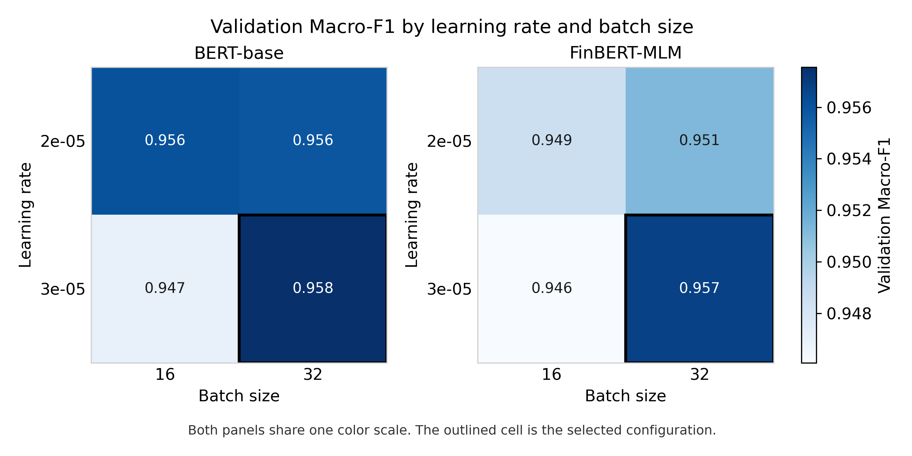
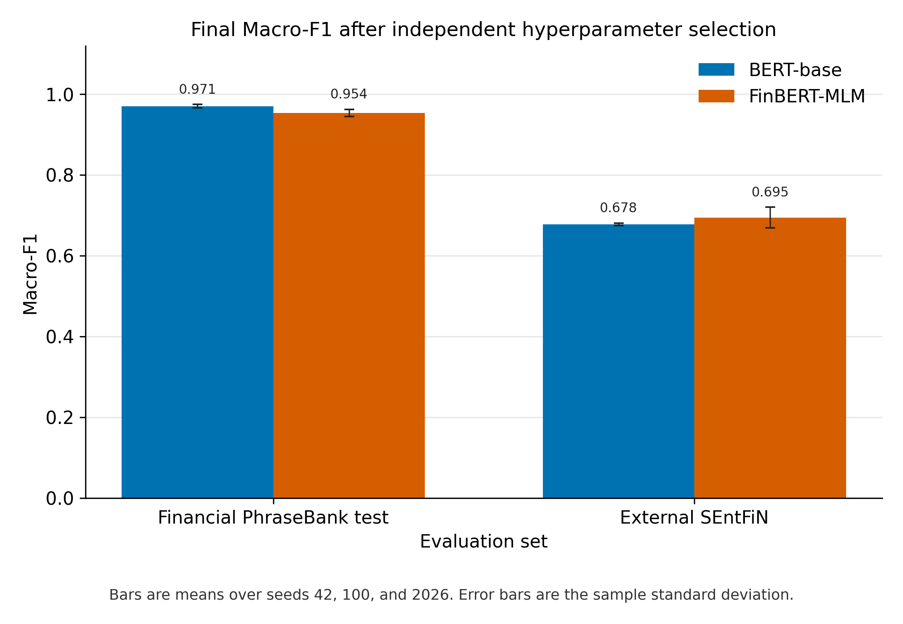
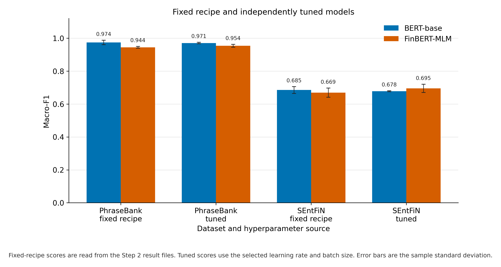
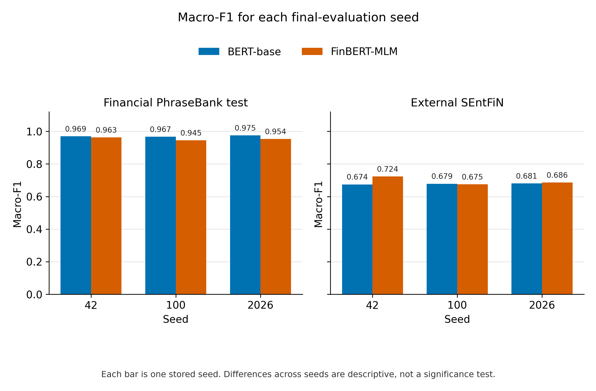

# Tuning results

Selection used seed 42 and validation Macro-F1 only. The final rows are the locked Financial PhraseBank test split and the external SEntFiN holdout. Means use seeds 42, 100, and 2026. The ± term is the sample standard deviation.

## Selected configurations

| Model | Learning rate | Batch size | Validation Macro-F1 |
| --- | ---: | ---: | ---: |
| BERT-base | 3e-05 | 32 | 0.958 |
| FinBERT-MLM | 3e-05 | 32 | 0.957 |

## Final evaluation

| Model | PhraseBank test Macro-F1 | SEntFiN Macro-F1 |
| --- | ---: | ---: |
| BERT-base | 0.971 ± 0.004 | 0.678 ± 0.003 |
| FinBERT-MLM | 0.954 ± 0.009 | 0.695 ± 0.025 |

## Interpretation

On the PhraseBank test set, BERT-base has the higher three-seed mean (0.971 versus 0.954 for FinBERT-MLM).
On SEntFiN, FinBERT-MLM has the higher three-seed mean (0.695 versus 0.678 for BERT-base).
These comparisons describe the stored runs. They are not a significance test, and the seed-level differences in Figure 4 should not be read as statistically significant.
The original bars use the fixed recipe stored in the Step 2 result files (learning rate 2e-05, batch size 16). The tuned bars use the configuration selected independently for each model.
On the PhraseBank test set, the BERT-base minus FinBERT-MLM gap is 0.029 under the fixed recipe and 0.017 after independent tuning. On SEntFiN, the same gap is 0.016 under the fixed recipe and -0.017 after independent tuning.

## README images

